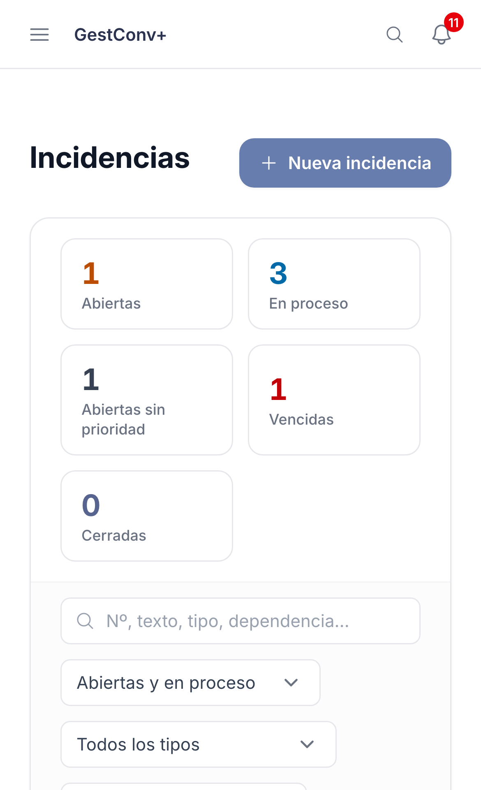
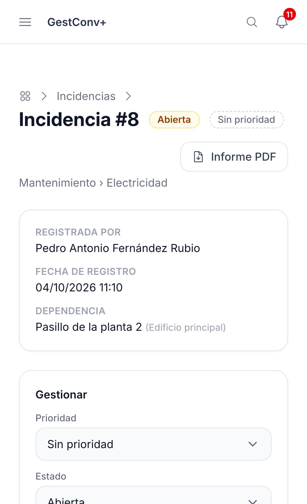
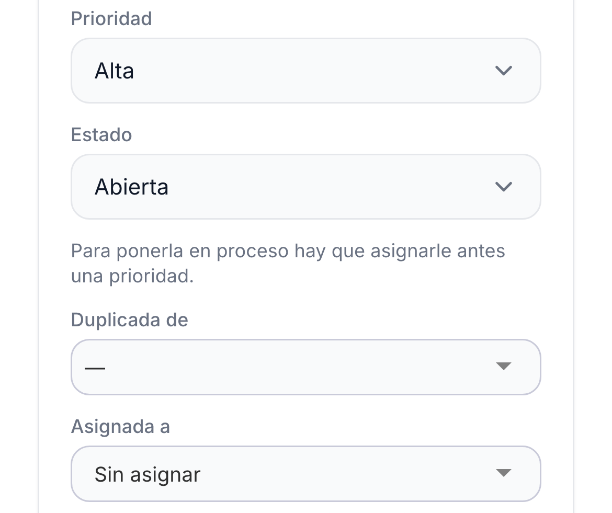
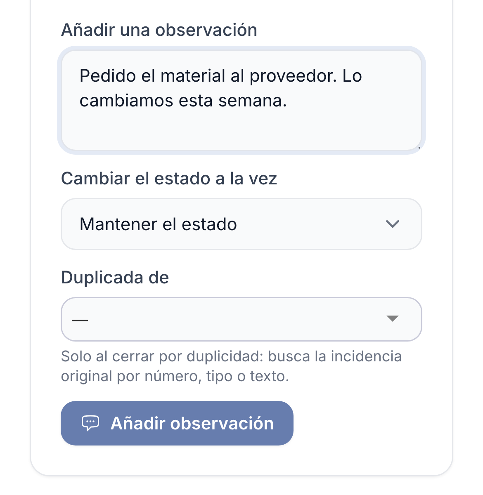

GestConv+ · Ficha rápida · Responsables de incidencias

# Atender una incidencia (responsable del tipo)

  1
  

    
Abre <strong>Incidencias</strong>: las cifras indican cuántas hay <strong>abiertas</strong>, <strong>sin prioridad</strong> y <strong>vencidas</strong>. Pulsa la que quieras atender.

    
  

  2
  

    
La <strong>ficha</strong> muestra quién la registró, la dependencia, la descripción, los adjuntos y el historial. El botón <strong>Informe PDF</strong> genera un documento con todo.

    
  

  3
  

    
En <strong>Gestionar</strong>, asigna una <strong>prioridad</strong> (sin ella no se puede poner <em>en proceso</em>), cambia el <strong>estado</strong> y, si hace falta, <strong>asígnala a una persona</strong> (docente o personal no docente). Pulsa <strong>Guardar</strong>.

    
  

  4
  

    
Deja una <strong>observación</strong> con lo que se ha hecho. Al terminar, cámbiala a <strong>solucionada</strong>, <strong>no procede</strong> o <strong>duplicada</strong> (indicando la original).

    
  

  
Quien tiene la incidencia <strong>asignada</strong> también puede observarla y cambiar su prioridad y su estado. Los avisos llegan a la <strong>campana</strong> y por correo; las <strong>vencidas</strong> se recuerdan cada día.

