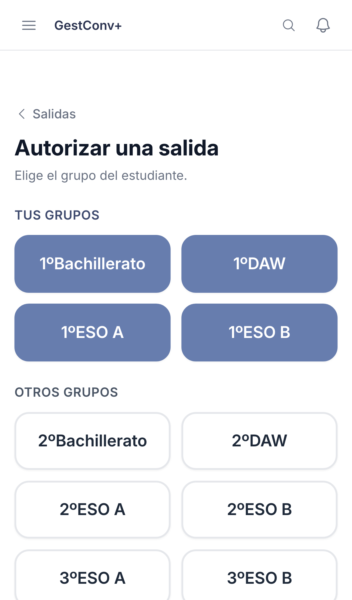
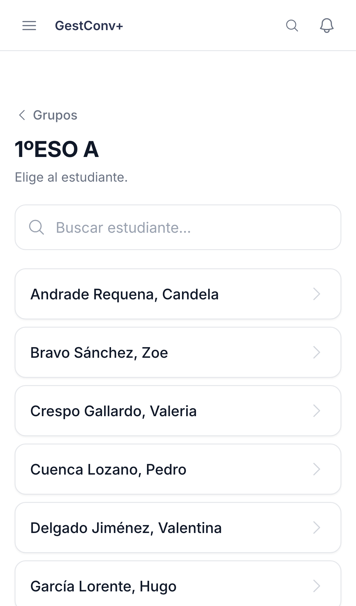
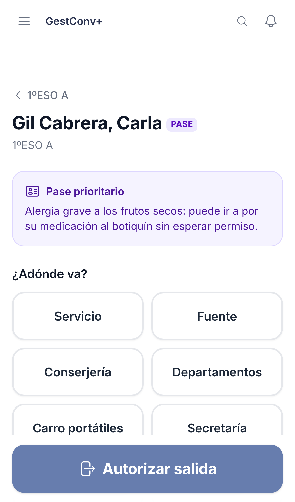
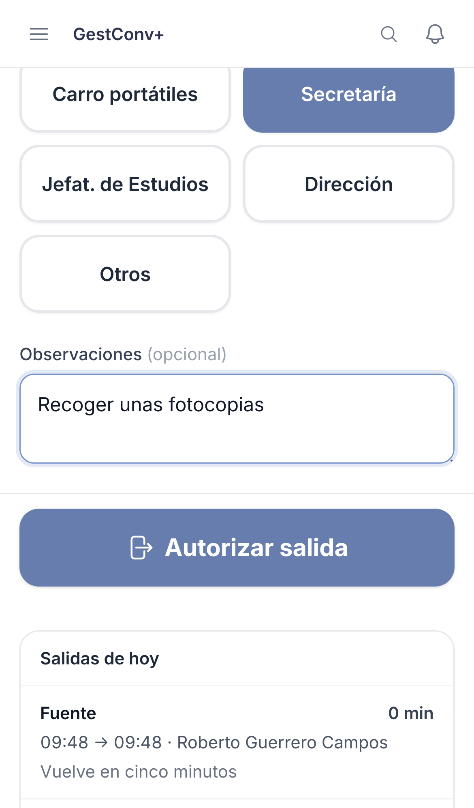

GestConv+ · Ficha rápida

# Autorizar una salida del aula

  1
  

    
Pulsa el botón fijo <strong>Autorizar salida</strong> (o el acceso rápido del inicio) y elige el <strong>grupo</strong>. Primero aparecen <strong>tus grupos</strong>.

    
  

  2
  

    
Toca al <strong>estudiante</strong>. En los grupos grandes escribe unas letras para buscarlo. Si ya está fuera, aparece marcado.

    
  

  3
  

    
Si el estudiante tiene <strong>pase prioritario</strong> (badge <strong>PASE</strong>), lee el aviso: explica el trato especial que necesita. Después elige <strong>adónde va</strong>.

    
  

  4
  

    
Toca el <strong>motivo</strong>, añade una observación si hace falta (es opcional) y pulsa el botón grande <strong>Autorizar salida</strong>. La salida aparece en <strong>Tus salidas ahora</strong>, con el tiempo que lleva fuera.

    
  

  
Un estudiante con una salida abierta no puede volver a salir hasta que se registre su regreso. Los motivos de la cuadrícula los configura el equipo directivo en <strong>Centro educativo</strong>. Al pie de la pantalla del paso 3 ves las salidas de hoy de ese estudiante.

