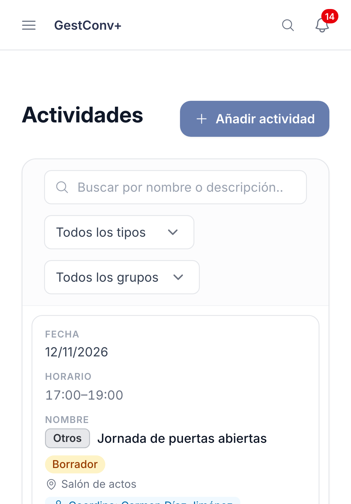
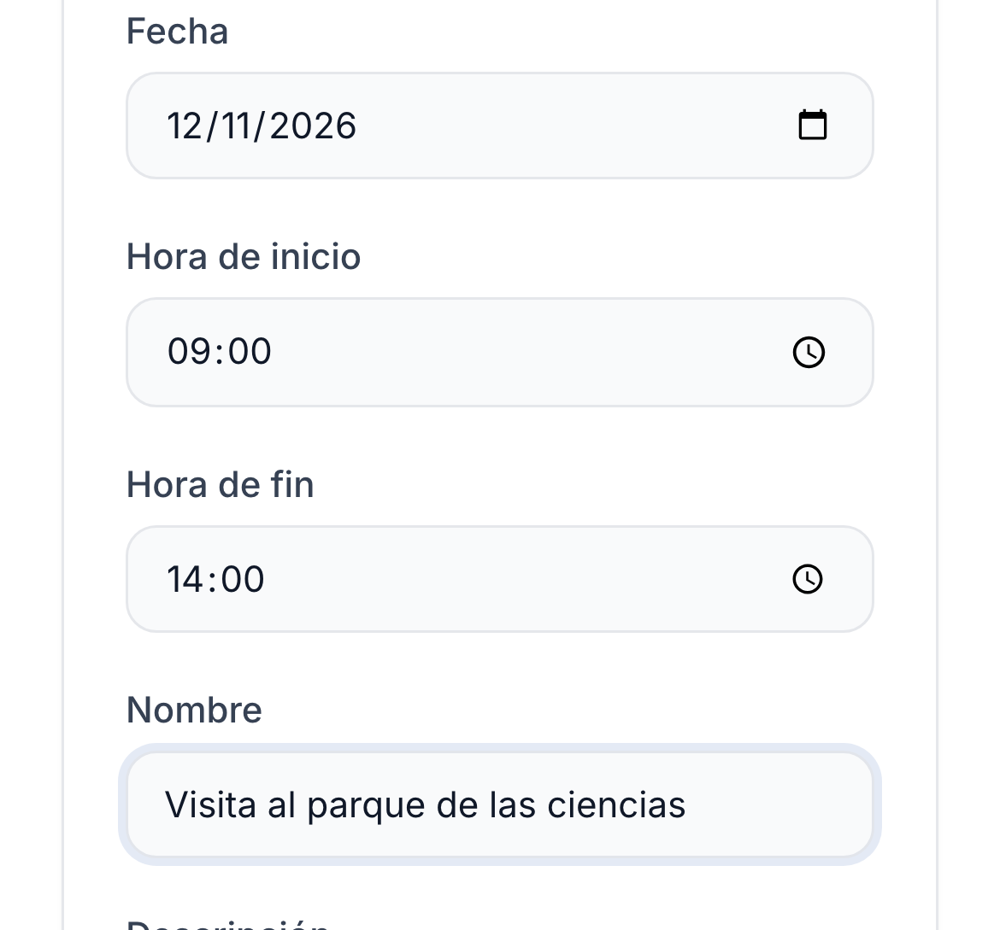
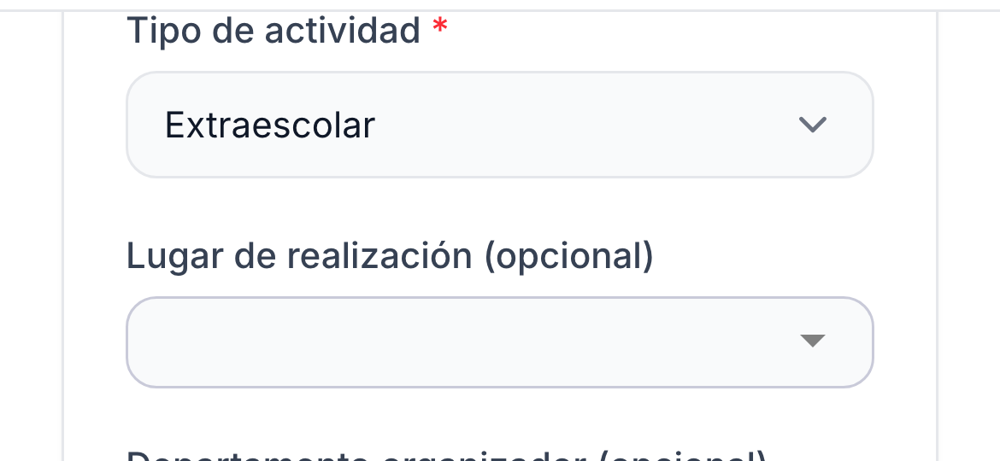
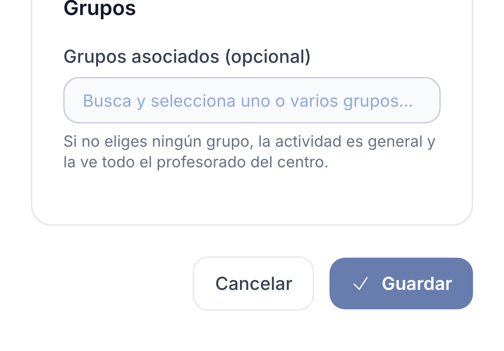

GestConv+ · Ficha rápida

# Crear una actividad de centro

  1
  

    
Abre <strong>Actividades</strong> en el menú y pulsa <strong>Añadir actividad</strong>. (Si no ves el botón, el centro reserva la publicación al equipo directivo o a la coordinación de actividades.)

    
  

  2
  

    
Indica la <strong>fecha</strong>, la <strong>hora de inicio y de fin</strong> y el <strong>nombre</strong>. Si quieres, añade una descripción y un enlace.

    
  

  3
  

    
Elige el <strong>tipo</strong> (complementaria, extraescolar…) y el <strong>lugar</strong>: el desplegable sugiere las ubicaciones del centro, pero puedes escribir cualquier otro.

    
  

  4
  

    
Elige los <strong>grupos</strong> si solo afecta a algunos (sin grupos, la ve todo el profesorado) y pulsa <strong>Guardar</strong>.

    
  

  
Con grupos puedes hacerla <strong>general</strong> (la ve todo el profesorado) o <strong>restringida</strong> (solo quien los imparte o tutoriza). Como <strong>Borrador</strong> no se muestra en ningún sitio; al <strong>Publicada</strong> aparece en el calendario, las guardias, el tablón y el inicio. Desde su ficha puedes asociar <strong>estudiantes</strong> y generar un <strong>informe en PDF</strong>.

