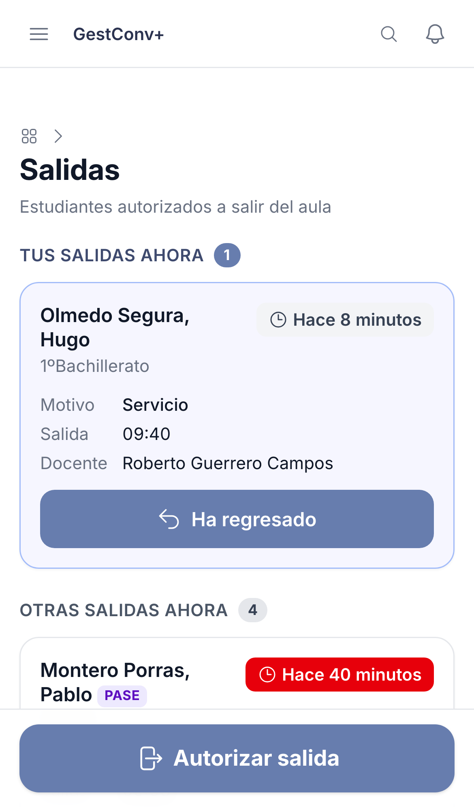
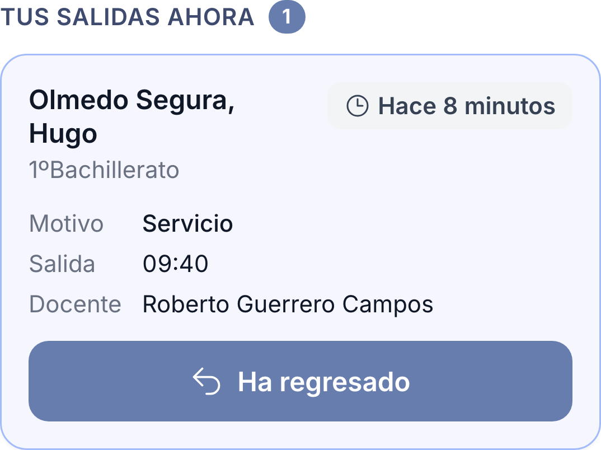
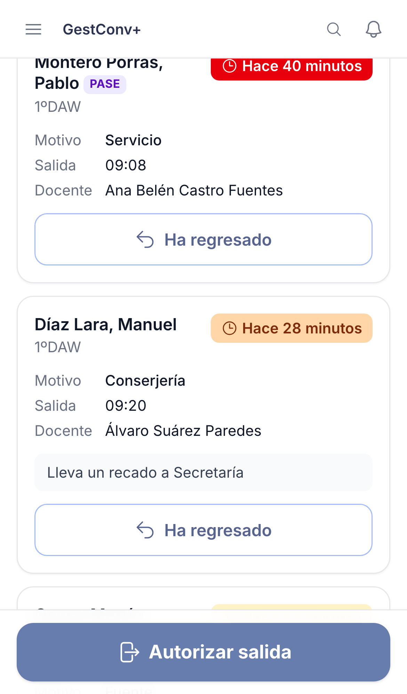
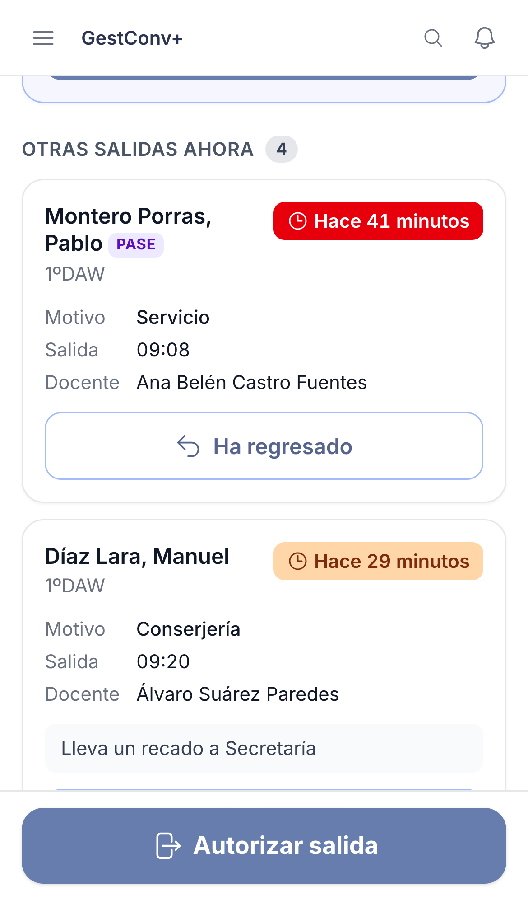

GestConv+ · Ficha rápida

# Quién está fuera y registrar el regreso

  1
  

    
Abre <strong>Salidas</strong> en el menú. Ves, <strong>en tiempo real</strong>, qué estudiantes están fuera del aula; la lista se actualiza sola, sin recargar.

    
  

  2
  

    
Las salidas que has autorizado tú aparecen <strong>arriba y aparte</strong>, con el botón <strong>Ha regresado</strong>. Si no tienes ninguna, esa sección no se muestra.

    
  

  3
  

    
Cada tarjeta indica estudiante, grupo, docente, motivo, hora de salida y <strong>cuánto lleva fuera</strong>. A partir de los <strong>10 minutos</strong> el tiempo se pone <strong>ámbar</strong>; a los 20, <strong>naranja</strong>; a los 30, <strong>rojo</strong>.

    
  

  4
  

    
Cuando el estudiante vuelva, pulsa <strong>Ha regresado</strong>: la salida se cierra y desaparece de la lista.

    
  

  
En las salidas de <strong>otros docentes</strong> el botón <strong>Ha regresado</strong> solo aparece si eres tutor/a del grupo del estudiante, equipo directivo o administración. El badge <strong>PASE</strong> marca a los estudiantes con pase prioritario. En la ficha de cada estudiante tienes el historial de sus salidas.

