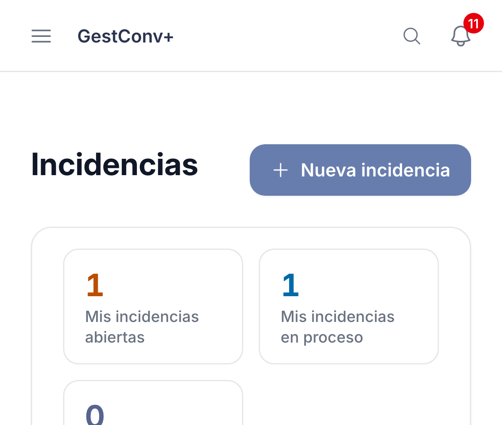
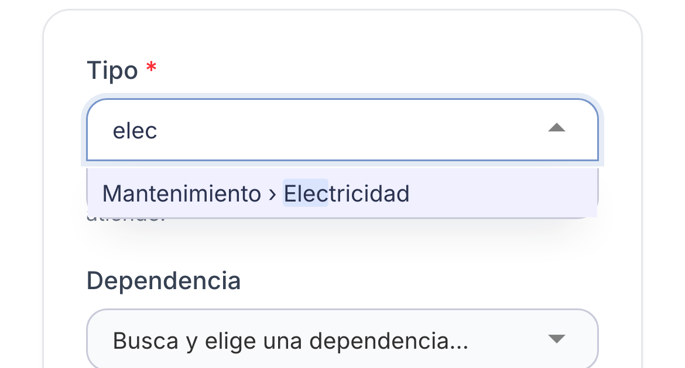
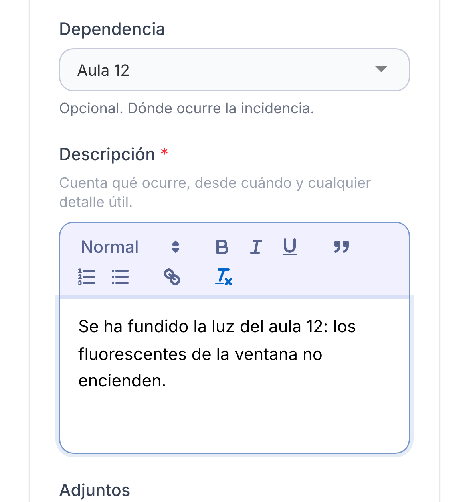
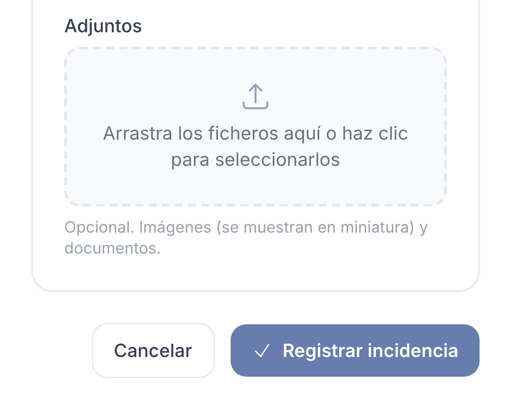

GestConv+ · Ficha rápida

# Registrar una incidencia (avería, desperfecto, problema del centro)

  1
  

    
Abre <strong>Incidencias</strong> en el menú (o <strong>Nueva incidencia</strong> en el inicio, o el buscador <strong>Ctrl/⌘ + K</strong>) y pulsa <strong>Nueva incidencia</strong>.

    
  

  2
  

    
Elige el <strong>tipo</strong>: escribe unas letras para buscarlo en la lista (por ejemplo, <em>Mantenimiento › Electricidad</em>). Elige el más concreto posible: <strong>decide quién la atiende</strong>.

    
  

  3
  

    
Si quieres, indica la <strong>dependencia</strong> (dónde ocurre). Escribe la <strong>descripción</strong> (obligatoria): qué pasa, desde cuándo y cualquier detalle útil.

    
  

  4
  

    
Adjunta <strong>fotos</strong> o documentos si ayudan (opcional: las imágenes se ven en miniatura). Pulsa <strong>Registrar incidencia</strong>: se avisa a las personas responsables del tipo.

    
  

  
Una incidencia nueva está <strong>Abierta</strong> y sin prioridad; los responsables le asignan una, la ponen <strong>en proceso</strong> y la cierran como <strong>solucionada</strong>, <strong>no procede</strong> o <strong>duplicada</strong>. La ves tú y tus responsables; sigues su estado en <strong>Incidencias</strong>, en la <strong>campana</strong> y por correo, y puedes añadir <strong>observaciones</strong> y más adjuntos desde su ficha. Si es sobre un <strong>recurso reservado</strong>, regístrala desde la ficha de la reserva (<strong>Registrar incidencia</strong>): no pide la dependencia.

