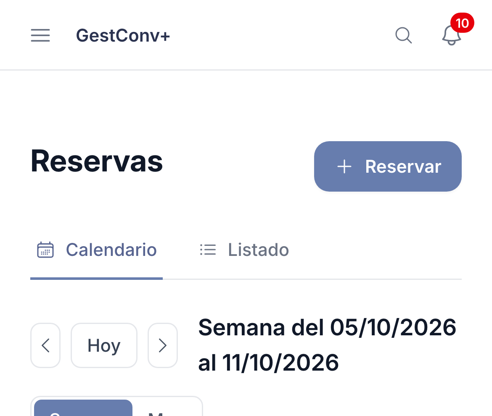
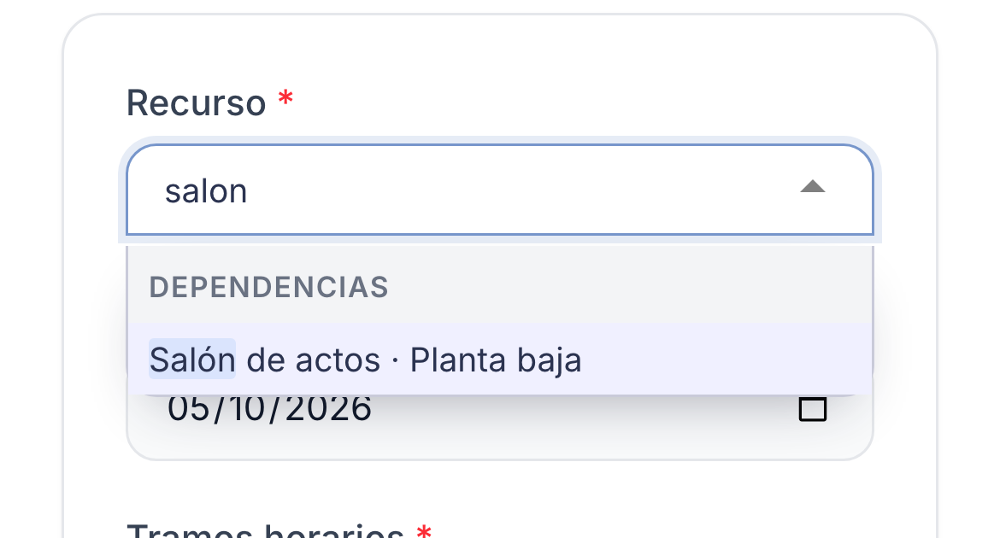
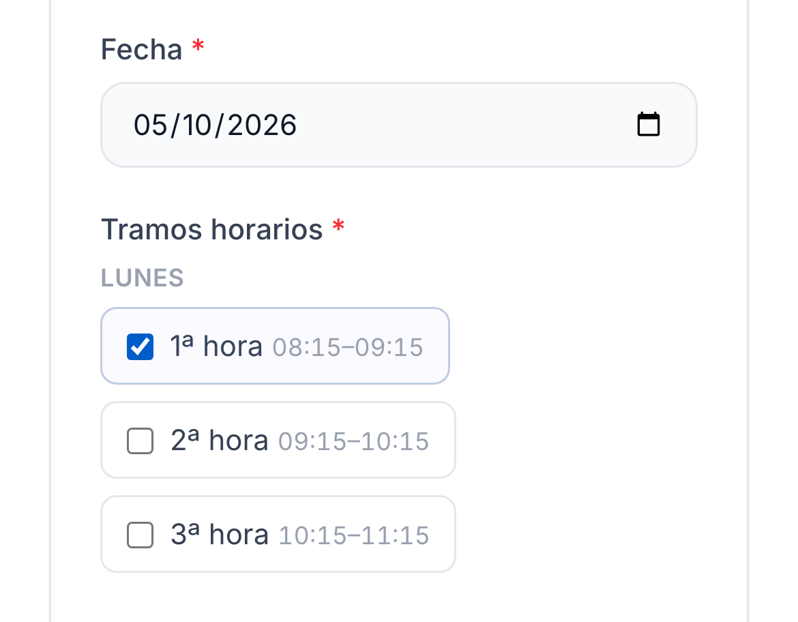
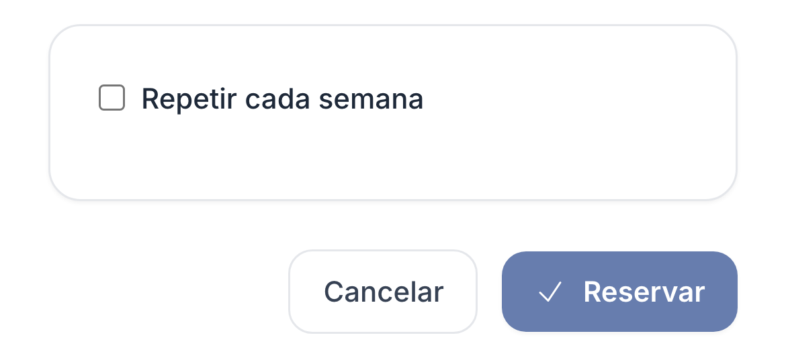

GestConv+ · Ficha rápida

# Reservar un recurso (aula, carro de portátiles…)

  1
  

    
Abre <strong>Reservas</strong> en el menú: el <strong>calendario</strong> muestra lo libre y lo ocupado por tramos, y se actualiza solo. Pulsa <strong>Reservar</strong> (o el <strong>+</strong> de un día).

    
  

  2
  

    
Elige el <strong>recurso</strong>: escribe unas letras para buscarlo, agrupados por categoría. Solo salen los que puedes reservar.

    
  

  3
  

    
Elige la <strong>fecha</strong> (no puede ser un día no lectivo) y marca uno o varios <strong>tramos horarios</strong>: solo se ofrecen los de ese día de la semana.

    
  

  4
  

    
Añade <strong>grupos</strong> o una descripción si quieres (opcional). Para repetirla, marca <strong>Repetir cada semana</strong> y la fecha final; antes de guardar verás qué fechas están libres. Pulsa <strong>Guardar</strong>.

    
  

  
Un recurso admite <strong>una sola reserva por día y tramo</strong>. En algunas categorías un responsable debe <strong>validar</strong> la reserva: queda <strong>pendiente</strong> (y ocupa el tramo) hasta que la aprueba o rechaza, y te avisa. Puedes editarla o eliminarla desde su ficha, o toda la serie si es periódica. <strong>¿Algo ha fallado al usar el recurso?</strong> Abre tu reserva, describe el problema y pulsa <strong>Registrar incidencia</strong>: se avisa a los responsables (y solo tú, ellos y el equipo directivo la veis) y recibirás su respuesta en la campana y por correo.

