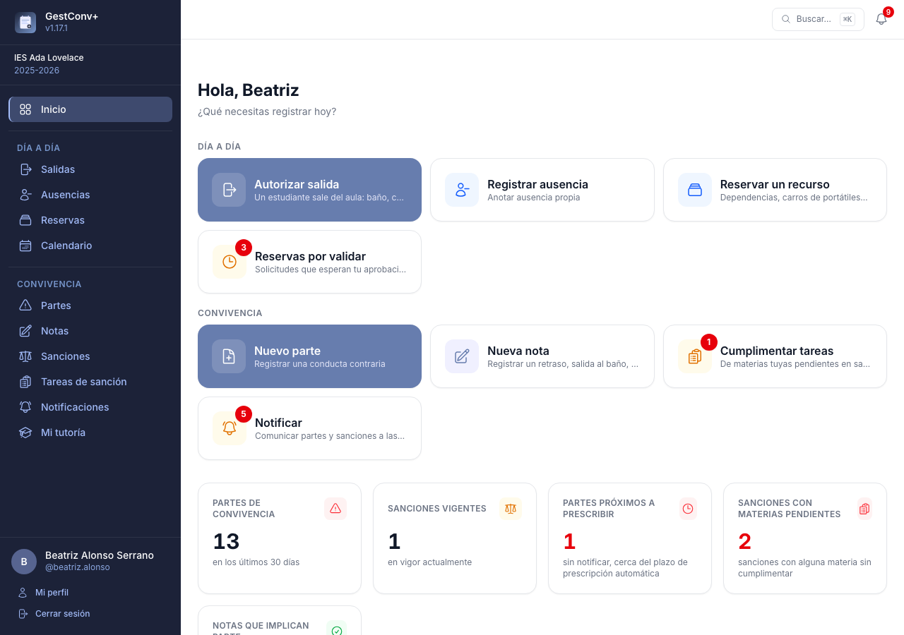
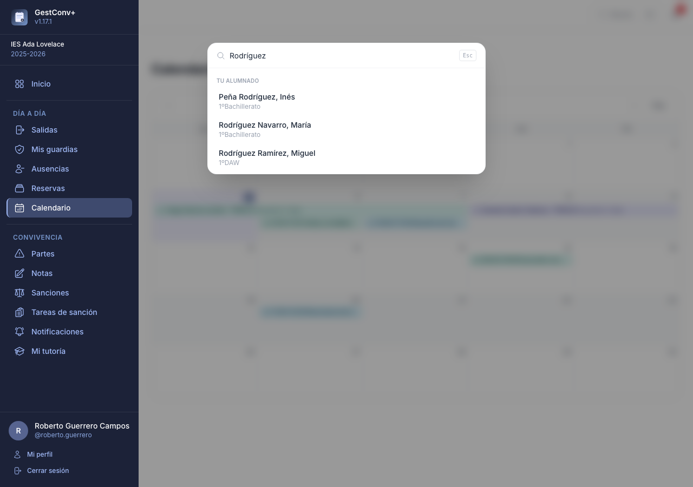

# Usar la aplicación

Este capítulo es para todas las personas que usan GestConv+, sea cual sea su perfil: cómo está
organizado el menú, qué muestra la pantalla de inicio, cómo buscar y moverse con rapidez, y cómo
usar la aplicación desde el móvil. Cada módulo (convivencia, salidas, ausencias y guardias,
reservas, incidencias y calendario) tiene después su propio capítulo; la
[introducción](index.md#como-usar-este-manual) indica cuál le interesa a cada perfil.

## Cómo está organizado el menú

El menú lateral agrupa las secciones por lo que se hace con ellas, y solo muestra las que el perfil
puede usar (un grupo sin ninguna entrada visible no aparece):

- **Inicio**, suelto arriba.
- **Día a día** — lo que se usa en mitad de la clase, también desde el móvil: **Salidas**,
  **Guardias**, **Ausencias**, **Reservas**, **Incidencias** y **Calendario**.
- **Convivencia** — **Partes**, **Notas**, **Sanciones**, **Tareas de sanción**,
  **Notificaciones** y **Mi tutoría**. Es el recorrido completo de un incidente: se registra, se
  sanciona si procede, se cumplen las tareas y se informa a la familia.
- **Gestión** — **Informes** y **Centro educativo**, solo para el equipo directivo y la
  administración. **Administración** (solo administradores globales) queda aparte, al final.

## La pantalla de inicio

El panel de inicio muestra un resumen del curso activo, adaptado al perfil de quien entra.

En la parte superior están los **accesos rápidos**: botones grandes, uno por cada acción habitual,
que solo aparecen para quien puede realizarlas. Siguen los mismos dos bloques y el mismo orden que
el menú lateral (ver [Cómo está organizado el menú](#como-esta-organizado-el-menu)). En el móvil son
baldosas compactas, de dos en dos, para llegar a cada acción con un solo toque; en pantallas mayores
son tarjetas con una línea de ayuda y se reparten en tantas columnas como caben.

**Día a día**

- **Autorizar salida** — todo el profesorado; para [dejar salir a un estudiante del
  aula](07-salidas.md).
- **Guardias** — quien tiene guardia en algún tramo del curso, o la administración del centro.
- **Registrar ausencia** — todo el profesorado.

**Convivencia**

- **Nuevo parte** — todo el profesorado.
- **Nueva nota** — todo el profesorado; para registrar un [aviso de comportamiento del día a
  día](04-convivencia-profesorado.md#notas) sin abrir un parte.
- **Nueva sanción** — solo quien puede registrar sanciones.
- **Cumplimentar tareas** — visible para cualquier docente con grupos de materia, con un contador
  de sus propias [tareas de sanción](04-convivencia-profesorado.md#tareas-de-sancion) pendientes.
- **Notificar** — con un contador en rojo si hay algo pendiente de comunicar; en gris y sin
  contador cuando no queda nada pendiente.

Las acciones más frecuentes también están en la paleta de comandos (`Ctrl+K` / `⌘K`): autorizar
una salida, ver quién está fuera, crear un parte o una nota, ir a notificaciones o cambiar de curso.

Debajo, las tarjetas de estadísticas:

- **Partes de convivencia** — registrados en los últimos 30 días y accesibles para ese docente.
- **Sanciones vigentes** — sanciones en vigor en el día de hoy.
- **Partes próximos a prescribir** — partes sin notificar cuya prescripción automática está
  próxima, según el plazo configurado para el centro. Solo se muestra si esa función está
  activada en los ajustes.
- **Sanciones próximas a prescribir** — como la anterior, pero para sanciones sin notificar. Solo
  se muestra si el centro ha activado la
  [prescripción de sanciones](06-convivencia-administracion.md#prescripcion-de-sanciones-sin-notificar)
  (por defecto no prescriben).
- **Sanciones con materias pendientes** — visible para administradores, comisión de convivencia,
  orientación y tutores/as: cuántas sanciones del curso tienen alguna materia de [tareas de
  sanción](04-convivencia-profesorado.md#tareas-de-sancion) sin cumplimentar. Enlaza al listado de sanciones con el filtro
  correspondiente ya aplicado.
- **Notas que implican parte** — visible para administradores y tutores/as: cuántos estudiantes
  han alcanzado el umbral de ocurrencias de un tipo de nota activa. Enlaza a la pestaña
  [Listado de estudiantes](04-convivencia-profesorado.md#listado-de-estudiantes) de la sección Notas.

A continuación, las **sanciones en vigor en tus grupos** de esta semana y la próxima, visible para
quien imparte materia en algún grupo.

Si hay alguna, una tarjeta **Actividades de hoy** lista las [actividades de
centro](11-calendario-actividades-y-tablon.md#actividades-de-centro) del día, con su tipo: las generales
para cualquier docente, o las restringidas a algún grupo que se imparte o tutoriza; los
administradores y la coordinación de actividades ven además las restringidas a grupos ajenos. Cada tarjeta enlaza a la
[vista de detalle de ese día](11-calendario-actividades-y-tablon.md#vista-de-detalle-de-un-dia).

Y por último:

- **Últimos partes** — los seis partes más recientes accesibles para el docente, cada uno con su
  estado (*Notificado* / *Pendiente de notificar*).
- **Alumnado con partes pendientes de sanción** — visible para administradores, comisión de
  convivencia y orientación: los estudiantes con más partes ya notificados y todavía sin sanción.
  Cada nombre enlaza con su [ficha del estudiante](04-convivencia-profesorado.md#ficha-del-estudiante).
- **Tus grupos** — visible para los tutores/as sin los perfiles anteriores: sus grupos
  tutorizados y el número de estudiantes de cada uno.

Si el curso activo todavía no tiene estudiantado matriculado, las tarjetas se sustituyen por un
aviso con acceso directo a importar estudiantes (para quienes administran el centro).

### Cambio de curso académico (administradores)

Los administradores de centro y globales pueden consultar cursos académicos anteriores sin
modificar el curso activo, con el selector de curso de la cabecera del menú lateral. Al
visualizar un curso histórico, la aplicación muestra un aviso en ámbar y bloquea las operaciones
de escritura.

## Búsqueda global y paleta de comandos

El campo **Buscar…** de la cabecera abre una paleta de búsqueda que también puede invocarse con
el atajo de teclado **Ctrl+K** (**⌘K** en Mac) desde cualquier pantalla. Los resultados se
agrupan por tipo y se filtran mientras se escribe, sin distinguir mayúsculas ni tildes:

- **Estudiantes** — cada resultado muestra el grupo del estudiante y abre su
  [ficha](04-convivencia-profesorado.md#ficha-del-estudiante). Se muestran todos los del centro, separados entre **Tu
  alumnado** (a quienes se imparte clase o se tutoriza) y **Otro alumnado**; sobre estos últimos
  la ficha no muestra datos de contacto ni el historial de convivencia, solo las notas diarias.
- **Docentes** — solo para administradores.
- **Acciones** — accesos directos a **Nuevo parte**, **Ir a notificaciones** y **Cambiar de
  curso** (esta última requiere permisos de administración). Si la sección de
  [Reservas](09-reservas.md) está habilitada para el centro, también **Reservar recurso** y **Ver el
  calendario de reservas** (no se ofrecen al consultar un curso pasado).

## Uso con teclado y cambios sin guardar

- Al pulsar **Tab** nada más cargar una pantalla aparece el enlace **Saltar al contenido
  principal**, que lleva directamente al contenido sin recorrer antes el menú lateral.
- Si empiezas a rellenar un formulario (parte, sanción, ausencia, actividad, nota, actividad de centro, ficha
  de estudiante o tarea de sanción) y intentas salir de la página sin guardar —cerrar la pestaña,
  recargar o seguir un enlace—, el navegador pide confirmación antes de descartar los cambios. Al
  guardar el formulario, o si no has modificado nada, no se muestra ningún aviso.

## La aplicación en el móvil

GestConv+ funciona como una aplicación web progresiva: se puede añadir a la pantalla de inicio
del móvil como si fuera una app nativa, con su propio icono y sin la barra de direcciones del
navegador. No requiere descargarla de ninguna tienda ni instalar nada aparte.

**Android (Chrome)**

1. Abre la aplicación con Chrome desde el móvil.
2. Toca el menú ⋮ (arriba a la derecha) y selecciona **Instalar aplicación** (o **Añadir a
   pantalla de inicio**, según la versión). En muchos casos Chrome ofrece directamente un aviso
   para instalarla.
3. Confirma tocando **Instalar**.

**iPhone / iPad (Safari)**

1. Abre la aplicación con Safari; es imprescindible usar Safari, ya que en iOS ningún otro
   navegador puede añadir aplicaciones a la pantalla de inicio.
2. Toca el icono de compartir (el cuadrado con una flecha hacia arriba) en la barra inferior.
3. Selecciona **Añadir a pantalla de inicio** y confirma con **Añadir**.

En ambos casos queda un icono de GestConv+ en la pantalla de inicio del dispositivo que abre la
aplicación a pantalla completa.
