# Convivencia: el trabajo del profesorado

Este capítulo es para todo el profesorado: registrar un parte de convivencia cuando se produce un
incidente, anotar avisos del día a día, comunicarlo a la familia, consultar la trayectoria de un
estudiante y cumplimentar las tareas de una sanción. No hace falta ningún permiso especial para
nada de lo que se explica aquí. La tramitación de las sanciones está en
[Convivencia: la comisión](05-convivencia-comision.md) y la configuración del módulo, en
[Convivencia: la administración](06-convivencia-administracion.md).

!!! warning "La regla de oro"
    Un parte **sin comunicación a la familia no puede incorporarse a una sanción** y, pasado un
    plazo, prescribe. Registrar el parte es solo la mitad del trabajo: la otra mitad es dejar
    constancia de que la familia ha sido informada.

## Partes de convivencia {#partes-de-convivencia}

La sección **Partes** del menú lateral permite registrar y consultar los partes del curso activo.
Cada docente ve, como mínimo, los partes que ha registrado; las tutorías y los perfiles
especiales amplían esa visibilidad (ver [Permisos de un vistazo](15-permisos-de-un-vistazo.md)).

### Registrar un nuevo parte {#registrar-un-nuevo-parte}

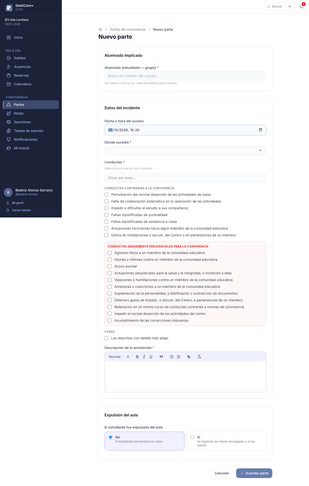

1. Pulsa **Nuevo parte** en la esquina superior derecha de la sección o desde el acceso rápido
   del inicio.
2. **Alumnado implicado** — escribe el nombre o el NIE del estudiante en el campo de búsqueda; el
   desplegable muestra cada estudiante con su grupo. Si en el incidente participaron varios
   estudiantes (incluso de grupos distintos), selecciónalos todos: se creará un parte
   independiente para cada uno con los mismos datos.

   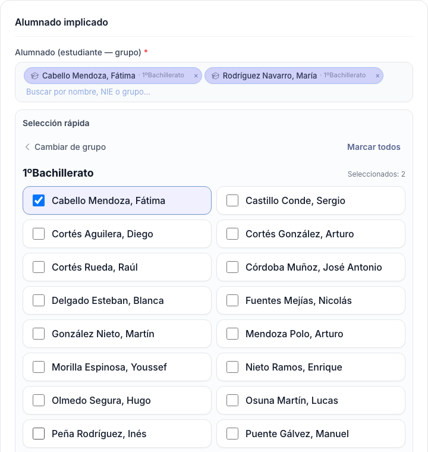

   **Selección rápida.** Debajo del buscador aparecen botones con tus grupos (los que impartes o
   tutorizas), pensados para elegir con pocos toques incluso en la pantalla de un móvil. Pulsa un
   grupo y se listan sus estudiantes: marca uno o varios, o usa **Marcar todos** / **Quitar todos**.
   **Cambiar de grupo** vuelve a los botones, y puedes marcar estudiantes de varios grupos. El botón
   **Otros** despliega el resto de los grupos del centro; si no impartes ni tutorizas ninguno, se
   ven todos directamente. En cuanto escribes en el buscador, los botones y la lista desaparecen
   para dejar sitio a los resultados, y los estudiantes ya elegidos siguen marcados como etiquetas
   en el propio buscador; al vaciarlo, la selección rápida vuelve. Está activada por defecto; el
   ajuste **Selección rápida de alumnado** (categoría **Visualización**, común a los formularios de
   parte y de [nota](#registrar-una-nota-nueva)) permite
   desactivarla para toda la plataforma, para un centro o para ti (ver
   [Ajustes disponibles](13-administrar-la-plataforma.md#ajustes-disponibles)).

   **Antecedentes.** Al elegir a un estudiante, justo debajo aparece una tarjeta con un resumen de su
   situación: los **partes del último mes** (y cuántos incluyen conductas graves), si tiene una
   **sanción vigente** (con su fecha de fin) y sus **notas activas** por tipo, con un enlace a su
   [ficha](#ficha-del-estudiante). Hay una tarjeta por estudiante, hasta cinco; con más estudiantes
   elegidos no se muestra para no sobrecargar la pantalla. El resumen **solo incluye lo que la ficha
   enseñaría a ese mismo docente**: si no tienes relación con el estudiante (no le das clase, no lo
   tutorizas y no administras el centro) solo verás los partes y sanciones que tú hayas registrado, y la
   tarjeta no afirma que «no tiene partes», porque no puedes verlos todos. Las notas activas se muestran
   siempre que la sección Notas esté activada.

3. **Fecha y hora del suceso** — por defecto se rellena con el momento actual; modifícala si el
   parte se registra después del incidente.
4. **Dónde sucedió** — campo obligatorio con el catálogo de lugares del centro
   (ver [Ubicaciones](12-administrar-el-centro.md#ubicaciones)), agrupados por categoría en el
   desplegable.
5. **Conductas** — marca al menos una conducta de las definidas para el centro. Están agrupadas
   en *Contrarias a la convivencia* y *Conductas graves*; los bloques de conductas graves se
   destacan con un recuadro rojo. Un campo de filtro sobre la lista oculta al instante las que no
   coinciden con el texto escrito (sin distinguir mayúsculas ni tildes) y un contador indica
   cuántas hay seleccionadas.
6. **Descripción de lo acontecido** — campo de texto obligatorio, con formato. Describe los
   hechos con detalle.
7. **Expulsión del aula** — elige **Sí** si el estudiante fue expulsado (por defecto está marcado
   **No**). Aparecerán dos campos adicionales: *Tareas encargadas durante la expulsión* y
   *¿Realizó las tareas?* (No se sabe / Sí / No).
8. Pulsa **Guardar parte**. Una pantalla de confirmación muestra los partes creados (uno por
   estudiante) con accesos directos para **notificar a la familia**, **crear otro parte** o
   **volver al listado**.

Los campos obligatorios están marcados con un asterisco; si falta alguno al guardar, cada error
se muestra junto al campo afectado.

> Cada parte queda vinculado al docente que lo registra. La fecha y hora de creación se registran
> automáticamente.

### Listado y filtros

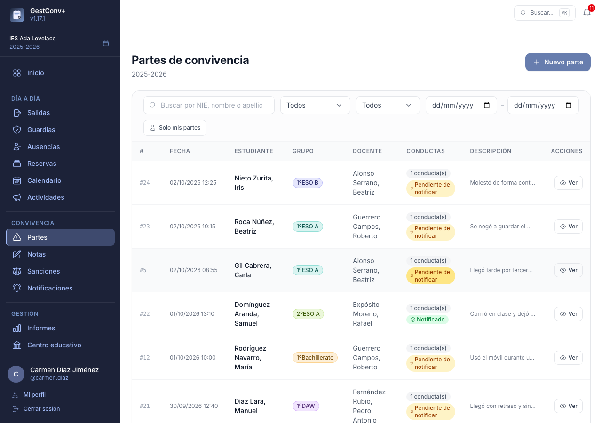

El listado muestra los partes accesibles según el perfil, del más reciente al más antiguo, con
paginación. La primera columna (`#`) es el número de parte dentro del curso académico activo. Los
filtros disponibles son:

| Filtro | Descripción |
|---|---|
| Búsqueda libre | Busca por estudiante, docente, conducta o contenido de la descripción |
| Solo mis partes | Alterna entre ver solo los propios o todos los accesibles |
| Gravedad | Solo partes con conductas graves, solo contrarias, o todos |
| Expulsión | Solo partes con expulsión del aula |
| Rango de fechas | Filtra por fecha del suceso (desde / hasta) |

Cada fila muestra, junto a las conductas, una pastilla con el estado de notificación a la familia
(**Notificado** en verde, o **Pendiente de notificar** en ámbar con enlace directo para registrar
la comunicación si tienes permiso) y, si corresponde, otra pastilla **No sancionable** para los
partes prescritos, que se muestran atenuados en toda la fila.

En pantallas pequeñas, cada fila se muestra como una tarjeta con las etiquetas de campo visibles.

### Ver y editar un parte

Pulsa **Ver** en cualquier fila para abrir el detalle completo del parte. Cualquier docente con
acceso al parte puede añadir **observaciones**: anotaciones con la fecha y hora actuales, el
docente que las registra y un texto con formato. Se muestran en orden cronológico inverso, justo
antes del historial de comunicaciones. Quien registra una observación puede editarla o eliminarla
durante la hora siguiente; pasado ese plazo, solo un administrador puede hacerlo (y es el único
que puede corregir su fecha y hora).

Desde el detalle puedes **editar** el parte si eres quien lo registró o un administrador. El
número de parte (`#1`, `#2`…) es de solo lectura y no cambia al editar. En cuanto el parte se
comunica a la familia, solo un administrador puede seguir editando sus datos; quien lo registró
conserva la posibilidad de gestionar sus observaciones, pero no de modificar el resto de campos.

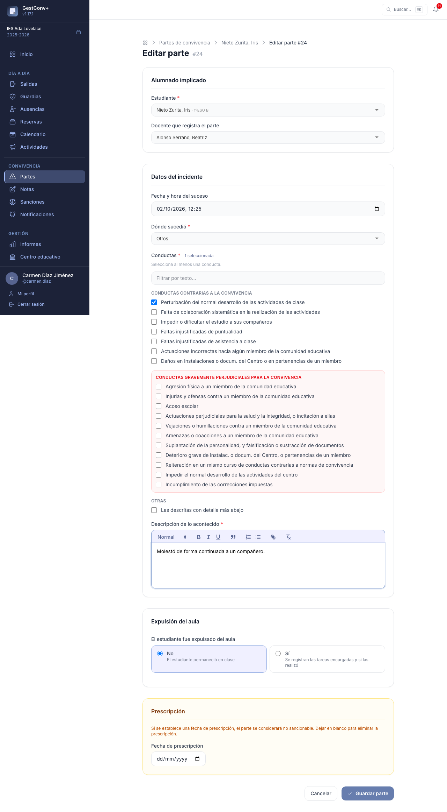

Los administradores pueden además **reasignar el docente y el estudiante** de un parte ya
registrado, y son los únicos que pueden **eliminarlo** definitivamente (una acción irreversible).

Mientras el parte esté pendiente de comunicar a la familia y no esté prescrito, quien tenga
permiso para notificarlo ve también un botón **Notificar** junto a los de editar y eliminar.

## Notas {#notas}

La sección **Notas** del menú lateral permite registrar avisos de comportamiento del día a día
(un retraso, salir al baño, usar el móvil en clase…) sin necesidad de abrir un parte de
convivencia formal. Cada tipo de nota tiene un umbral de ocurrencias configurable por el centro y
una caducidad opcional (ver [Tipos de notas diarias](06-convivencia-administracion.md#tipos-de-notas-diarias)).

!!! note "Quién registra el parte al alcanzar el umbral"
    Cuando un estudiante alcanza el umbral de un tipo de nota, no es cualquier docente quien debe
    registrar el parte de convivencia derivado, sino el tutor/a de su grupo o administración. Por
    eso este aviso no aparece ni en el formulario de alta de una nota ni en la ficha del alumno:
    se gestiona desde la pestaña **Listado de estudiantes** de esta misma sección (ver más abajo),
    y opcionalmente por correo electrónico (ver
    [Avisos por correo](13-administrar-la-plataforma.md#avisos-por-correo)).

### Registrar una nota nueva

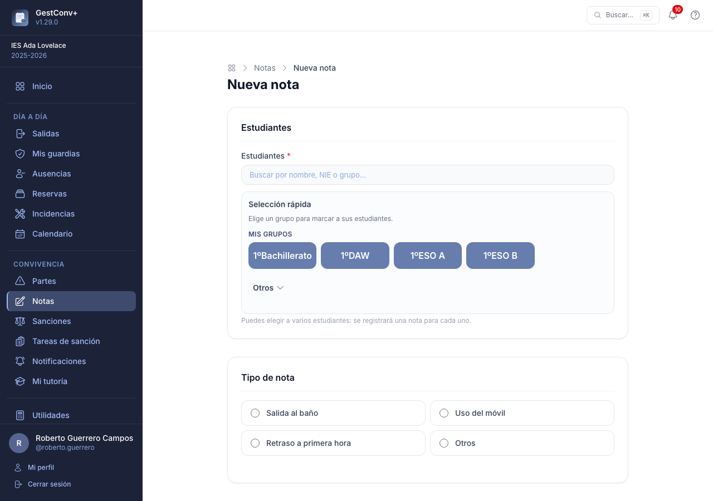

1. Pulsa **Nueva nota** en la sección, en el acceso rápido del inicio o desde la ficha del
   alumno, siempre junto a **Nuevo parte**.
2. **Estudiantes** — escribe el nombre o el NIE en el buscador, o usa la **selección rápida** de
   botones de grupo, que funciona igual que en los [partes](#registrar-un-nuevo-parte). Puedes
   elegir a **varios estudiantes** (hasta 50): se registra **una nota independiente para cada uno**,
   con el mismo tipo y las mismas observaciones, y cada una cuenta por separado para su umbral. Es lo
   más cómodo para anotar, por ejemplo, los cinco retrasos de primera hora de una vez.
3. **Tipo de nota** — elige uno de los tipos activos del centro. Los tipos que, de añadir esta
   nota, alcanzarían el umbral de ocurrencias que dan lugar a parte se muestran resaltados en
   rojo (con varios estudiantes, si lo alcanzaría **cualquiera** de ellos). Al elegir un tipo
   aparece, sin recargar la página, el historial de ese tipo para el
   estudiante seleccionado (con varios estudiantes elegidos solo se muestra al elegir uno) (fecha/hora, docente y observaciones; las notas ya desactivadas se ven
   atenuadas).

   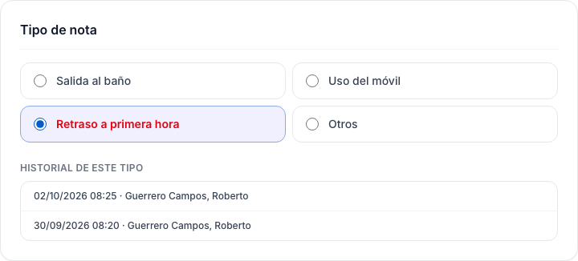

4. **Observaciones** — campo de texto libre, opcional.
5. Pulsa **Guardar**. La pantalla de resumen muestra los datos de la nota y, si el tipo tiene
   umbral configurado, cuántas ocurrencias lleva el estudiante sobre el total; con varios
   estudiantes, una tarjeta por cada uno (el contador se resalta en rojo si ya ha alcanzado el
   umbral). La edición de una nota existente sigue siendo de un solo estudiante.

> La fecha y hora de la nota se registran automáticamente en el momento de guardarla, y no se
> pueden elegir manualmente.

Si accedes como administrador y no impartes clase en el curso académico activo, el campo de
docente aparece vacío para obligar a elegir a quién corresponde la nota, igual que en los partes.

### Listado de notas

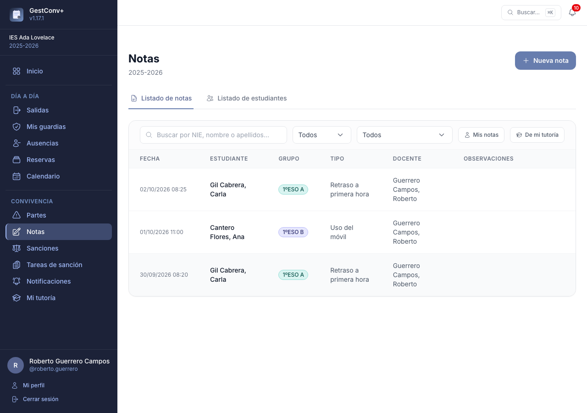

La pestaña **Listado de notas** admite búsqueda libre (estudiante, docente u observaciones),
filtro por grupo (solo se listan los que tienen notas) y por tipo. Cada docente ve, como mínimo,
sus propias notas y las de los grupos que tutoriza; solo los administradores ven todas. Quien
tutoriza algún grupo dispone además de los botones **Mis notas** y **De mi tutoría** para acotar
la vista.

Puedes editar el texto de tus propias observaciones o eliminar una nota propia durante los 30
minutos posteriores a su registro. Pasado ese tiempo, solo un administrador puede modificarla o
eliminarla. Los tutores del grupo del estudiante pueden además marcar cualquier nota como
**desactivada**, para que deje de contar en el umbral sin borrar el registro. Una nota también se
desactiva sola, de forma automática, si su tipo tiene configurada una caducidad y pasan esos días
desde su registro.

La [ficha del estudiante](#ficha-del-estudiante) muestra también un histórico paginado de sus
notas y las ocurrencias acumuladas por tipo.

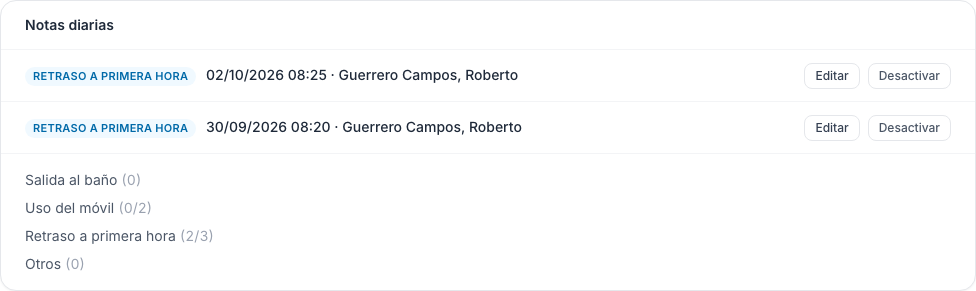

### Listado de estudiantes

La pestaña **Listado de estudiantes**, visible solo para quien tutoriza algún grupo o es
administrador/a de centro, reúne en una tabla a los estudiantes con notas de un tipo elegido con
los radio buttons de la parte superior, con una fila por cada combinación de estudiante y grupo.
Admite los mismos filtros de búsqueda y grupo que el listado de notas. Cada fila muestra cuántas
notas de ese tipo están activas, cuántas desactivadas, y el rango de fechas de las activas; se
resalta en rojo si el número de activas alcanza o supera el umbral del tipo, y en gris si todas
sus notas de ese tipo están ya desactivadas.

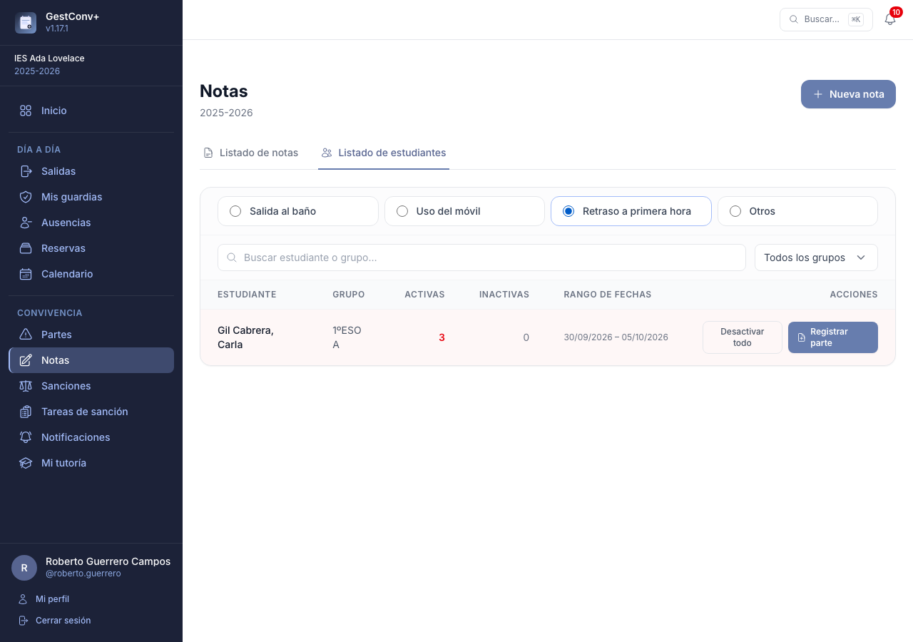

Dos botones por fila:

- **Desactivar todo** — desactiva de golpe todas las notas activas de ese tipo para ese
  estudiante, con confirmación previa.
- **Registrar parte** — abre el formulario de un parte nuevo con el estudiante y el grupo ya
  fijados (no se pueden cambiar). Al guardarlo, se desactivan automáticamente **todas** las notas
  activas del estudiante, de cualquier tipo, y la pantalla de éxito indica cuántas se han
  desactivado.

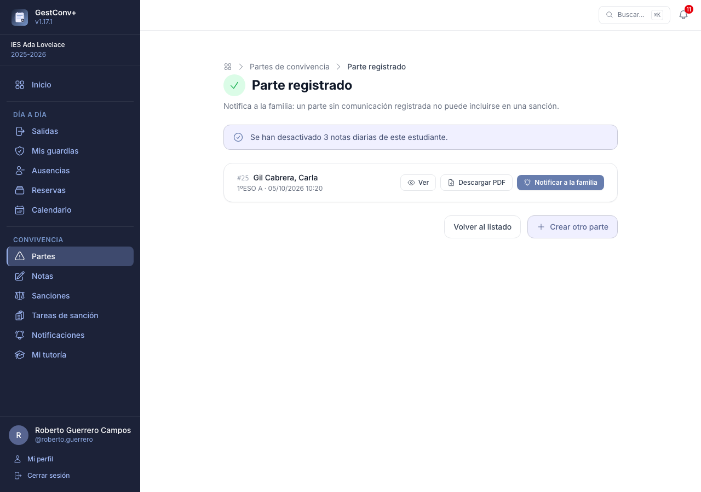

## Notificaciones {#notificaciones}

La sección **Notificaciones** del menú lateral tiene dos pestañas: **Notificaciones pendientes**,
la cola de partes y sanciones cuya familia todavía no ha sido informada, e **Historial de
notificaciones**, con todas las comunicaciones registradas en el curso activo.

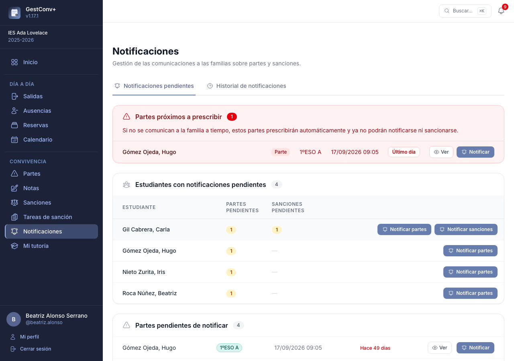

Si hay partes que van a prescribir pronto, la pestaña los destaca arriba del todo en una sección
de fondo rojo, **Partes próximos a prescribir**, con los días que quedan para cada uno y los
botones **Ver** y **Notificar**. Son los mismos que cuenta la tarjeta del inicio y el
[aviso por correo](06-convivencia-administracion.md#aviso-de-prescripcion-proxima) (los que
prescribirán dentro del plazo del ajuste *Aviso de prescripción próxima de partes*) y solo se
muestra si hay alguno y esas funciones están activadas.

Las **sanciones** solo prescriben si el centro lo activa
([Prescripción de sanciones sin notificar](06-convivencia-administracion.md#prescripcion-de-sanciones-sin-notificar);
por defecto no prescriben). Cuando está activado, las sanciones próximas a prescribir aparecen en
la misma sección —que pasa a titularse **Partes y sanciones próximos a prescribir**, o **Sanciones
próximas a prescribir** si solo hay sanciones— con una etiqueta que distingue cada tipo. Una
sanción prescrita sale de las notificaciones pendientes, igual que un parte prescrito.

Los mismos partes y sanciones pendientes de notificar, junto con las [tareas de
sanción](#tareas-de-sancion) propias todavía sin cumplimentar, aparecen también en la campana
**Tareas pendientes** de la cabecera, agrupados en secciones por prioridad:

1. **Próximos a prescribir**: los partes y sanciones que están a punto de prescribir, con los días
   que les quedan, el más urgente primero. Si hay alguno, el contador de la campana se pone en rojo.
   Estos elementos no se repiten en las secciones siguientes.
2. **Partes pendientes** de notificar.
3. **Sanciones pendientes** de notificar.
4. **Tareas de sanción** propias sin cumplimentar.
5. **Notas que dan lugar a parte**, solo para la administración del centro: los estudiantes que han
   alcanzado el umbral de un tipo de nota (ver [Listado de estudiantes](#listado-de-estudiantes)).
   Los tutores ven ese aviso en la tarjeta **Notas que implican parte** del
   [panel de inicio](03-usar-la-aplicacion.md#la-pantalla-de-inicio), no en la campana.

Cada sección muestra sus 4 primeros elementos, ordenados por antigüedad, y una línea «y N más» que
lleva a la pantalla completa; así una sección con muchos elementos no tapa a las demás. Cada
elemento enlaza directamente a su pantalla de registro o de cumplimentación.

Antes de las colas de partes y sanciones, la pestaña muestra los **estudiantes con notificaciones
pendientes** (solo lo que el docente puede notificar), con una columna de partes pendientes y otra
de sanciones pendientes, ordenados de más a menos elementos en total. Cada fila muestra el botón
**Notificar partes** y/o **Notificar sanciones** según de qué tenga pendiente ese estudiante; cada
uno abre su propia pantalla de notificación en bloque (ver más abajo).

Cada elemento de la cola muestra su **antigüedad** (los días transcurridos desde que se
registró), destacada en ámbar a partir de tres días y en rojo a partir de siete, para localizar
de un vistazo los más atrasados.

Los **partes prescritos** (por el paso del plazo o marcados por un administrador) ya no se pueden
comunicar a la familia, así que no aparecen en la cola, en la campana, en el listado de
estudiantes con notificaciones pendientes ni en las pantallas de notificación en bloque. Siguen
visibles en el [listado de partes](#listado-y-filtros), atenuados.

El botón **Notificar** solo aparece en los elementos que ese docente tiene permiso para comunicar
(ver [Quién puede notificar](#quien-puede-notificar)); el resto aparece igualmente en la lista,
sin acción disponible.

### Registrar una comunicación

Pulsa **Notificar** en la fila correspondiente para abrir el formulario de registro, común a
partes y sanciones.

Si el docente tiene permiso para verlos, la pantalla muestra también los **datos de contacto**
del estudiante (tutores legales, teléfonos y observaciones) justo antes del formulario. Quien
registró el parte o la sanción los ve siempre, aunque no sea tutor/a del grupo, para poder
contactar con la familia.

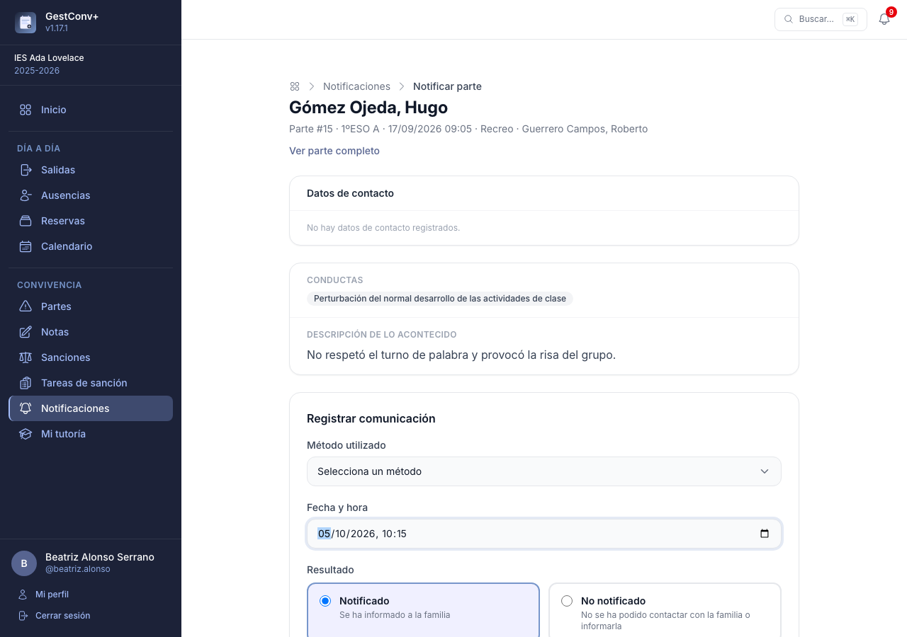

Para un parte, la pantalla incluye además todo su detalle —conductas, descripción, prescripción y
expulsión si las tiene— y sus observaciones, para poder comunicar a la familia todo lo acontecido
sin consultar el parte por separado.

1. **Método utilizado** — uno de los métodos de comunicación activos del centro.
2. **Fecha y hora** — por defecto, el momento actual.
3. **Resultado** — *Notificado* (la familia ha sido informada correctamente) o *No notificado*
   (no se ha podido contactar).
4. **Observaciones** — campo de texto opcional.

Al guardar se vuelve a la cola de notificaciones, lista para continuar con el siguiente elemento.

Cada intento queda registrado en el **historial**, se marque o no como notificado. La primera
comunicación con resultado *Notificado* es la que desbloquea el parte o la sanción; los intentos
posteriores se siguen añadiendo al historial pero no cambian ese estado.

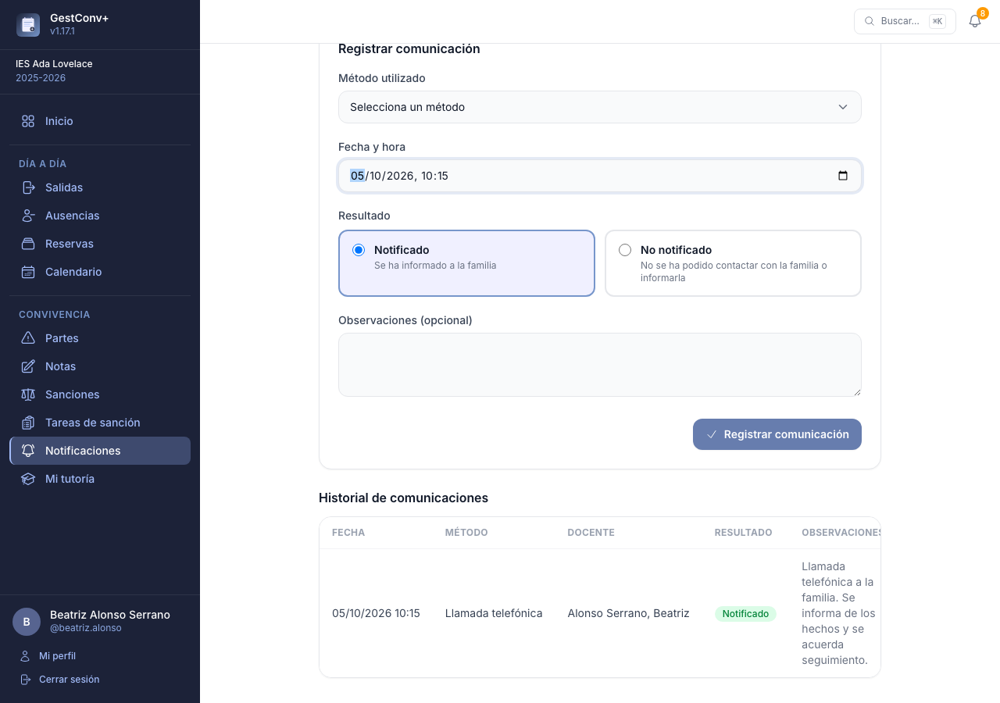

El detalle de un parte o de una sanción muestra un indicador de estado (**Notificado** /
**Pendiente de notificar**) enlazado a esta pantalla de registro.

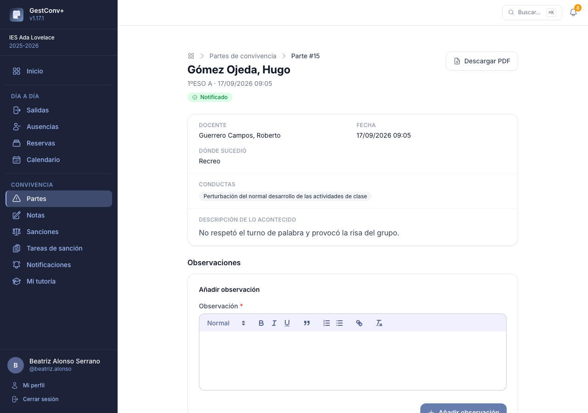

### Notificar varios partes o sanciones a la vez

Desde el listado de **estudiantes con notificaciones pendientes**, la pantalla **Notificar
partes** reúne todos los partes de ese estudiante que el docente puede notificar, cada uno con
una casilla (marcadas todas por defecto) y sus detalles desplegables; **Notificar sanciones** hace
lo mismo con sus sanciones, mostrando las medidas aplicadas y el detalle de cada una. En ambas
pantallas, los datos de la comunicación (método, fecha y hora, resultado y observaciones) se
rellenan una única vez y se aplican a todos los elementos marcados: se crea una comunicación
independiente por cada uno, igual que si se notificaran de uno en uno.

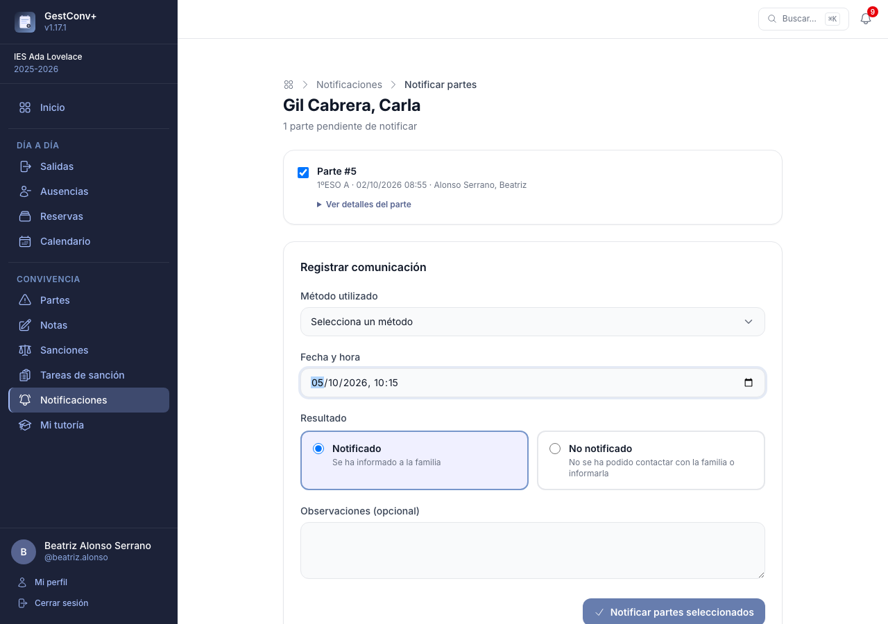

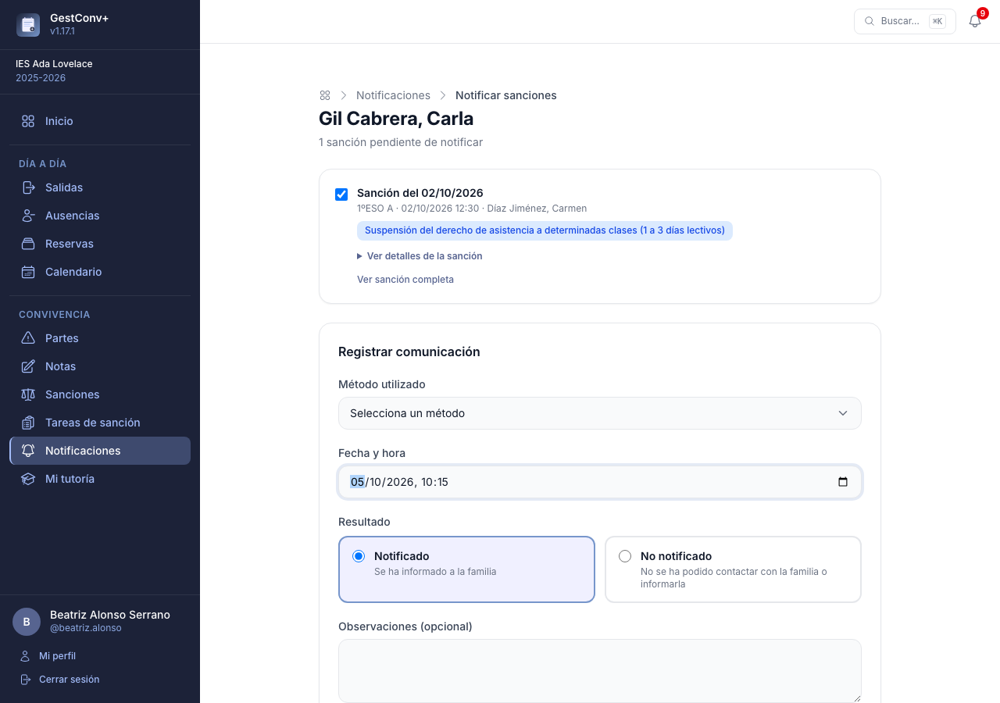

### Historial de notificaciones

La pestaña **Historial de notificaciones** reúne, en una única tabla paginada, todas las
comunicaciones registradas en el curso activo sobre partes y sanciones: fecha, estudiante, grupo,
tipo de elemento, método, docente, resultado y observaciones. Un enlace **Ver** lleva al parte o
sanción correspondiente. Puede filtrarse por texto libre, por tipo de elemento y por resultado.

Un docente sin permisos especiales solo ve las comunicaciones de los partes y sanciones que él
mismo registró o que pertenecen a un grupo del que es tutor/a. Los administradores, la comisión
de convivencia y orientación ven el historial completo del centro.

### Quién puede notificar

Un ajuste por centro determina, además de los administradores, quién puede registrar la
comunicación de un parte y de una sanción, de forma independiente: **quien lo registró**, **el
tutor/a del grupo**, o **ambos** (opción por defecto). Se configura en los ajustes del centro
(ver [Administrar el centro educativo](12-administrar-el-centro.md#ajustes-del-centro)).

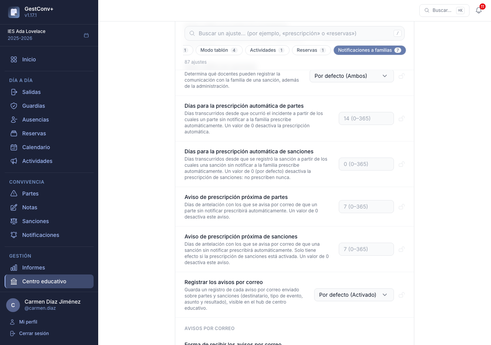

## Ficha del estudiante {#ficha-del-estudiante}

La ficha del estudiante reúne en una sola pantalla toda la información de convivencia de un
estudiante. Su contenido depende de la relación del docente con ese estudiante:

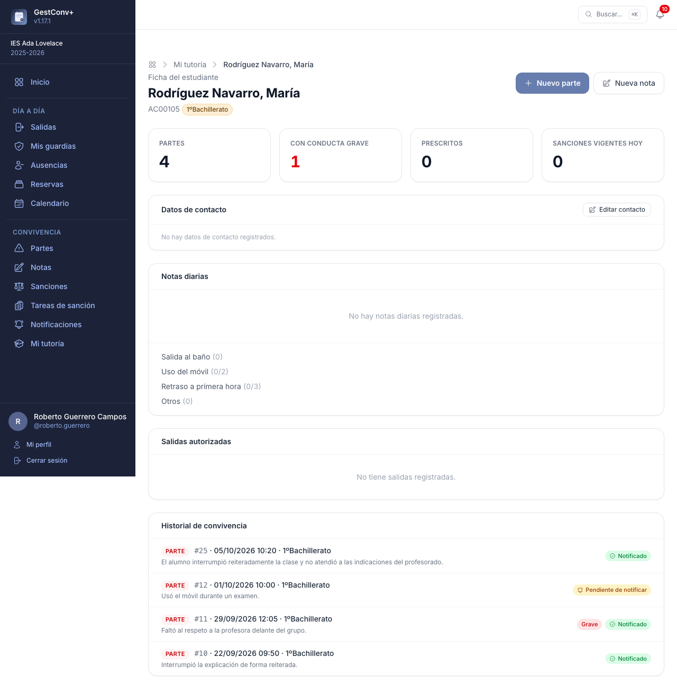

- **Datos básicos** — nombre y grupo. Siempre visibles.
- **Accesos directos** para registrar un nuevo parte o una nueva nota con el estudiante ya
  seleccionado (y una nueva sanción, si se tienen permisos). Siempre visibles.
- **Notas diarias** — el histórico y las ocurrencias por tipo (ver [Notas](#notas)). Siempre
  visibles.
- **Pase prioritario** — si el estudiante lo tiene este curso, su justificación; la administración
  del centro puede concederlo, modificarlo o retirarlo desde aquí (ver [Salidas](07-salidas.md)).
  Visible para cualquier docente que vea la ficha.
- **Salidas autorizadas** — el historial de salidas del aula del estudiante, con el tiempo que
  estuvo fuera en cada una. Siempre visible.
- **Contadores** — partes registrados (indicando cuántos incluyen conductas graves y cuántos han
  prescrito) y sanciones vigentes hoy.
- **Datos de contacto** — tutores legales, teléfonos y observaciones. Solo visibles para los
  administradores, la comisión de convivencia, la orientación y los tutores/as del grupo. El
  tutor/a del grupo del estudiante en el curso activo puede además **editarlos**, con el botón
  **Editar contacto** que abre un formulario en un cuadro de diálogo; el resto de perfiles con
  acceso a estos datos solo puede consultarlos. La edición queda bloqueada mientras se consulta un
  curso académico distinto del activo y cada cambio se registra en el registro de actividad.
- **Historial de convivencia** — los partes y sanciones del estudiante en orden cronológico, cada
  uno con su estado de notificación. Cada docente ve solo los que le permiten sus permisos.

Los dos últimos bloques (**Contadores** e **Historial de convivencia**) solo se muestran si el
docente es administrador, tutor/a o imparte clase al estudiante, o si ha registrado él mismo algún
parte o sanción suyo; para el resto del profesorado la ficha se reduce a los datos básicos, los
accesos directos y las notas diarias.

### Informe de convivencia del estudiante {#informe-de-convivencia-del-estudiante}

El botón **Informe en PDF** de la cabecera de la ficha genera un documento con la situación de
convivencia del estudiante en el curso que estás viendo, útil para reuniones con la familia, sesiones de
evaluación o la comisión de convivencia. Si rellenas **Desde** y/o **Hasta** solo incluye ese periodo; con
las fechas vacías, todo el curso. Contiene, de más antiguo a más reciente:

- los datos del estudiante, su grupo, el periodo y quién genera el informe y cuándo;
- los **datos de contacto de la familia**, solo si tienes permiso para verlos en la ficha;
- un **resumen** (partes, graves, prescritos, sanciones y sanciones vigentes);
- los **partes** con su descripción completa, conductas y estado de notificación, y las **sanciones**
  con sus medidas, vigencia y estado;
- las **notas del día** y las **salidas del aula**, mientras esas secciones estén activadas en el centro.

**El informe nunca incluye más de lo que la ficha te enseña a ti**: cada docente obtiene solo los partes
y sanciones que puede ver, y si no tienes relación con el estudiante el informe lo advierte en lugar de
dar a entender que «no tiene partes». Cada generación queda en el
[registro de actividad](13-administrar-la-plataforma.md#registro-de-actividad).

Se llega a la ficha desde el buscador global, los listados y detalles de partes y sanciones, y la
lista *Alumnado con partes pendientes de sanción* del inicio.

## Mi tutoría {#mi-tutoria}

La sección **Mi tutoría** del menú lateral aparece para cualquier docente que sea tutor/a de al
menos un grupo en el curso académico visualizado, y reúne en una sola tabla todo el alumnado de
sus grupos tutorizados, ordenado por apellidos y nombre:

- **Apellidos, nombre** y **grupo** de cada estudiante.
- **Partes** — total de partes registrados, con el desglose entre normales (N) y graves (G) entre
  paréntesis.
- **Sin notificar** — partes todavía sin comunicar a la familia, sin contar los prescritos (que
  tienen su propia columna).
- **Prescritos** — partes que han prescrito por el paso del plazo.
- **Sanciones** y **Sanciones sin notificar**, con el mismo criterio que los partes (las sanciones
  prescritas no cuentan como pendientes).
- **Sanciones prescritas** — solo si el centro [permite que las sanciones
  prescriban](06-convivencia-administracion.md#prescripcion-de-sanciones-sin-notificar).

Un buscador por nombre o apellidos y un desplegable de grupo permiten filtrar el listado, y
cualquier columna —incluidas las estadísticas— puede usarse para ordenar, alternando entre orden
creciente y decreciente. El botón **Ver ficha** de cada fila lleva a la
[ficha del estudiante](#ficha-del-estudiante), donde el tutor/a puede además editar sus datos de
contacto.

## Tareas de sanción {#tareas-de-sancion}

Cuando una sanción incluye una medida con **rango de fechas** (el estudiante pasa un periodo fuera
de su aula habitual, por ejemplo una expulsión al aula de convivencia o a casa), la aplicación
genera automáticamente una **tarea de sanción** por cada docente que le imparte alguna materia en
ese grupo, para que cada uno deje constancia del trabajo que le corresponde asignar — o indique
que no procede — y el estudiante no se quede atrás. Quien registra la sanción puede elegir
**No solicitar tareas a los docentes** (ver
[Sanciones sin tareas](05-convivencia-comision.md#sanciones-sin-tareas)): en ese caso no se crea ninguna
tarea ni se avisa al profesorado.

La sección **Tareas de sanción** del menú lateral aparece para cualquier docente que imparta
materia a algún grupo en el curso visualizado, y lista sus propias tareas (pendientes primero),
con el estudiante, la materia y el periodo de la sanción de cada una.

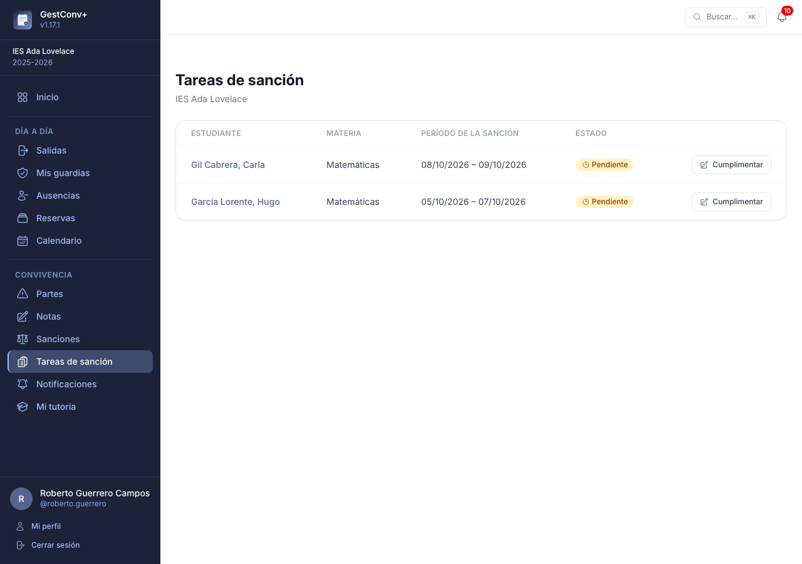

!!! note "Solo tu propia tarea"
    Un docente ve y cumplimenta únicamente las tareas de sus propias materias. No tiene acceso a
    la pantalla completa de la sanción (datos de contacto familiar, observaciones o historial de
    notificación), que sigue reservada a quien ya la veía antes de esta funcionalidad —
    normalmente el tutor/a, la comisión de convivencia, orientación y los administradores (ver
    [Permisos de un vistazo](15-permisos-de-un-vistazo.md#tareas-de-sancion)).

Pulsa sobre cualquier tarea de la lista (el nombre del estudiante o el icono de lápiz) para abrir
su formulario, que muestra también, a modo de contexto, el nombre del estudiante, las fechas de la
sanción, su descripción (si la tiene) y el estado del resto de materias de esa misma sanción (sin
enlace a su contenido). Desde ahí se puede:

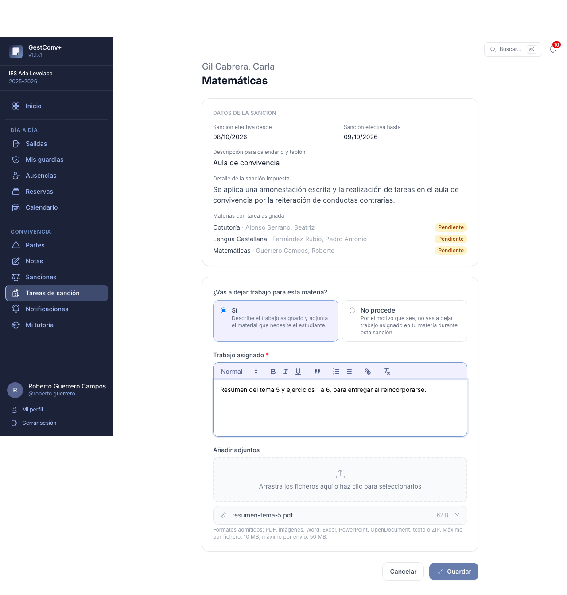

- Redactar el **trabajo asignado** en el editor de texto enriquecido y, opcionalmente, **adjuntar
  ficheros** — mismo límite de tamaño (10 MB por fichero, configurable) y formatos admitidos que en las
  actividades de ausencia.
- Responder **No procede** a la pregunta «¿Vas a dejar trabajo para esta materia?», si por el
  motivo que sea no corresponde asignar nada; en ese caso se vacía cualquier descripción o
  adjunto que hubiera.

Una tarea queda **cumplimentada** la primera vez que se guarda con una descripción o marcando que
no procede, pero sigue siendo editable después sin límite de tiempo: se puede volver a abrir para
corregir el trabajo asignado, añadir o quitar adjuntos, tantas veces como haga falta.

!!! note "Los adjuntos tampoco se conservan indefinidamente"
    Igual que en las actividades de ausencia, un número de días configurable desde el fin de la
    sanción (ver [Tareas de sanción](13-administrar-la-plataforma.md#tareas-de-sancion)) determina
    cuándo una tarea programada elimina automáticamente sus ficheros adjuntos, dejando una nota en
    la descripción con lo que se eliminó y cuándo.

