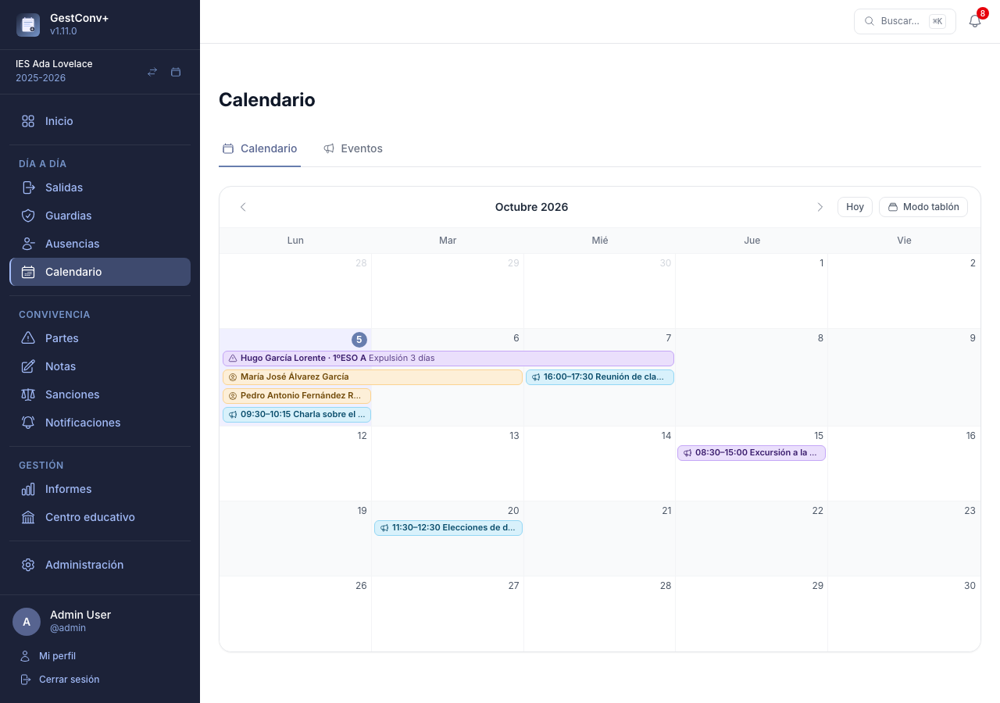
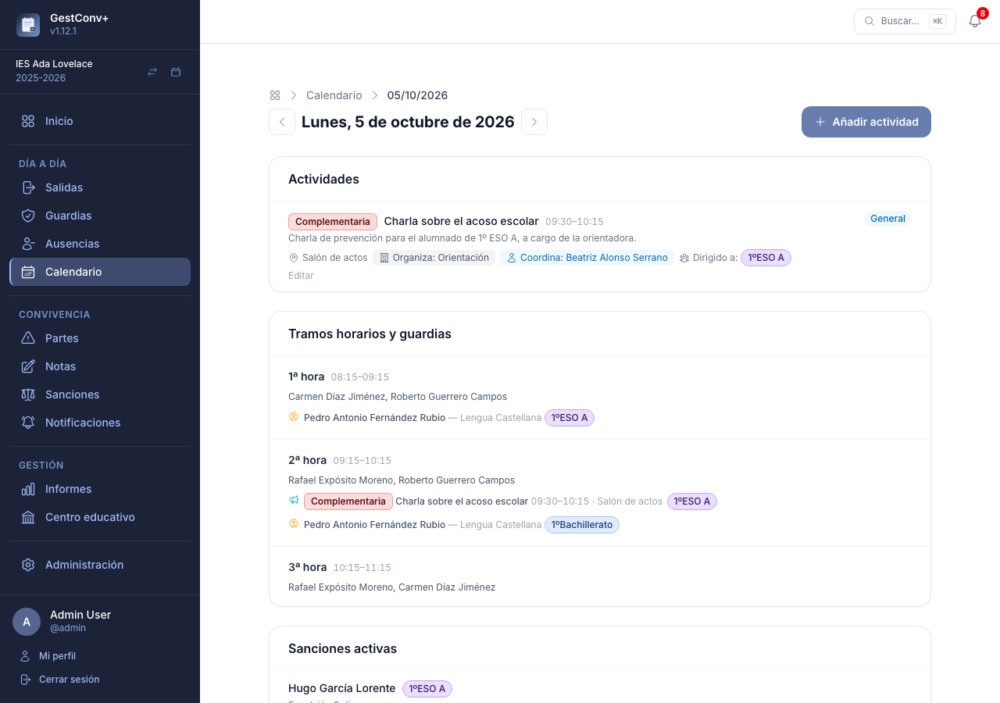
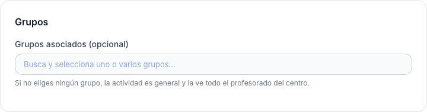
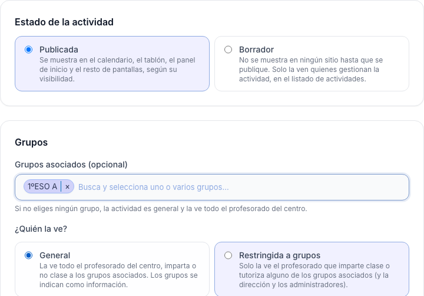
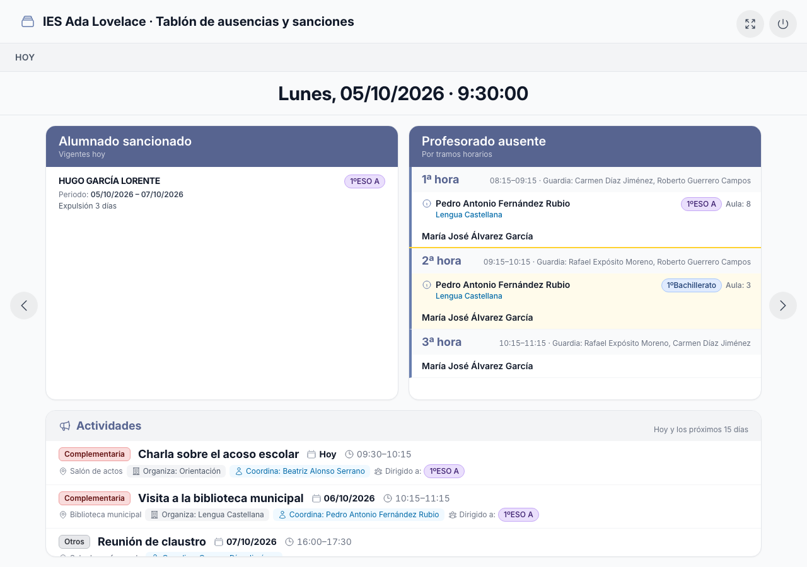
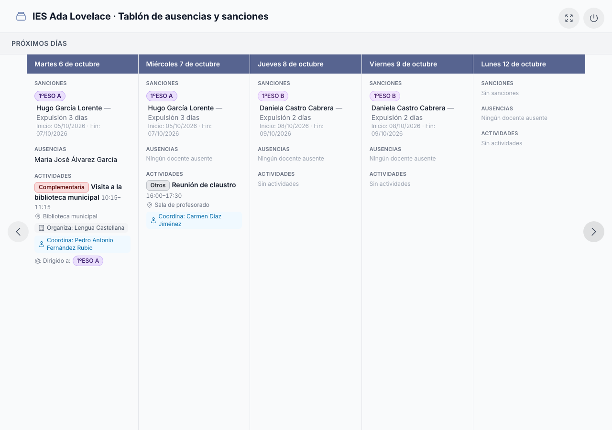

# Calendario y tablón

La sección **Calendario** reúne, en una sola vista mensual, todo lo que le interesa al
profesorado día a día: las **sanciones** en vigor, las **ausencias** del profesorado (solo
administradores) y las **actividades de centro**. Su versión para pantallas del centro, el
**modo tablón**, muestra lo mismo de un vistazo en la sala de profesorado.

## Calendario

La sección **Calendario** del menú lateral muestra, en una vista mensual, todo lo relevante para
quien la consulta:

- **Sanciones**: todas las del curso activo ya comunicadas a la familia y con fecha, sin filtrar
  por autoría ni tutoría — cualquier docente del centro las ve todas. Las pendientes de comunicar
  no aparecen hasta que se registra la comunicación (ver
  [Notificaciones](03-el-trabajo-diario.md#notificaciones)). Cada una se colorea según el grupo del
  estudiante y muestra el icono ⚠, el nombre del estudiante, su grupo y la
  **descripción para calendario y tablón** (o el detalle completo si ese campo está en blanco).
- **Ausencias del profesorado** (solo administradores de centro, ver
  [Ausencias](03-el-trabajo-diario.md#ausencias)): se colorean en ámbar con el icono de un docente
  y muestran únicamente el nombre de quien está ausente, sin grupo ni descripción. El resto del
  profesorado no las ve en su calendario. Las ausencias marcadas con **docente sustituto/a** no
  aparecen (ni en el calendario, ni en la vista de día, las guardias o el tablón).
- **Actividades de centro** (ver más abajo): se colorean con el color del primer grupo asociado si
  están restringidas a grupos, o en azul con el icono de un megáfono si son generales, y muestran
  la hora seguida del nombre de la actividad.

Los colores de los grupos se calculan automáticamente, pero la dirección puede personalizarlos
desde la [oferta formativa](06-administrar-el-centro.md#color-de-un-grupo). Dondequiera que se
nombra un grupo —calendario, panel de inicio, guardias, tablón y listados— se hace con una
etiqueta de ese color.

- Solo se muestran los días de lunes a viernes; los fines de semana no aparecen en la cuadrícula.
  Una actividad en fin de semana sigue siendo visible en su [vista de detalle](#vista-de-detalle-de-un-dia),
  en el modo tablón y en el panel de inicio, aunque no aparezca en esta cuadrícula mensual.
- El día actual se resalta con un color de fondo distinto en toda su columna.

### Vista de detalle de un día

Al hacer clic en cualquier día de la cuadrícula se abre su ficha completa, con botones para
avanzar o retroceder de día sin volver al calendario:

- Aviso de **día no lectivo**, si aplica (con su descripción, si el día no lectivo la tiene).
- **Tramos horarios y guardias** de ese día de la semana, con el profesorado de guardia, las
  ausencias con actividad encomendada y las **actividades** que caen dentro de cada tramo (las que
  se solapan con su horario; una actividad larga aparece en todos los tramos que cubre).
- **Sanciones activas** ese día.
- **Ausencias** del profesorado (solo administradores).
- **Actividades** de ese día, con su tipo, horario, descripción, enlace si lo tienen, lugar,
  departamento organizador, coordinación y los grupos a los que están dirigidas, y la etiqueta
  **General** si las ve todo el profesorado.

Quien puede [publicar actividades](#quien-puede-publicar-actividades) tiene además un botón
**Añadir actividad** que abre el formulario de alta con la fecha del día ya rellenada.

## Actividades de centro {#actividades-de-centro}

Una **actividad de centro** es un aviso puntual con fecha y horario propios — una charla, una
salida, una jornada de puertas abiertas, una reunión de tutoría — que se muestra en el calendario,
la vista de día, las guardias, el modo tablón y el panel de inicio de quien deba verla. (Hasta la
versión 1.12 se llamaban «eventos».)

Quienes pueden publicar actividades las gestionan desde la pestaña **Actividades**, junto a
**Calendario**, dentro de la misma sección del menú lateral: un listado paginado con búsqueda por
nombre o descripción y filtros por grupo y por tipo, y un botón **Añadir actividad** (también
disponible desde la vista de detalle de un día, con la fecha ya rellenada).

Las **Actividades** se pueden desactivar de golpe, para toda la plataforma o para un centro, con el
ajuste **Actividades de centro** (categoría **Secciones de la aplicación**, ver
[Sistema de ajustes](07-administrar-la-plataforma.md#sistema-de-ajustes)): desaparecen la pestaña,
los avisos del panel de inicio, de las guardias y del tablón, el catálogo de tipos y el perfil de
coordinación, y sus direcciones dejan de funcionar. Los datos ya registrados se conservan.

### Quién puede publicar actividades {#quien-puede-publicar-actividades}

Lo decide el ajuste **Quién puede publicar actividades** (categoría **Actividades**, en los ajustes
globales y en los de cada centro) junto con el perfil **Coordinación de actividades** del centro
(ver [Perfiles](06-administrar-el-centro.md#perfiles)):

- **Equipo directivo** (valor por defecto): solo los administradores del centro y de la
  plataforma publican actividades.
- **Todos**: cualquier docente del centro puede publicar, además de los administradores. Un docente
  que publica **solo ve en el listado, modifica y elimina las actividades que ha publicado él**;
  las de los demás siguen apareciendo en el calendario si le corresponde verlas, pero no puede
  tocarlas.
- La **coordinación de actividades** (uno o varios docentes que la dirección designa) puede publicar
  siempre y ve, modifica y elimina **todas** las actividades del centro, las haya publicado quien
  las haya publicado, como si fuera administradora. Las actividades anteriores a la versión 1.13,
  que no guardan su autoría, solo las gestionan la dirección y la coordinación.

Los administradores ven siempre todas las actividades, tengan o no relación con ellas.

### Datos de una actividad

Cada actividad tiene:

- **Fecha**, **hora de inicio** y **hora de fin** (obligatorias).
- **Nombre** (obligatorio) y **descripción** (opcional).
- **Tipo de actividad** (obligatorio), elegido del catálogo del centro (ver
  [Tipos de actividad](06-administrar-el-centro.md#tipos-de-actividad)). Por defecto:
  *Complementaria*, *Extraescolar* y *Otros*.
- **Enlace** opcional (por ejemplo, a un formulario de inscripción o más información).
- **Lugar de realización**, **departamento organizador** y **coordinador/a de la actividad**
  (un docente del curso, elegido en un buscador): opcionales.
- **Profesorado acompañante** (opcional): uno o varios docentes del curso, además de quien coordina.
- **Grupos asociados** (opcionales), elegidos en un desplegable de búsqueda que admite varios a la
  vez. Una actividad puede estar asociada a grupos aunque la vea todo el centro.
- **Visibilidad**, que solo aparece al elegir al menos un grupo:
    - **General** — la ve todo el profesorado del centro, imparta o no clase a los grupos
      asociados; los grupos se muestran como información.
    - **Restringida a grupos** — la ve solo el profesorado que imparte clase o tutoriza alguno de
      los grupos asociados (y la dirección, la coordinación y los administradores). Quien la
      publica la ve siempre en su propio calendario, aunque no imparta en esos grupos.

Si no se elige ningún grupo, la actividad es **general** automáticamente y el formulario no muestra
ninguna opción de visibilidad:

En cuanto se elige un grupo aparecen las dos opciones, cada una con su explicación:

## Modo tablón

El botón **Modo tablón**, junto al botón *Hoy* del calendario, pide confirmación (recuerda que,
una vez dentro, hay que cerrar sesión para salir) y abre una vista a pantalla completa pensada
para dejarse fija en una pantalla del centro — por ejemplo, en la sala de profesorado. Solo pueden
activarlo los administradores; el resto de docentes no ve el botón ni puede acceder a la vista
directamente.

El tablón rota automáticamente entre dos pantallas: **Hoy** y **Próximos días**. Cuando hay más de
una pantalla activa aparecen también dos botones, a izquierda y derecha, para avanzar o retroceder
de pantalla sin esperar a la rotación. En ambas, la información se presenta en paneles, y los
grupos aparecen siempre con una etiqueta de su color.

### Pantalla "Hoy"

Muestra la fecha del día junto con un reloj que se actualiza cada segundo, y tres paneles:

- **Alumnado sancionado** (mitad izquierda): las sanciones vigentes hoy, con el nombre del
  estudiante, su grupo, el periodo de la sanción y la descripción para calendario y tablón (o el
  detalle recortado si aquella está en blanco).
- **Profesorado ausente** (mitad derecha), por tramos horarios. Cada tramo muestra el profesorado
  de guardia y los docentes ausentes con su grupo, su materia y su aula. Un docente ausente que
  dejó tareas aparece en los tramos donde las dejó (el icono de información abre la descripción de
  la tarea y sus adjuntos, descargables desde el propio tablón); uno que **no dejó ninguna tarea
  ese día aparece en todos los tramos de la jornada**. El tramo que coincide con la hora actual se
  resalta, y el resaltado se recalcula solo conforme avanza el reloj, sin recargar la pantalla.
- **Actividades** (franja inferior): las actividades de hoy y de los próximos días, con su tipo
  (en el color del tipo), nombre, fecha, horario, lugar, departamento organizador, coordinación
  y los grupos a los que se dirigen. Cuántos días por delante se listan lo decide el ajuste
  **Días de antelación de las actividades en el tablón** (15 por defecto). Las actividades se
  muestran incluso en un día no lectivo — el resto de la pantalla queda vacía salvo el aviso del
  día no lectivo, pero una jornada de puertas abiertas puede caer en fiesta y sigue siendo
  relevante.

Si el contenido de un panel no cabe, se desplaza automáticamente arriba y abajo. Si las
**Ausencias** están desactivadas, el panel de profesorado ausente no se muestra y el de alumnado
sancionado ocupa toda la anchura; si lo están las **Actividades**, desaparece la franja inferior.

### Pantalla "Próximos días"

Muestra, en cinco columnas, las **5 jornadas lectivas siguientes** al día actual, empezando por el
día lectivo posterior a hoy: se saltan los fines de semana y los días no lectivos, así que puede
cruzar varias semanas. Cada columna indica:

- Las **sanciones** que cubren ese día, agrupadas por grupo, con el estudiante, la descripción para
  calendario y tablón (o el detalle, si aquella está en blanco) y las fechas de inicio y fin. Aquí
  se anticipan las expulsiones que empiezan en los próximos días.
- El profesorado **ausente** ese día.
- Las **actividades** de ese día, con su tipo, horario, lugar y coordinación.

Si el contenido de una columna no cabe, se desplaza automáticamente arriba y abajo.

Un botón en la esquina superior alterna la pantalla completa del navegador; otro, con icono de
encendido/apagado, cierra la sesión.

!!! warning "El tablón es una sesión sin salida"
    Una vez activado el modo tablón, esa sesión del navegador no puede navegar a ninguna otra
    parte de la aplicación (salvo para descargar los adjuntos de una actividad de una ausencia desde
    la propia pantalla "Hoy"): cualquier otro intento redirige de vuelta al tablón. La única salida
    es cerrar sesión con el botón de encendido/apagado. Así, la pantalla del centro puede quedarse
    encendida sin riesgo de que alguien la use para consultar otros datos.

## Ajustes del modo tablón

Los administradores pueden afinar el comportamiento del tablón desde **Ajustes** (ver
[Sistema de ajustes](07-administrar-la-plataforma.md#sistema-de-ajustes)):

| Ajuste | Rango | Por defecto |
|---|---|---|
| Duración de la pantalla "Hoy" | 0-3600 segundos | 60 |
| Duración de la pantalla "Próximos días" | 0-3600 segundos | 10 |
| Días de antelación de las actividades en el tablón | 0-90 días | 15 |
| Tema del modo tablón | Claro / Oscuro / Según el sistema | Claro |

Las dos duraciones controlan cuántos segundos se muestra cada pantalla antes de pasar a la
siguiente. Un valor de 0 en cualquiera de ellas omite esa pantalla de la rotación. (Al actualizar
desde la versión 1.12, la duración de «Esta semana» pasa a ser la de «Próximos días» y la de
«Semana que viene» desaparece.)

El tema controla la combinación de colores: claro, oscuro, o **según el sistema**, que sigue en
todo momento la preferencia de color del dispositivo que muestra el tablón, incluidos los cambios
que se produzcan con la pantalla ya abierta, sin recargarla.

Los cuatro ajustes se fijan a nivel global o de centro; no existen como preferencia individual de
docente.
