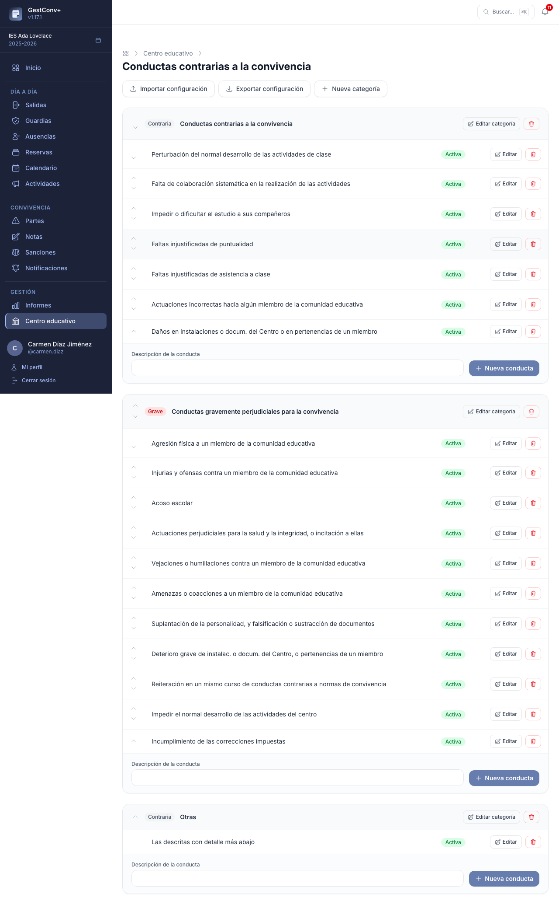
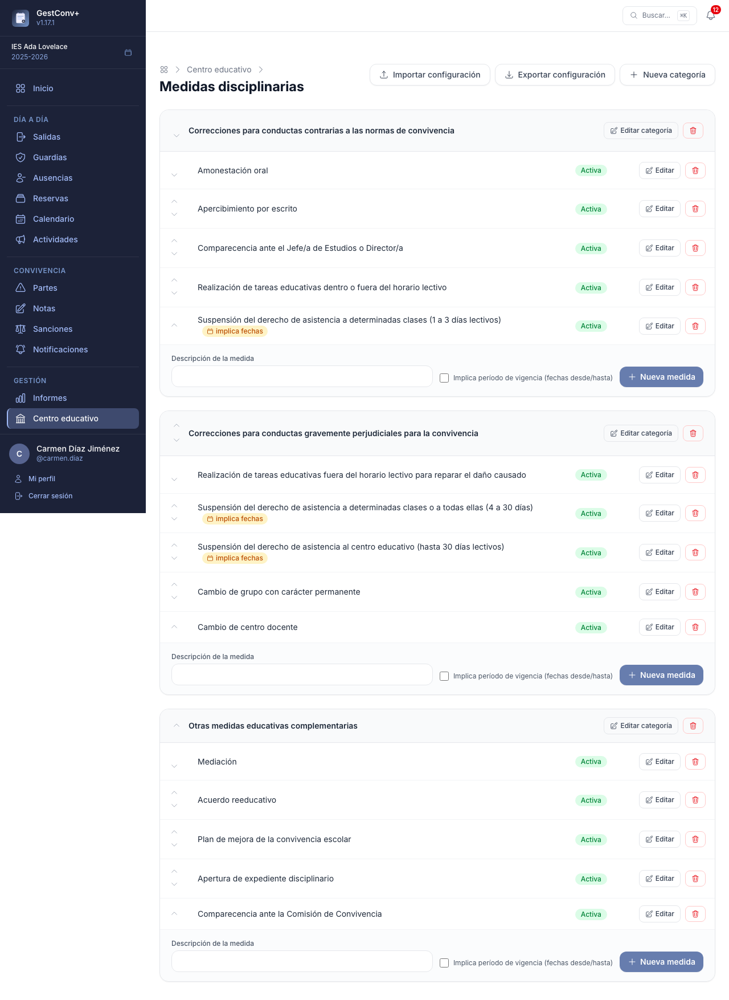
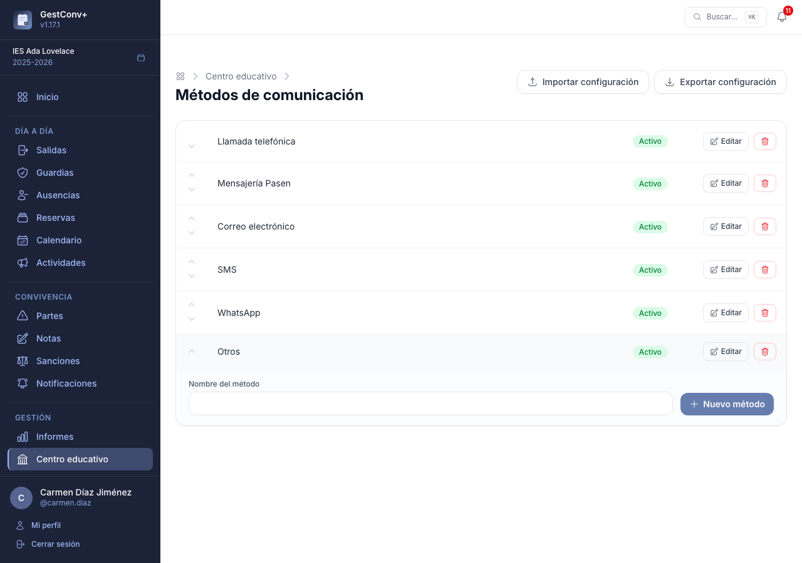
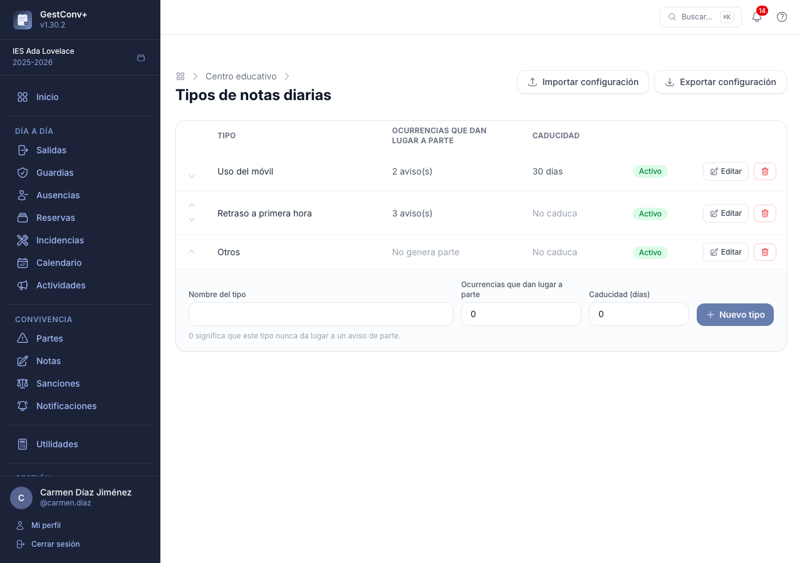
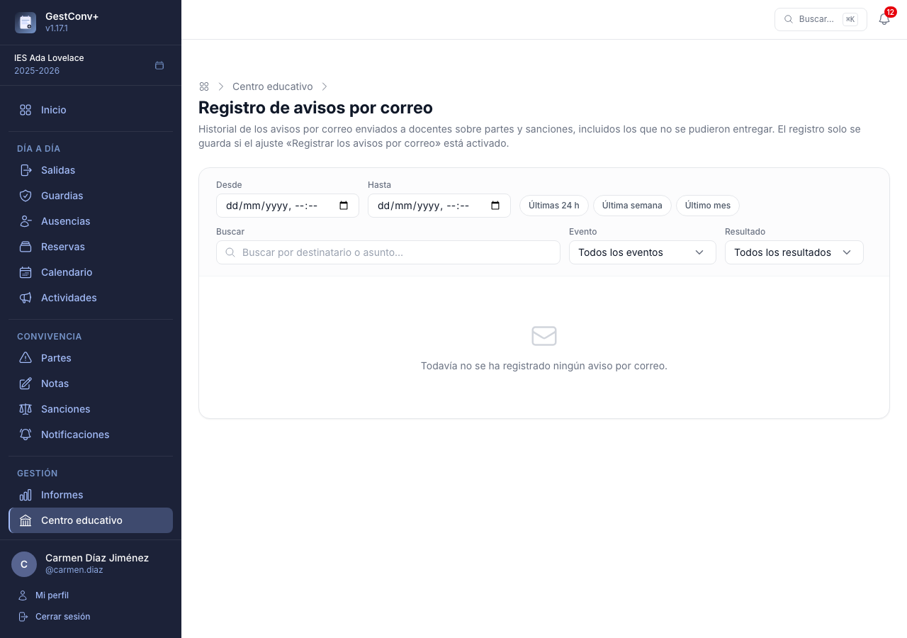
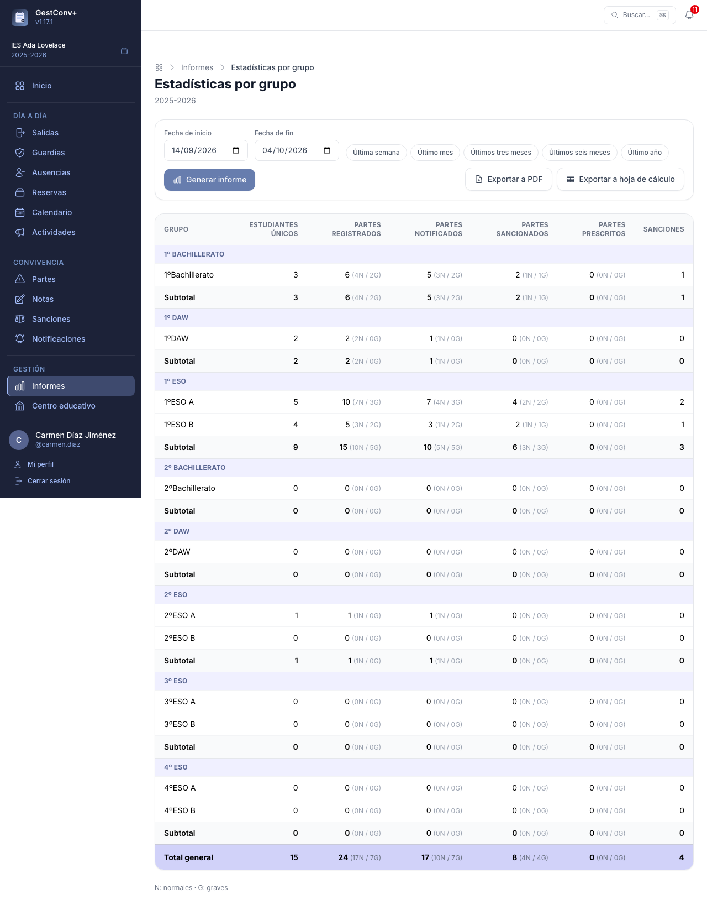
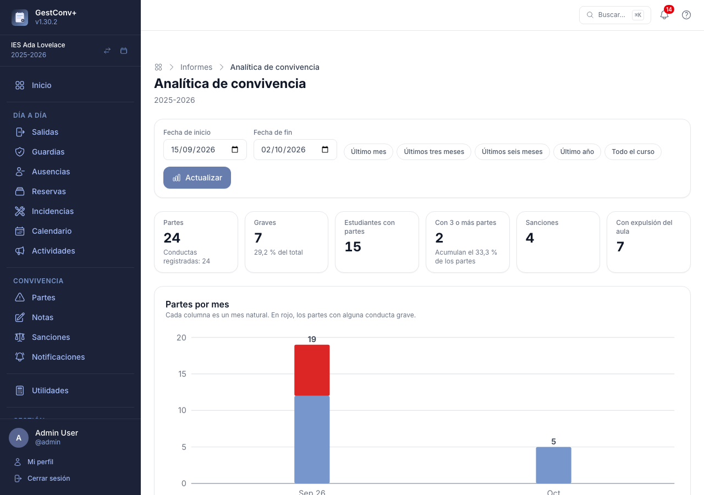
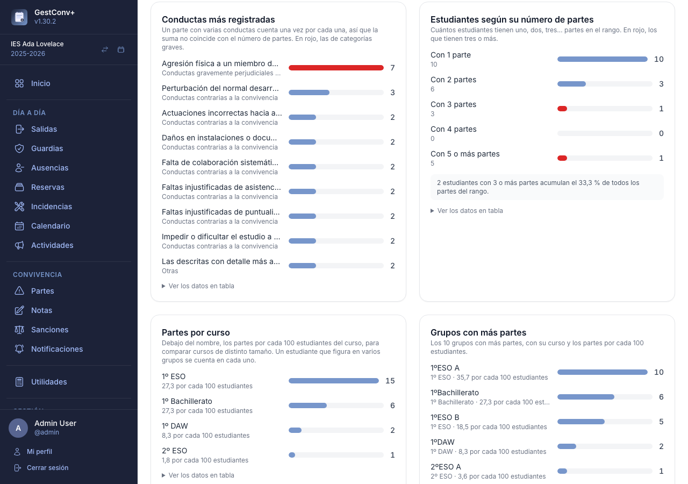

# Convivencia: la administración

Este capítulo es para quienes administran el centro (normalmente, el equipo directivo): los
catálogos de conductas, medidas, métodos de comunicación y tipos de notas del módulo de
convivencia, los avisos por correo de partes y sanciones, la prescripción y los informes. Los
catálogos comparten la mecánica explicada en [Catálogos del centro](12-administrar-el-centro.md#catalogos-del-centro):
cada elemento se puede activar o desactivar, reordenar, editar o eliminar, y se pueden
[copiar entre centros](12-administrar-el-centro.md#copiar-catalogos-entre-centros).

## Conductas contrarias a la convivencia

Se gestionan en **Centro educativo › Conductas contrarias**, organizadas en categorías. Cada
conducta puede marcarse como *grave* o *contraria*. Al crear el centro se configuran **19
conductas por defecto** basadas en la normativa de convivencia escolar de Andalucía, ordenadas de
contrarias a graves.

## Medidas disciplinarias

Se gestionan en **Centro educativo › Sanciones › Medidas disciplinarias**, organizadas en
categorías igual que las conductas. Son las medidas que la comisión de convivencia marca al
[registrar una sanción](05-convivencia-comision.md#registrar-una-sancion).

## Métodos de comunicación

En **Centro educativo › Métodos de comunicación** se configura la lista —plana, sin categorías—
de vías de contacto con las familias, que se ofrece al
[registrar una comunicación](04-convivencia-profesorado.md#notificaciones). Los 6 métodos por defecto
son: Llamada telefónica, Mensajería Pasen, Correo electrónico, SMS, WhatsApp y Otros.

Un método que ya se ha usado en alguna comunicación no se puede eliminar (aparece un aviso);
desactívalo en su lugar.

## Tipos de notas diarias

En **Centro educativo › Tipos de notas diarias** se configura la lista —plana, sin categorías— de
tipos disponibles al [registrar una nota](04-convivencia-profesorado.md#notas), con dos campos
adicionales por tipo: **Ocurrencias que dan lugar a parte** (0 = este tipo nunca lo sugiere) y
**Caducidad**, en días desde el registro, pasados los cuales una nota activa de ese tipo se
desactiva automáticamente (0 = no caduca nunca). Los 3 tipos por defecto de un centro nuevo son:
Uso del móvil (2 ocurrencias, caduca a los 30 días), Retraso a primera hora (3 ocurrencias, no
caduca) y Otros (0 ocurrencias, no caduca). Las salidas al baño **no** son un tipo de nota: se
registran en la sección [Salidas](07-salidas.md). Los centros que ya existían antes de esta
funcionalidad recibieron entonces los tipos de entonces, entre ellos «Salida al baño»; si lo
tienen, se conserva y se puede borrar desde esta misma pantalla.

Un tipo que ya se ha usado en alguna nota no se puede eliminar (aparece un aviso); desactívalo en
su lugar.

## Avisos de partes y sanciones

Además de las comunicaciones con las familias, la aplicación puede avisar **al profesorado, por
correo electrónico**, de los eventos relevantes de partes y sanciones. Estos avisos están
**desactivados por defecto** y se activan uno a uno (llegan en un [resumen diario](#resumen-diario)
salvo que se elija recibirlos de forma inmediata) desde
[Ajustes](13-administrar-la-plataforma.md#avisos-por-correo), a nivel global o de centro,
eligiendo en cada caso si se notifica a nadie, al docente que registró el elemento, al tutor/a
del grupo o a ambos:

- **Parte registrado, notificado a la familia, modificado, eliminado, prescrito o incorporado a
  una sanción** — seis avisos independientes, uno por evento. El de «modificado» cubre cualquier
  edición del parte salvo marcarlo como prescrito, que tiene su propio aviso. El de «prescrito»
  se envía tanto si un administrador marca el parte manualmente como si prescribe de forma
  automática (ver más abajo).
- **Sanción notificada a la familia** — se avisa al docente que registró cada uno de los partes
  incorporados a la sanción y/o al tutor/a del grupo.
- **Sanción prescrita** — se avisa al docente que registró la sanción y/o al tutor/a del grupo
  cuando una sanción sin notificar prescribe, tanto automáticamente (si el centro ha activado la
  prescripción de sanciones) como si un administrador la marca como prescrita a mano.
- **Parte sancionable** — cuando un parte queda notificado a la familia y todavía no está
  prescrito ni incorporado a una sanción, puede avisarse a todos los docentes con el perfil de
  comisión de convivencia del centro.

Cada correo enlaza directamente al parte o la sanción correspondiente (salvo el de eliminación,
ya que el elemento deja de existir) e incluye el nombre de quien realizó la acción, salvo el de
prescripción automática, que no tiene un docente asociado.

Dos ajustes adicionales, **Enviar parte adjunto al correo** y **Enviar sanción adjunta al
correo** (desactivados por defecto), añaden el PDF correspondiente como adjunto: el primero a
cualquiera de los seis avisos de parte, el segundo al aviso de sanción notificada. Solo afectan
al correo enviado, no al [registro de avisos](#registro-de-avisos-por-correo).

!!! note "El correo del servidor debe estar activo"
    Para que estos avisos lleguen, el servidor debe tener configurado el envío de correo (ver
    [Correo electrónico del servidor](13-administrar-la-plataforma.md#correo-electronico-del-servidor)).

### Resumen diario

Para que el profesorado no reciba decenas de correos al día, **por defecto los avisos no se envían
uno a uno**: se acumulan y llegan juntos en **un único correo diario por centro**, el *resumen
diario*, a las 7:00 (hora del servidor). El correo agrupa las novedades por secciones —próximos a
prescribir, partes, sanciones, tareas de sanción y notas diarias—, con un enlace a cada parte o
sanción. Si una misma novedad se repite (por ejemplo, un parte modificado varias veces), aparece
una sola vez con el número de veces. Si ese día no hay nada que comunicar, no se envía ningún
correo.

Dos ajustes, con el esquema habitual **global › centro › docente** y sus bloqueos, lo controlan:

- **Forma de recibir los avisos por correo** — *Resumen diario* (por defecto) o *Inmediata* (un
  correo por aviso, como antes). Cada docente puede elegir la suya en sus ajustes personales,
  salvo que un administrador la haya bloqueado a nivel global o de centro.
- **Hora del resumen diario** — de 0 a 23 (7 por defecto). También la puede fijar cada docente.

Qué avisos se reciben y por qué evento no cambia: siguen gobernados por los ajustes de
[Avisos por correo](13-administrar-la-plataforma.md#avisos-por-correo). El resumen solo cambia
*cuándo* llegan. Tienes que saber además que:

- **Los avisos de prescripción próxima** (de partes y de sanciones) **y el recordatorio de tareas
  de sanción pendientes** se envían siempre dentro del resumen, incluso a quien haya elegido la
  forma *inmediata*. Así, quien recibe los avisos de forma inmediata recibe un solo correo diario
  con esos tres recordatorios, en lugar de tres.
- **Los PDF adjuntos** (ajustes *Enviar parte adjunto* y *Enviar sanción adjunta*) no se incluyen
  en el resumen, solo los enlaces. Siguen adjuntándose a los correos de quien recibe los avisos de
  forma inmediata.
- Los correos de verificación de correo y de recuperación de contraseña **nunca** van en el
  resumen: se envían al momento.
- El envío del resumen queda registrado, como cualquier otro correo, en el
  [registro de avisos](#registro-de-avisos-por-correo) con el evento «Resumen diario». Si el
  servidor de correo falla, el resumen se reintenta en la hora siguiente; los avisos pendientes de
  más de 14 días se descartan.
- Quien cambia su ajuste a *inmediata* recibe los avisos nuevos al momento; los que ya estaban
  acumulados salen en el siguiente resumen.

## Prescripción automática de partes sin notificar

Una tarea programada diaria revisa, para cada centro, los partes que todavía no se han comunicado
a la familia y marca como prescritos los que llevan más días sin notificar que el valor del
ajuste **Días para la prescripción automática** (14 por defecto; 0 para desactivarla). El plazo
se cuenta desde la fecha en la que ocurrió el incidente. Si el aviso de «Parte prescrito» está
activado, se envía igual que si lo hubiera marcado un administrador manualmente, pero sin nombrar
a ningún docente como autor de la acción.

Un parte prescrito sale de las notificaciones pendientes (cola, campana, resumen por estudiante y
notificación en bloque) y deja de contarse como «sin notificar» en **Mi tutoría**; en el listado
de partes se sigue viendo, atenuado.

## Aviso de prescripción próxima

Otra tarea programada diaria, independiente de la anterior, avisa con antelación de los partes a
punto de prescribir. Para cada docente que puede notificar partes (según el ajuste **Quién
notifica los partes de convivencia**), revisa los que le corresponden y todavía no se han
comunicado a la familia; si alguno prescribirá en el número de días del ajuste **Aviso de
prescripción próxima** (7 por defecto; 0 para desactivarlo, y cada docente puede fijar su propio
valor) o menos, le envía un único correo con el listado completo de esos partes.

Este aviso nunca incluye partes ya prescritos: solo avisa mientras todavía se puede evitar la
prescripción comunicando el parte a la familia.

## Prescripción de sanciones sin notificar

Igual que los partes, las sanciones pueden prescribir si no se comunican a la familia a tiempo,
pero **por defecto no lo hacen**: el ajuste **Días para la prescripción automática de sanciones**
vale 0, y con ese valor todo funciona exactamente como si esta función no existiera. Al
asignarle un número de días (a nivel global o por centro) se activan:

- **La prescripción automática.** Una tarea programada diaria marca como prescritas las sanciones
  sin notificar que llevan más días desde su registro que el valor del ajuste. Si el aviso de
  «Sanción prescrita» está activado, se envía un correo (sin docente como autor de la acción).
- **El aviso de prescripción próxima.** Otra tarea diaria envía a cada docente que puede notificar
  sanciones (según **Quién notifica las sanciones**) un único correo con las que prescribirán en
  el número de días del ajuste **Aviso de prescripción próxima de sanciones** (7 por defecto; 0
  para desactivarlo; cada docente puede fijar el suyo).
- **Los indicadores en pantalla**: la sección roja de [Notificaciones](04-convivencia-profesorado.md#notificaciones)
  incluye las sanciones próximas a prescribir, el inicio muestra una tarjeta **Sanciones próximas
  a prescribir**, **Mi tutoría** añade la columna **Sanciones prescritas** y las
  [estadísticas por grupo](#estadisticas-por-grupo) (y su PDF y Excel) indican entre paréntesis cuántas sanciones
  han prescrito.

Una sanción prescrita ya no aparece entre las notificaciones pendientes (cola, campana, resumen por
estudiante y notificación en bloque), no cuenta como «sin notificar» y se muestra atenuada, con
la etiqueta **Prescrita**, en el listado de sanciones y en su ficha. Las sanciones ya notificadas
nunca prescriben por plazo.

Con independencia del plazo, un administrador puede también [marcar una sanción como prescrita (o
quitar la prescripción) a mano](05-convivencia-comision.md#marcar-una-sancion-como-prescrita),
igual que con los partes; en ese caso el aviso «Sanción prescrita» nombra a quien la marcó.

## Registro de avisos por correo

Cada envío de los avisos anteriores queda registrado —tanto si se entrega correctamente como si
falla— en un historial visible desde **Centro educativo › Registro de avisos por correo**,
accesible solo para los administradores del centro.

Cada entrada muestra la fecha, el destinatario, el tipo de evento, el asunto y el resultado
(entregado o fallido, con el motivo del error en este último caso). El listado pagina y puede
filtrarse por texto libre (destinatario o asunto), tipo de evento, resultado y rango de fechas,
con accesos rápidos para las últimas 24 horas, la última semana o el último mes.

El registro se activa o desactiva con el ajuste **Registrar los avisos por correo** (activado por
defecto). Al desactivarlo, los avisos se siguen enviando con normalidad; simplemente no queda
constancia de ellos. Este historial no incluye los correos de verificación de email ni de
restablecimiento de contraseña, que no son configurables y no tienen registro propio.

Las entradas se purgan automáticamente pasados los días del ajuste **Retención de los registros**
(90 por defecto, limpieza semanal los domingos a las 3:00). Este mismo ajuste, exclusivamente
global, controla también la retención del
[registro de actividad](13-administrar-la-plataforma.md#registro-de-actividad).
## Informes {#informes}

La sección **Informes** del menú lateral reúne los informes agregados del centro: las estadísticas
de convivencia por grupo (que se explican aquí), el [informe de salidas](07-salidas.md#informe-de-salidas)
y el [informe de incidencias](10-incidencias.md#informe-de-incidencias), que aparecen mientras sus
módulos estén activados. Solo la ven quienes tienen acceso a la sección Centro educativo, y requiere
un curso académico activo. Todos se piden por un rango de fechas, con rangos rápidos (última semana,
último mes…), y se pueden exportar a PDF y a hoja de cálculo.

### Estadísticas por grupo

La tarjeta **Estadísticas por grupo** pide una fecha de inicio y una de fin, y genera una tabla
con los partes registrados en ese rango para cada grupo del curso activo, agrupados por curso:

- **Estudiantes únicos** — estudiantes distintos con al menos un parte en el rango.
- **Partes registrados, notificados, sancionados y prescritos** — cada uno desglosado entre
  conductas contrarias y graves.
- **Sanciones** — sanciones distintas asociadas a los partes del grupo; una sanción que agrupe
  varios partes cuenta una sola vez.

Los grupos sin partes también aparecen, con todos los valores a cero. Cada curso muestra una fila
de subtotal y la tabla termina con el total general del centro.

Una vez generado, los botones **Exportar a PDF** y **Exportar a hoja de cálculo** descargan el
mismo contenido en PDF (con el encabezado personalizable del centro, ver
[Personalización de informes](13-administrar-la-plataforma.md#personalizacion-de-informes)) o en
una hoja Excel con una fila por grupo, los subtotales y el total general.

### Analítica de convivencia {#analitica-de-convivencia}

La tarjeta **Analítica de convivencia** presenta los mismos partes y sanciones en **gráficos**, para ver
de un vistazo cómo evoluciona la convivencia y dónde se concentra. Sin elegir fechas abarca desde el
primer hasta el último parte del curso; con los campos de fecha y los rangos rápidos (último mes, tres
meses, seis meses, año) o **Todo el curso** se acota. Solo la ve quien tiene acceso a la sección
Informes (equipo directivo y administración) y recoge siempre el centro entero.

Arriba, las **cifras clave** del rango: partes (y conductas registradas), partes graves y su
porcentaje, estudiantes con partes, estudiantes con **tres o más partes** (y el porcentaje de los partes
que acumulan), sanciones y partes con expulsión del aula. Debajo, los gráficos:

- **Partes por mes** — una columna por mes natural, con los partes de conductas contrarias y, en rojo,
  los que incluyen alguna conducta grave. Los meses sin partes aparecen a cero.
- **Partes por día de la semana** y **por hora del día** — cuándo se concentran los incidentes (el
  sábado y el domingo solo aparecen si hay partes).
- **Conductas más registradas** — las diez más frecuentes, en rojo las de categorías graves. Un parte con
  varias conductas cuenta una vez por cada una, así que la suma no coincide con el número de partes.
- **Estudiantes según su número de partes** — cuántos estudiantes tienen uno, dos, tres, cuatro o cinco
  o más partes: muestra si los partes se reparten entre muchos o los acumulan unos pocos.
- **Partes por curso** y **grupos con más partes** — con el número de partes y los partes **por cada
  100 estudiantes**, para comparar cursos y grupos de distinto tamaño. Un estudiante que figura en
  varios grupos se cuenta en cada uno.
- **Sanciones por mes** — según la fecha de alta de cada sanción.

Cada gráfico lleva debajo un desplegable **Ver los datos en tabla** con las cifras exactas (útil
también con lector de pantalla). Los totales coinciden con los de las
[estadísticas por grupo](#estadisticas-por-grupo) para el mismo rango, porque comparten los datos y la
definición de «parte grave». Los gráficos se dibujan en el propio servidor, sin cargar nada de fuera,
y se imprimen desde el navegador como cualquier otra pantalla.

