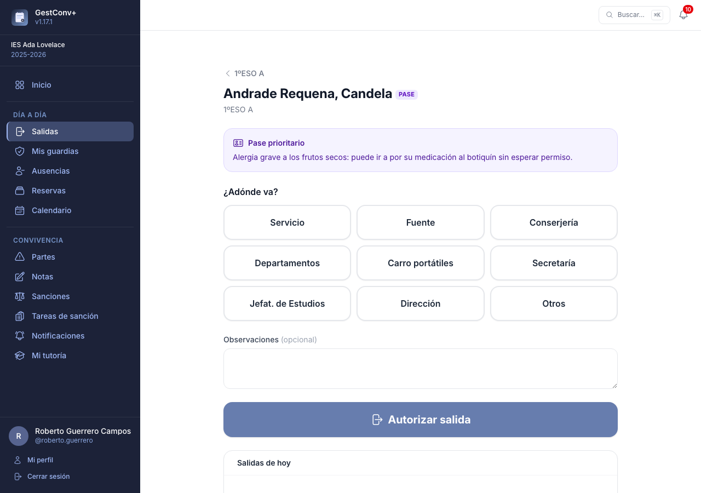
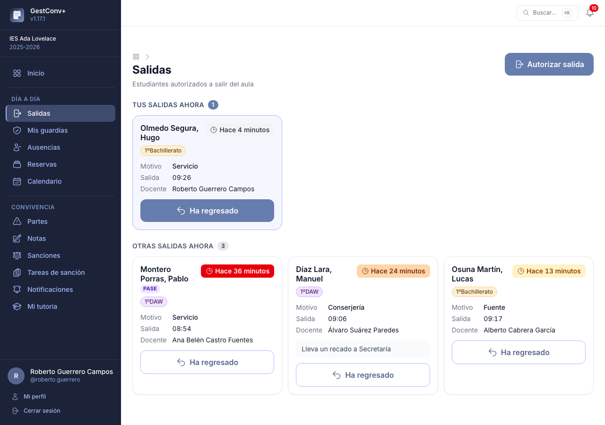
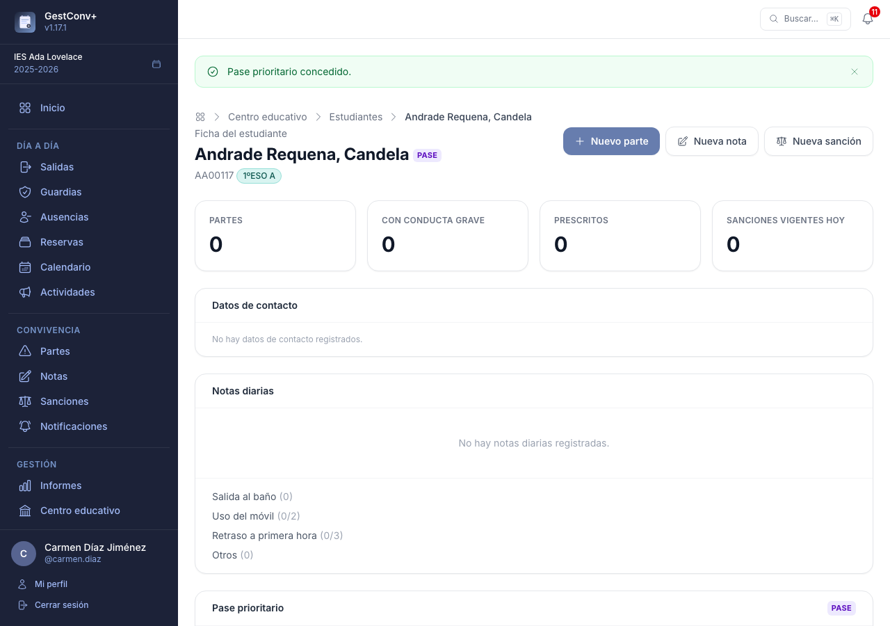
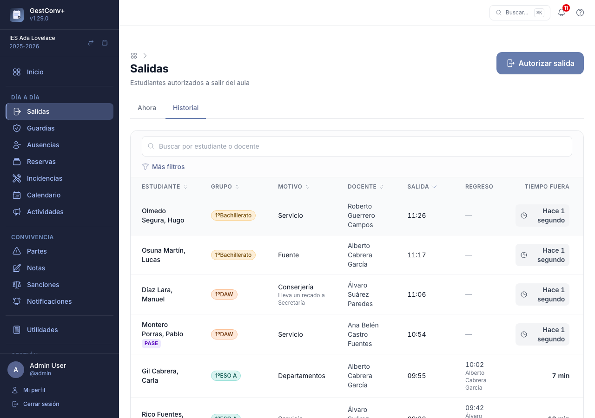
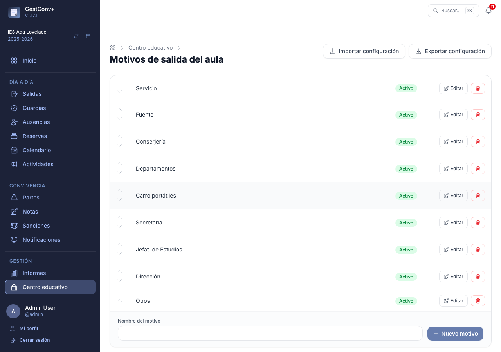

# Salidas del aula

Este capítulo es para todo el profesorado, y para la administración del centro en lo que se refiere a los motivos de salida y al historial.

La sección **Salidas** del menú lateral controla qué estudiantes están ahora mismo fuera del
aula con permiso de un docente, adónde han ido y cuánto llevan fuera. Está pensada para usarse
sobre todo desde el móvil: el botón **Autorizar salida** queda fijo en la parte inferior de la
pantalla y también está entre los accesos rápidos de la pantalla de inicio y en la paleta de
comandos.

## Autorizar una salida

1. Pulsa **Autorizar salida** y elige el **grupo**. Primero aparecen tus grupos (aquellos en los
   que das clase o eres tutor/a) y debajo el resto.
2. Elige al **estudiante** (hay un buscador para los grupos grandes). Los estudiantes que ya están
   fuera aparecen marcados.
3. Elige el **motivo** en la cuadrícula de botones, escribe si quieres una observación y pulsa el
   botón grande **Autorizar salida**. Debajo se listan las salidas de hoy de ese estudiante, con el
   tiempo que estuvo fuera en cada una.

Si el estudiante tiene **pase prioritario** (ver más abajo), se muestra su justificación en un
aviso destacado antes de elegir el motivo. Un estudiante que ya tiene una salida abierta no puede
volver a salir hasta que se registre su regreso.

## Quién está fuera ahora

La pantalla principal muestra, en tiempo real (se actualiza sola cada pocos segundos), los
estudiantes que están fuera: nombre y grupo, docente que autorizó, motivo con sus observaciones y
la hora de salida junto a un texto como «Hace 12 minutos». Si la salida no es de hoy se añade la
fecha. A partir de los **10 minutos** el tiempo cambia de color —ámbar a los 10, naranja a los 20 y
rojo a los 30— para que las ausencias largas destaquen.

Las salidas que has autorizado tú aparecen **aparte y primero**, con un botón **Ha regresado** que
cierra la salida (la sección no se muestra si no tienes ninguna). En las salidas de otros docentes
el botón **Ha regresado** solo aparece si eres tutor/a del grupo del estudiante, equipo directivo o
administración.

## Pase prioritario

Algunos estudiantes necesitan un trato especial al salir del aula (por ejemplo, por motivos de
salud). La administración del centro puede concederles un **pase prioritario** desde su
[ficha](04-convivencia-profesorado.md#ficha-del-estudiante), con una justificación escrita. Vale para el curso académico
actual y se muestra con el distintivo **PASE** junto al nombre del estudiante en todos los
listados de salidas.

## Historial

En la ficha de cada estudiante hay un listado de sus salidas autorizadas. El equipo directivo y la
administración disponen además de la pestaña **Historial** en la sección Salidas, con todas las
salidas del curso: se puede buscar por estudiante o docente, filtrar por grupo, motivo, estado
(siguen fuera o ya han regresado) y fechas, y ordenar por columnas. Para las salidas que han
terminado se indica el tiempo que estuvo fuera el estudiante.

La administración (global o del centro) puede además **eliminar una salida** desde ese historial,
con el botón de la papelera de su fila. La aplicación pide confirmación antes de borrarla: la salida
desaparece definitivamente de la base de datos y no se puede recuperar. Solo se puede borrar mientras
se consulta el curso activo, y cada eliminación queda en el registro de actividad.

## Configurar los motivos de salida {#motivos-de-salida-del-aula}

En **Centro educativo › Motivos de salida del aula** (administración del centro) se configura la lista —plana, sin
categorías— de destinos entre los que el profesorado elige al
[autorizar una salida](#autorizar-una-salida). Los 9 motivos por defecto son: Servicio,
Fuente, Conserjería, Departamentos, Carro portátiles, Secretaría, Jefat. de Estudios, Dirección y
Otros; los centros que ya existían antes de esta funcionalidad los reciben automáticamente al
actualizar.

Un motivo que ya se ha usado en alguna salida no se puede eliminar (aparece un aviso); desactívalo
en su lugar.

