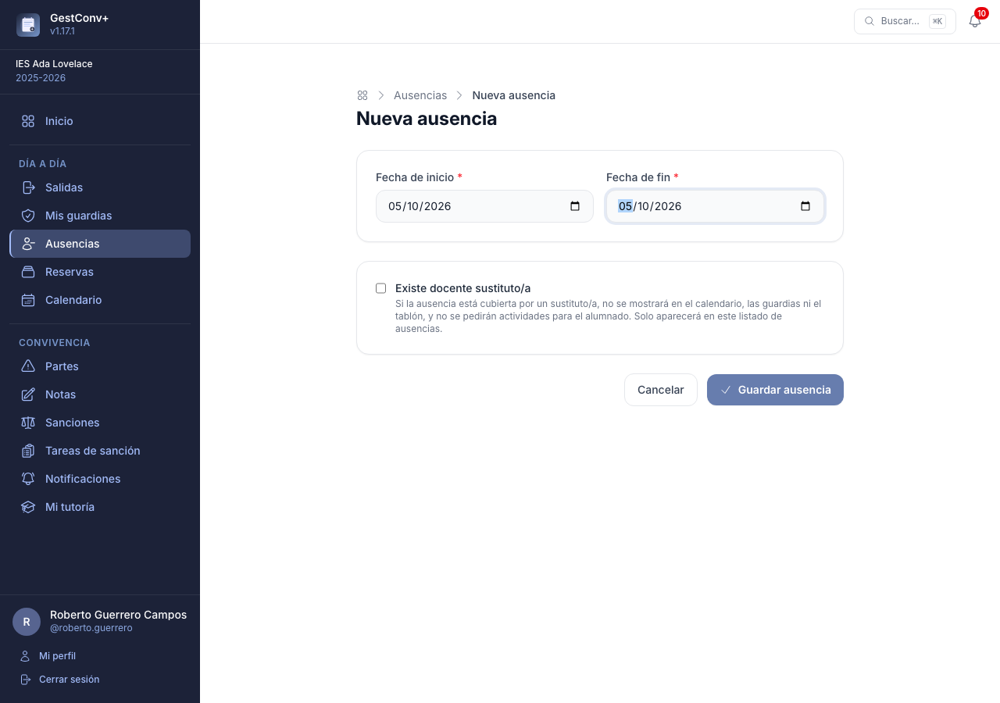
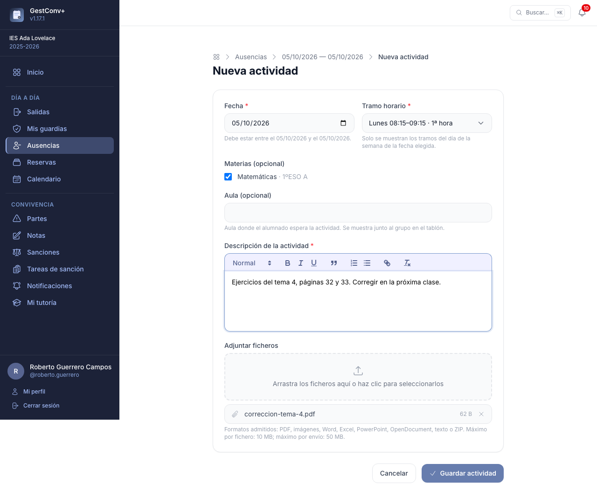
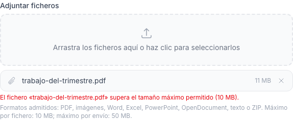
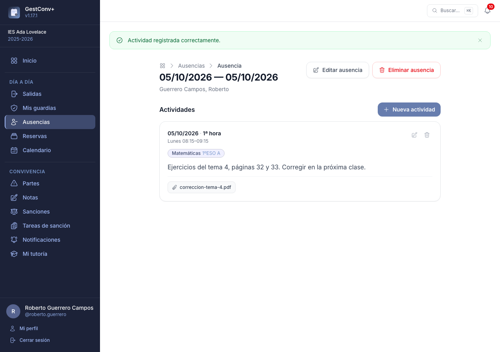
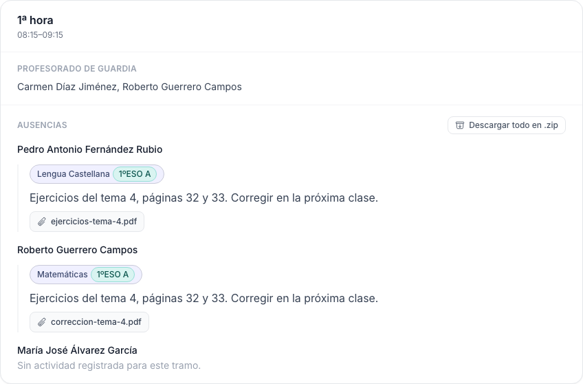
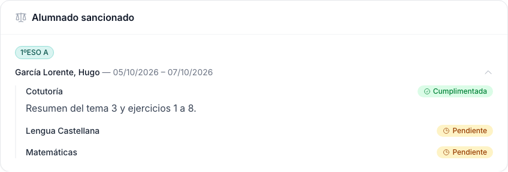

# Ausencias y guardias

Este capítulo es para todo el profesorado: dejar organizado el trabajo de las clases cuando se
sabe que se va a faltar, y consultar quién cubre cada tramo en las guardias.

## Ausencias {#ausencias}

La sección **Ausencias** del menú lateral permite a cualquier docente dejar organizado el trabajo
de sus grupos cuando sabe que va a faltar: qué debe trabajarse en cada clase afectada, con las
instrucciones y el material necesarios para quien la cubra.

Cada ausencia es un **rango de fechas** (por ejemplo, los días de una baja o de un permiso) y
contiene una o varias **actividades**: una por cada clase que se ve afectada, con su propio tramo
horario, grupo y descripción.

Una ausencia es **privada**: solo quien la registra puede editarla o eliminarla, y solo mientras no
haya pasado su fecha de fin (después queda **bloqueada** para ese docente, aunque sigue pudiendo
consultarla). Ningún otro docente tiene acceso a las ausencias de otra persona, ni siquiera si
comparte grupo con quien las registró. Los administradores globales y los de centro son la
excepción: tienen acceso completo —crear, consultar, editar y eliminar— a las ausencias de
cualquier docente del curso, sin que el bloqueo por fecha les afecte (ver
[Permisos de un vistazo](15-permisos-de-un-vistazo.md#ausencias)).

Si quien accede es administrador (global o de centro) y además pertenece al curso académico
visualizado, la sección muestra dos pestañas:

- **Mis ausencias** — las propias, igual que para cualquier docente.
- **Ausencias del centro** — todas las registradas en el curso, con filtros por fecha (hoy o un
  rango) y por docente, ordenadas por fecha de fin de más reciente a más antigua. El filtro de
  docente solo ofrece a quienes tienen alguna ausencia registrada en el curso visualizado.

Un administrador que no pertenezca al curso (por ejemplo, solo administra el centro pero no da
clase) ve directamente el listado de ausencias del centro, sin pestañas.

### Registrar una ausencia

1. Pulsa **Nueva ausencia** en la esquina superior derecha del listado.
2. Si quien registra es administrador, elige primero el **docente** para el que se registra la
   ausencia (por defecto, uno mismo).
3. Indica la **fecha de inicio** y la **fecha de fin** del periodo en el que se estará ausente.
   Ambas son obligatorias y la fecha de fin no puede ser anterior a la de inicio.
4. Si la ausencia ya está cubierta por un **sustituto/a**, marca **Existe docente sustituto/a**
   (se puede marcar o desmarcar también al editarla). Una ausencia con sustituto/a **no se
   muestra** en el calendario, la vista de día, las guardias ni el tablón, y **no se piden
   actividades** para el alumnado (el botón *Nueva actividad* desaparece); solo aparece, con la
   etiqueta *Con sustituto/a*, en el listado de ausencias de quienes pueden verla: su docente y los
   administradores.
5. Guarda: se abre el detalle de la ausencia, todavía sin actividades.

### Añadir actividades

Desde el detalle de la ausencia, pulsa **Nueva actividad** para indicar qué hacer en una de las
clases afectadas:

1. **Fecha** — debe estar dentro del rango de la ausencia; por defecto se sugiere la fecha de
   inicio de esta.
2. **Tramo horario** — uno de los tramos del centro cuyo día de la semana coincida con la fecha
   elegida; la lista se actualiza automáticamente al cambiar la fecha.
3. **Grupo o asignatura** (opcional) — puede marcarse más de uno de los grupos o asignaturas que
   imparte quien registra la actividad, si la misma instrucción sirve para varias clases del mismo
   tramo.
4. **Aula** (opcional) — dónde espera el alumnado. Se muestra junto al grupo en el
   [modo tablón](11-calendario-actividades-y-tablon.md#pantalla-hoy).
5. **Descripción** — instrucciones para quien cubra la clase, con formato de texto enriquecido.
   Es obligatoria.
6. **Adjuntar ficheros** (opcional) — fichas de trabajo, presentaciones u otro material de apoyo.
   Se pueden seleccionar varios ficheros a la vez, de hasta 10 MB cada uno (límite configurable) y 50 MB en total por envío; los formatos admitidos
   son PDF, imágenes (PNG, JPG, GIF), documentos de Word, Excel, PowerPoint y OpenDocument, texto
   plano y ZIP.
   Un fichero que supere el tamaño máximo o no esté en un formato admitido se rechaza, indicando el
   motivo, sin afectar al resto de la actividad. El aviso aparece ya al elegir el fichero, antes de
   guardar:

   

Una misma ausencia puede tener tantas actividades como clases afectadas, incluso varias el mismo
día si hay más de un tramo horario implicado. Un docente ausente que no registra ninguna actividad
un día aparece, en el tablón, en todos los tramos horarios de ese día.

### Consultar, editar y eliminar

El listado de **Ausencias** muestra las propias (o las del centro, en la pestaña
correspondiente), con sus fechas y el número de actividades de cada una. Su detalle reúne todas
las actividades en orden cronológico, cada una con su tramo horario, grupo, descripción y, si los
tiene, los ficheros adjuntos disponibles para descargar junto a su tamaño.

Quien registró la ausencia puede editar sus fechas (siempre que el nuevo rango siga cubriendo
todas sus actividades), editar o eliminar cualquiera de sus actividades, y eliminar la ausencia
completa, siempre que no haya pasado ya su fecha de fin. Eliminar una ausencia elimina también
todas sus actividades y ficheros adjuntos; es una acción irreversible que pide confirmación.

Al editar una actividad ya existente, cada fichero adjunto puede marcarse individualmente para
eliminarlo, además de poder añadir otros nuevos.

!!! note "Los adjuntos no se conservan indefinidamente"
    Pasado un número de días configurable desde la fecha de la actividad (ver
    [Ausencias](13-administrar-la-plataforma.md#ausencias)), una tarea programada elimina
    automáticamente sus ficheros adjuntos para no acumular documentos obsoletos. La actividad y su
    descripción no se ven afectadas: queda una nota al final indicando qué fichero se eliminó, y
    cuándo.

## Guardias {#guardias}

Cuando un docente cubre una guardia (un tramo horario en el que figura como guarda), la sección
**Mis guardias** del menú lateral —**Guardias** a secas para quien administra el centro— reúne todo
lo que necesita saber para esa clase: qué docentes del tramo están ausentes, qué actividad dejaron
encomendada (con sus adjuntos) y qué estudiantado sancionado hay ese día para poder entregarle sus
tareas pendientes.

La sección es visible para cualquier docente que tenga guardia en algún tramo horario del curso
visualizado —no hace falta que sea precisamente ese día— y para los administradores del centro, que
ven además **todos** los tramos, no solo los propios (ver
[Permisos de un vistazo](15-permisos-de-un-vistazo.md#guardias)).

La cabecera muestra el día activo, precedido de «Hoy: » cuando corresponde a la fecha actual, junto
con dos flechas para navegar al día anterior y siguiente. Si el día visualizado es hoy, el tramo
horario en curso se resalta automáticamente, igual que en el modo tablón de las pantallas de sala de
profesores. Cuando hay más de un tramo ese día, o alumnado sancionado que mostrar, un grupo de
botones al principio de la página permite saltar directamente a cada tramo y a **Alumnado
sancionado**.

Para cada tramo horario se muestran, una detrás de otra:

- **Profesorado de guardia** — el nombre completo de cada docente asignado a ese tramo, o un aviso
  si no hay ninguno. No figura quien ese día tiene una [ausencia con docente
  sustituto/a](#registrar-una-ausencia). Quien administra el centro ve además, junto al título del tramo, un botón para
  modificar sus datos (nombre, horario y día, y la propia asignación de docentes de guardia), que
  abre el editor de [tramos horarios](12-administrar-el-centro.md#tramos-horarios) con ese tramo ya
  seleccionado.
- **Actividades en este tramo** — las [actividades de centro](11-calendario-actividades-y-tablon.md#actividades-de-centro)
  que coinciden con el horario del tramo y que puedes ver; solo aparece si hay alguna.
- **Ausencias** — el docente ausente y, si dejó una actividad registrada para ese tramo, su
  descripción completa junto con los ficheros adjuntos disponibles para descargar. Si no dejó
  actividad, aparece un aviso indicándolo.
- **Alumnado sancionado** — a diferencia de las ausencias, esta subsección aparece una sola vez al
  final de la página (no se repite en cada tramo), agrupada por grupo. Cada estudiante muestra su
  nombre completo y las fechas de la sanción; un desplegable permite consultar, materia por materia,
  el estado de su tarea de sanción, el trabajo asignado y sus adjuntos.

Cuando hay varios ficheros que descargar juntos, aparece además un botón que los agrupa en un único
archivo ZIP:

- Junto al título **Ausencias** de cada tramo, si al menos una actividad de ese tramo tiene
  adjuntos: descarga los adjuntos de **todas** las actividades del tramo ese día, en carpetas
  separadas por docente.
- Junto a la descripción de una actividad, cuando tiene más de un adjunto: descarga solo los suyos.
- Junto a cada sanción del listado de alumnado sancionado, si alguna de sus tareas tiene adjuntos:
  descarga los adjuntos de **todas** las tareas de esa sanción, en carpetas separadas por materia.

