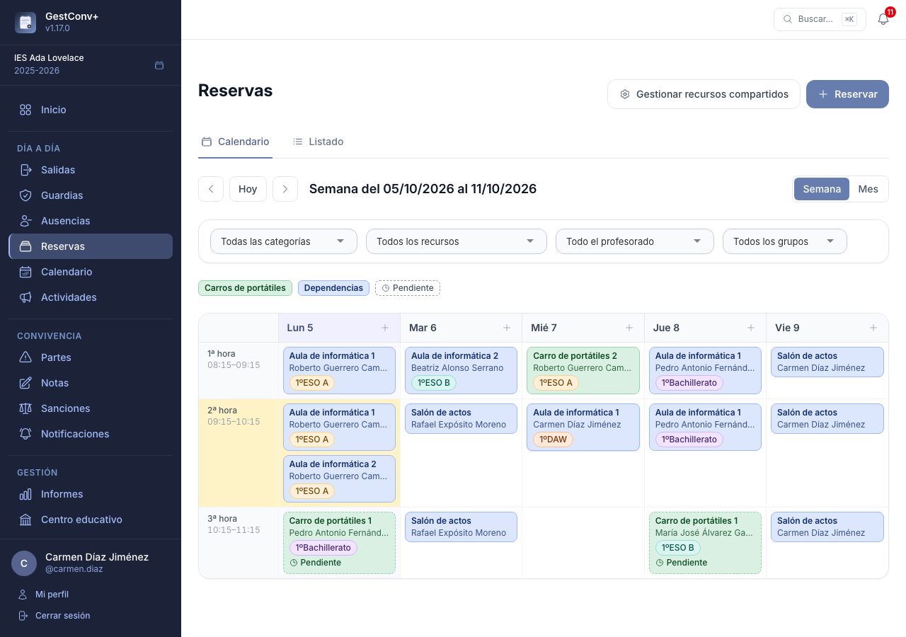
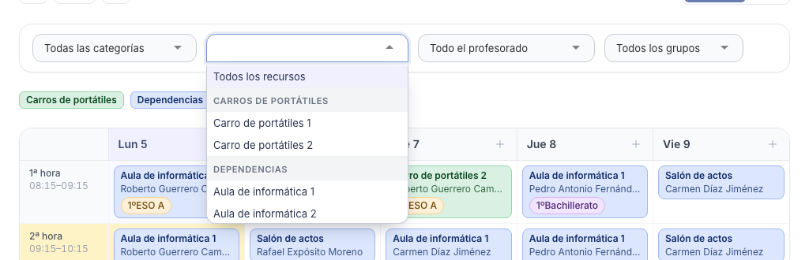
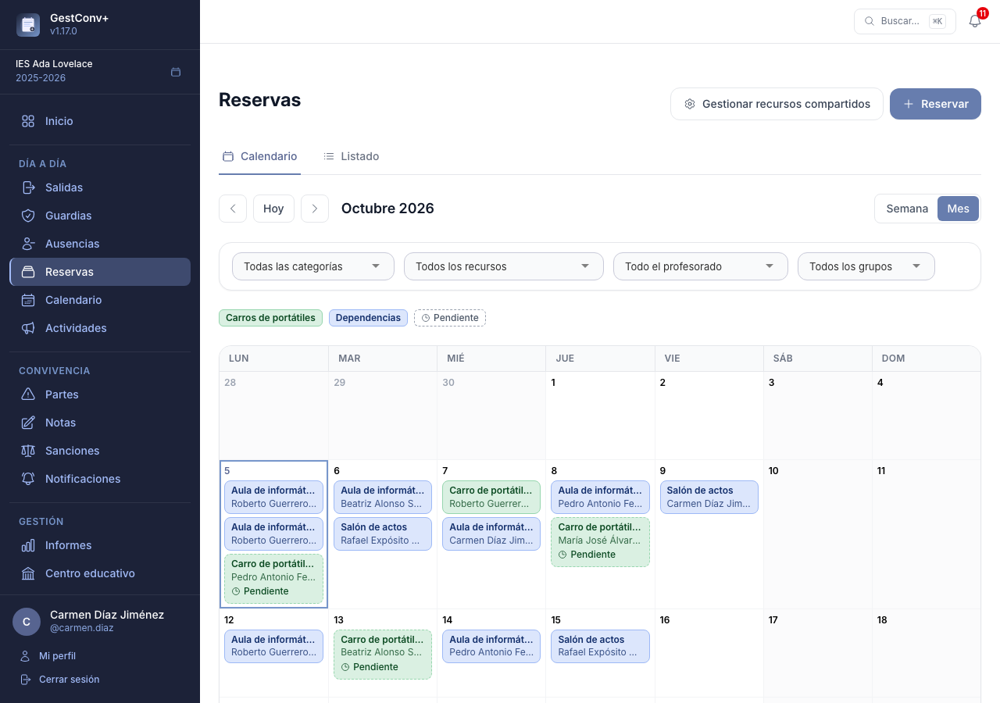
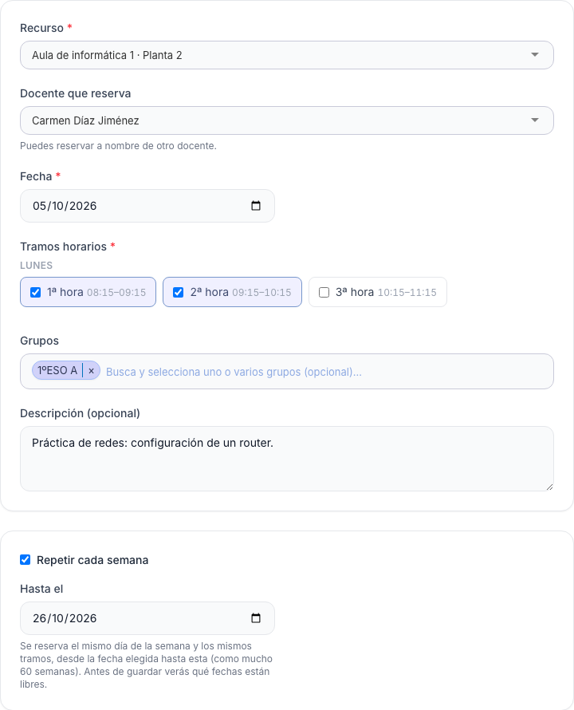
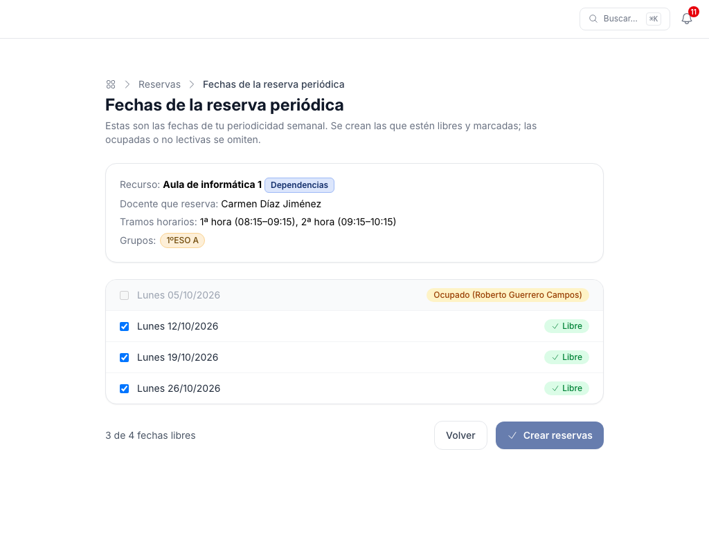
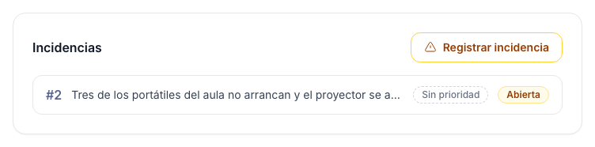
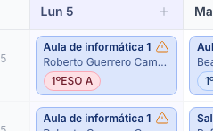
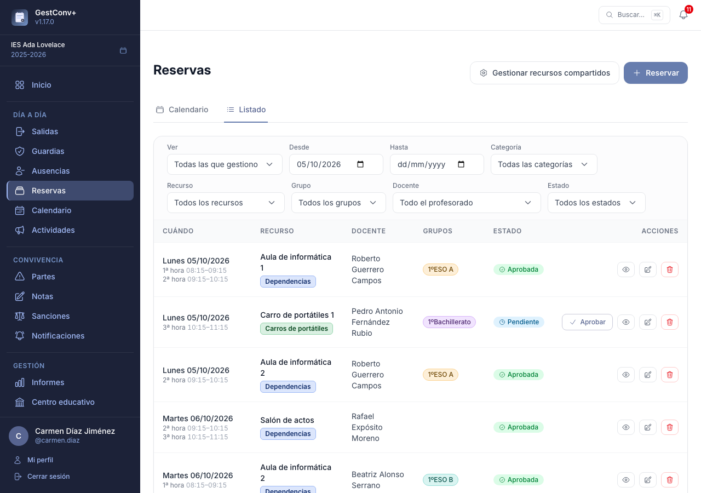
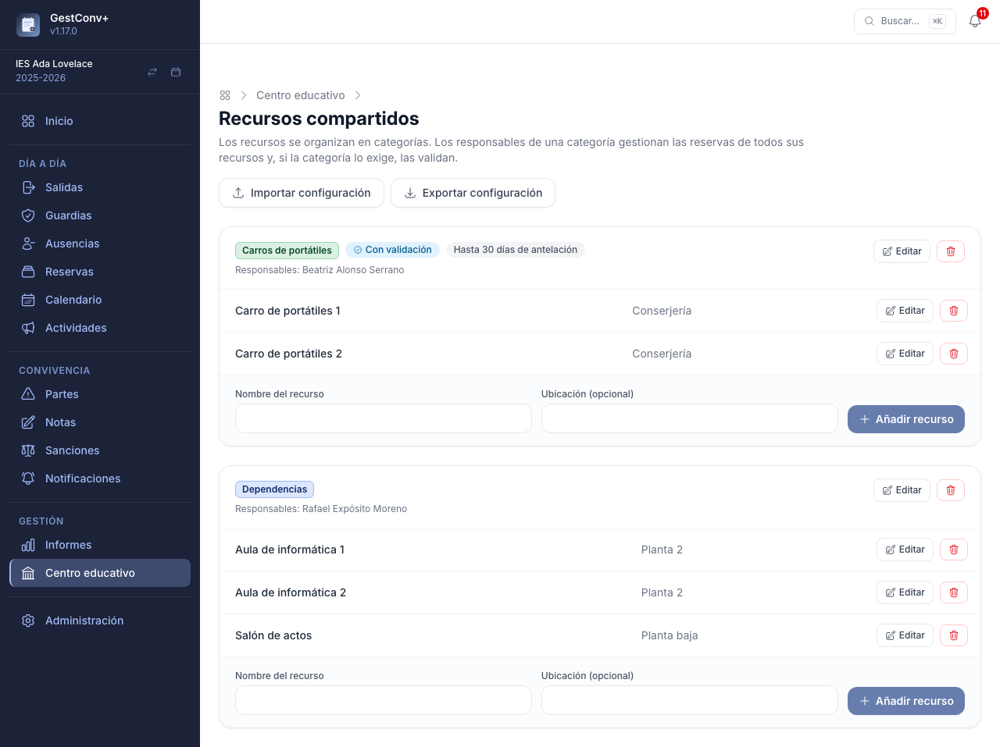
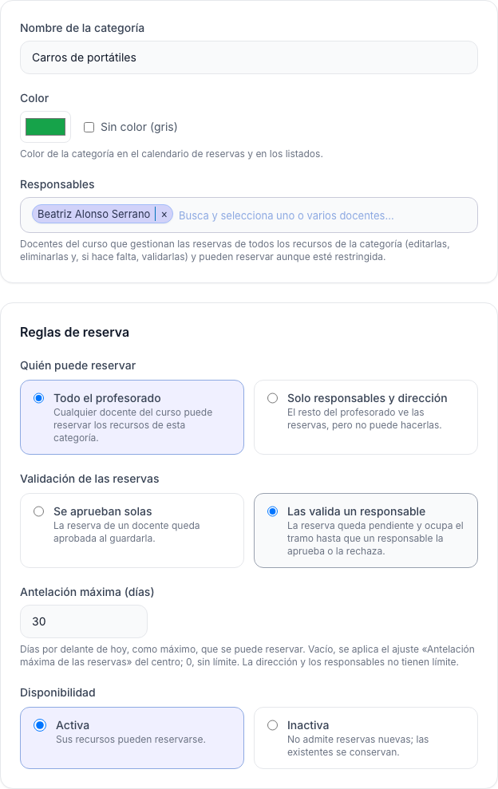

# Reservas de recursos

Este capítulo es para todo el profesorado, para quienes validan las reservas de una categoría y
para el equipo directivo, que define los recursos.

La sección **Reservas** del menú lateral (grupo **Día a día**) sirve para reservar los **recursos
compartidos** del centro —aulas de informática, el salón de actos, carros de portátiles…— por tramos
horarios, sin tener que ir preguntando quién los tiene. Los recursos y sus categorías los define el
equipo directivo (ver [Recursos compartidos](#recursos-compartidos)).
Cualquier docente del curso visualizado puede reservar, salvo en las categorías que el centro
restringe a sus responsables. La sección tiene dos pestañas, **Calendario** y **Listado**, y un botón
**Reservar** siempre a mano.

## El calendario

Muestra todas las reservas del centro, para que se vea de un vistazo qué está libre:

- **Vista semanal** (por defecto): los tramos horarios en filas y los días en columnas. Cada reserva
  es una etiqueta con el recurso, el docente y los grupos, del color de su categoría. Las
  **pendientes de validar** llevan el borde discontinuo y la marca *Pendiente*. Los días no lectivos
  se sombrean. El **+** de la cabecera de cada día abre el formulario con esa fecha. En la semana
  actual, el **tramo en curso** se resalta en ámbar (en la etiqueta de la hora y en la columna de
  hoy) y el resaltado avanza solo con el reloj.
- **Vista mensual**: una celda por día con sus reservas (las que no caben se resumen en «+N más», que
  lleva a esa semana).
- Las flechas y **Hoy** navegan por semanas o meses; **Semana / Mes** cambia de vista sin perder la
  fecha.
- Los **filtros** (categoría, recurso, docente y grupo) se aplican al elegirlos y se combinan entre
  sí; **Quitar filtros** los limpia. Las reservas rechazadas no se muestran porque no ocupan el
  recurso. Los cuatro son desplegables con **buscador**: escribe parte del nombre (sin importar las
  tildes) para encontrar rápido el recurso, el docente o el grupo, y el de recursos los **agrupa por
  categoría**. Si eliges una categoría, el desplegable de recursos **se limita a los de esa
  categoría** (y descarta un recurso ya elegido que no sea de ella). Lo mismo ocurre en el listado.
- La **leyenda de categorías** también filtra: pulsa una de ellas para ver solo sus reservas.
- Si hay un recurso filtrado, el **+** de cada día abre el formulario ya con ese recurso elegido.
- La dirección y las personas con permiso de administración del centro ven, junto a **Reservar**,
  el botón **Gestionar recursos compartidos**, que lleva directamente al catálogo (ver
  [Recursos compartidos](#recursos-compartidos)). Está también en la
  pestaña **Listado**.

Pulsar una reserva abre su ficha, con todos los datos y las acciones que te correspondan.

El calendario **se mantiene al día por sí solo**: cada 30 segundos, y al volver a la pestaña, se
actualiza con las reservas que hayan hecho, cambiado o dado de baja otras personas, sin recargar la
página ni perder los filtros. No hace falta pulsar nada para ver los cambios.

## Hacer una reserva

El botón **Reservar** abre el formulario:

- **Recurso** (obligatorio): los recursos que puedes reservar, agrupados por categoría. Es un
  desplegable con **buscador**: escribe parte del nombre (sin importar las tildes) para filtrar.
- **Docente que reserva**: solo lo ven la dirección y los responsables de categorías, que pueden
  reservar **a nombre de otro docente**. El resto reserva siempre a su nombre. También tiene
  buscador.
- **Fecha** (obligatoria) y **tramos horarios** (al menos uno): al elegir la fecha solo se ofrecen
  los tramos de ese día de la semana, y se pueden marcar varios. Si eliges un **día no lectivo**
  (fin de semana o festivo), el campo vuelve a la última fecha válida y se muestra un aviso.
- **Grupos** asociados y **descripción**: opcionales. Los grupos se muestran como etiquetas de color
  en el calendario y en los listados.
- **Repetir cada semana**: marca la casilla e indica la fecha final. Se reserva el mismo día de la
  semana y los mismos tramos desde la fecha elegida hasta esa (como mucho 60 semanas).

Un recurso admite **una sola reserva por día y tramo**: si alguno de los tramos ya está ocupado, el
formulario lo rechaza. Las reservas **pendientes de validar ocupan el tramo** igual que las
aprobadas; solo lo libera una reserva rechazada o eliminada. Tampoco se puede reservar en un día no
lectivo, en una fecha pasada ni con más antelación de la permitida (ver
[Ajustes de Reservas](13-administrar-la-plataforma.md#reservas)); la dirección y los responsables de
la categoría no tienen esos límites de fecha.

### Periodicidad: previsualizar y elegir

Con **Repetir cada semana** el formulario no guarda nada todavía: abre una **previsualización** con
todas las fechas de la periodicidad.

Cada fecha indica si está **libre** o por qué no se puede (**ocupada** —con el nombre de quien la
tiene—, **día no lectivo**, **fecha pasada** o **fuera de la antelación máxima**). Las libres vienen
marcadas y puedes desmarcar las que no quieras; las demás se omiten. **Crear reservas** guarda solo
las marcadas, que quedan unidas como una **serie**.

## Validación de las reservas

Algunas categorías exigen que un responsable **valide** las reservas del profesorado. En ellas, tu
reserva nace **pendiente**: ocupa el tramo, pero un responsable debe aprobarla o rechazarla. Recibes
un aviso (en la campana, en el correo o en el resumen diario, según tu preferencia) cuando se
resuelve, y si la rechazan verás el **motivo** que haya escrito. Las reservas de la dirección y de
los responsables de la categoría nacen ya aprobadas.

Si cambias el recurso, la fecha o los tramos de una reserva aprobada en una categoría con validación,
vuelve a quedar pendiente. Corregir una reserva **rechazada** la presenta de nuevo.

Quien valida ve en la **campana** y en el **panel de inicio** (tarjeta **Reservas por validar**) las
solicitudes que le tocan, y las resuelve desde la ficha de la reserva o con el botón **Aprobar** del
listado. Las series se pueden aprobar o rechazar enteras.

## Incidencias {#incidencias-de-las-reservas}

Si algo falla al usar un recurso (un proyector que no enciende, portátiles que no arrancan…), el docente
que hizo la reserva, los **responsables de su categoría** y la **dirección** pueden **registrar una
incidencia** desde la ficha de esa reserva con el botón **Registrar incidencia**. Solo se puede en
reservas **aprobadas**, y también después de usar el recurso, aunque la fecha ya haya pasado. Es una incidencia del módulo general de
[Incidencias](10-incidencias.md): la reserva ya indica el recurso, así que no se pide la dependencia, y
la ficha de la reserva lista las incidencias que tiene.

**Quién la ve.** Las incidencias de una reserva, y la marca que las señala, solo las ven el docente
de la reserva, los responsables del tipo de incidencia y la dirección; el resto del profesorado ve
la reserva como siempre. La marca es un icono junto al nombre del recurso, en el **calendario** y en
el **listado**: ámbar si alguna incidencia sigue **sin cerrar** y verde si están todas cerradas. El
texto de la incidencia solo aparece en su ficha, nunca en el calendario.

En el listado de reservas, el filtro **Incidencias** deja solo las reservas con incidencias sin
cerrar o con cualquier incidencia. El seguimiento (prioridad, estados, observaciones, avisos…) es el
de cualquier otra incidencia.

## Editar y eliminar

Desde la ficha de una reserva, **Editar** abre el mismo formulario y **Eliminar** la borra (con
confirmación). Cada docente gestiona **las suyas**; los **responsables** de una categoría gestionan
todas las de sus recursos y la **dirección** (administradores del centro y de la plataforma), todas.

Si la reserva forma parte de una serie, el formulario ofrece **Solo esta reserva** o **Toda la
serie** (esta y las siguientes que no han pasado: cambian el recurso, los tramos, el docente, los
grupos y la descripción, pero cada fecha se mantiene; las ya pasadas conservan su historial). La
ficha tiene igualmente **Eliminar** y **Eliminar la serie**.

## El listado

La pestaña **Listado** muestra las reservas en una tabla paginada (con la marca de
[incidencia](#incidencias-de-las-reservas) para quien puede verla). De entrada salen **tus reservas a
partir de hoy**; vaciando la fecha **Desde** se ven también las pasadas. Los filtros son la fecha
(**Desde** / **Hasta**), la categoría, el recurso (agrupado por categoría), el grupo y el estado
(pendiente, aprobada o rechazada).

Quien es responsable de alguna categoría, o administra el centro, ve además el selector **Ver**:
**Mis reservas** o **Todas las que gestiono** (todas las del centro para la dirección; las de sus
categorías para un responsable), con el filtro **Docente** y las acciones de validar, editar y
eliminar sobre las de otros.

## Configurar los recursos compartidos {#recursos-compartidos}

**Centro educativo › Recursos compartidos** (administración del centro) define lo que el profesorado puede
[reservar](#reservas-de-recursos): dependencias, carros de portátiles, el salón de
actos… Se organiza en dos niveles: **categorías** y, dentro de cada una, **recursos**. Además de
desde el menú del centro, se llega a él con el botón **Gestionar recursos compartidos** de la
sección **Reservas**.

Cada categoría es una tarjeta con sus recursos. Se crea una nueva con su nombre y color al pie de la
página y, al guardarla, se abre su formulario para indicar:

- **Responsables**: uno o varios docentes del curso, elegidos en un buscador. Gestionan (editan,
  eliminan y, si la categoría lo pide, validan) las reservas de **todos** los recursos de la
  categoría, y pueden reservar aunque esté restringida. Sin responsables, solo la dirección las
  gestiona.
- **Quién puede reservar**: *Todo el profesorado* (por defecto) o *Solo responsables y dirección*; en
  este caso el resto ve las reservas en el calendario, pero no puede hacerlas.
- **Validación de las reservas**: *Se aprueban solas* (por defecto) o *Las valida un responsable*.
  En ese caso la reserva de un docente queda **pendiente** y ocupa el tramo hasta que un responsable
  la aprueba o la rechaza; las de los responsables y la dirección nacen aprobadas.
- **Antelación máxima (días)**: cuántos días por delante de hoy se puede reservar. Vacío, se aplica
  el ajuste del centro [Antelación máxima de las reservas](13-administrar-la-plataforma.md#reservas);
  0 es «sin límite». La dirección y los responsables no tienen límite.
- **Disponibilidad**: una categoría inactiva no admite reservas nuevas, pero conserva las existentes.
- **Color**: el de las etiquetas de sus reservas en el calendario y los listados.

Cada **recurso** tiene nombre, **ubicación** y **descripción** opcionales, y puede cambiarse de
categoría o desactivarse (no admite reservas nuevas, pero conserva las existentes). Un recurso con
reservas, o una categoría con algún recurso reservado, no se puede eliminar (aparece un aviso):
desactívalo en su lugar. Esta tarjeta solo aparece si las **Reservas** están activadas.

Como los demás catálogos, este tiene **Exportar configuración** e **Importar configuración** (ver
[Copiar catálogos entre centros](12-administrar-el-centro.md#copiar-catalogos-entre-centros)). El fichero incluye las categorías con
sus reglas, los **responsables** (cada uno con su usuario IdEA y su nombre) y sus recursos. Al importar, los
responsables se buscan por usuario entre los docentes del curso activo del centro de destino y los que no estén
allí se omiten (los ficheros exportados antes de la 1.18, con solo el usuario, se siguen leyendo). Si se marca **vaciar el catálogo existente**, se conservan las categorías y los
recursos que ya tienen reservas.

