# Incidencias

Este capítulo es para todo el profesorado y el personal no docente que registra incidencias, para
quienes las atienden como responsables y para el equipo directivo, que configura los tipos y las
prioridades.

La sección **Incidencias** (grupo **Día a día**) sirve para avisar de **averías, desperfectos y
problemas del centro** —una luz fundida, un grifo que gotea, un aula sin wifi, un proyector
estropeado— y seguir su arreglo hasta que se cierran. Es distinta de los **partes** de convivencia,
que son sobre el alumnado. Cualquier docente del curso visualizado puede registrar incidencias, y
también el [personal no docente](12-administrar-el-centro.md#personal-no-docente) del centro, que
solo ve esta sección; el equipo directivo puede desactivarla (ver
[Secciones de la aplicación](13-administrar-la-plataforma.md#secciones-de-la-aplicacion)): en ese
caso el personal no docente no puede entrar en el centro.

## Registrar una incidencia

**Nueva incidencia**, en la propia sección o en el panel de inicio (y también desde el buscador
global, **Ctrl/⌘ + K**), abre un formulario muy corto:

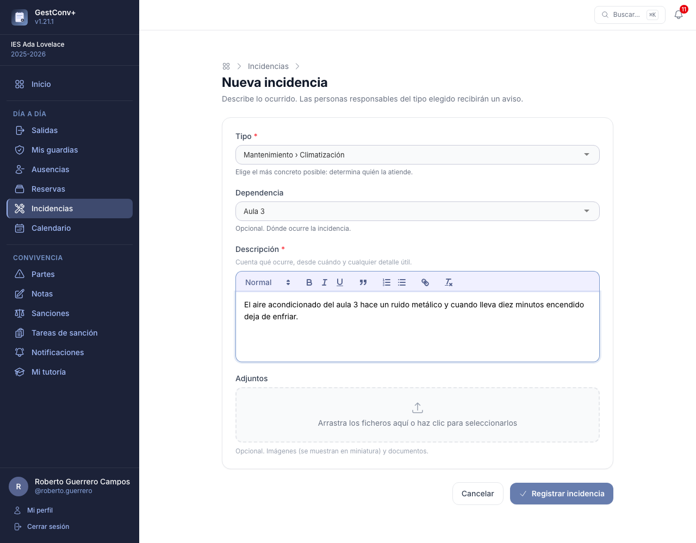

- **Tipo** (obligatorio). Una lista jerárquica que define el centro (por ejemplo, *Mantenimiento ›
  Electricidad*), con buscador. Elige el más concreto posible: **determina quién la atiende**.
- **Dependencia** (opcional). Dónde ocurre, del catálogo de
  [Ubicaciones](12-administrar-el-centro.md#ubicaciones) del centro.
- **Descripción** (obligatoria), con formato de texto enriquecido.
- **Adjuntos** (opcionales). Las **imágenes** se muestran en miniatura en la ficha y los **demás
  documentos** (PDF, ofimática, texto) se descargan.

Al registrarla se avisa a las personas **responsables** del tipo (ver [Avisos](#avisos-de-incidencias)).
Una incidencia recién registrada está **Abierta** y **sin prioridad**.

Si la incidencia es sobre un recurso reservado, se registra desde la **ficha de la reserva** (botón
**Registrar incidencia** de una reserva aprobada, para quien la hizo, los responsables de su categoría
y la dirección): queda asociada a la reserva, que ya
incluye el recurso, y no se pide la dependencia. Ver
[Incidencias de las reservas](09-reservas.md#incidencias-de-las-reservas).

## La ficha de la incidencia

Cada incidencia tiene un número (**Incidencia #12**) y una ficha. Arriba, en una sola fila, van los
**datos** (quién la registró y cuándo, la dependencia o la reserva, los plazos y, si se cerró, la
incidencia original de la que es duplicada) y, para quien la gestiona, el panel **Gestionar**. Debajo,
uno bajo otro: la **descripción**, los **adjuntos** (con sus miniaturas), las **observaciones** y el
**historial** de cambios.

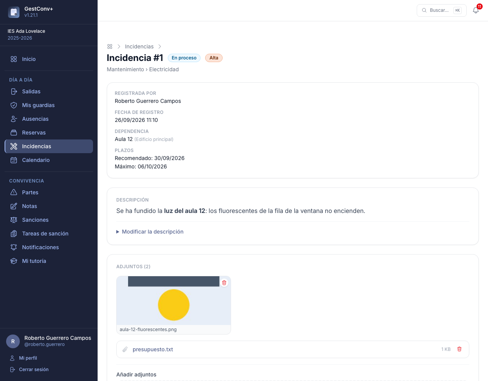

- **Observaciones.** Cualquier persona relacionada con la incidencia (quien la registró y sus
  responsables) puede añadir observaciones, que quedan con su fecha y hora, y subir más adjuntos.
- **Descripción.** Quien la registró puede modificarla mientras esté abierta; los responsables,
  siempre. Los adjuntos los quita quien los subió (mientras esté abierta) o un responsable.
- **Historial.** Cada cambio (alta, estado, prioridad, tipo, dependencia, descripción y adjuntos)
  queda anotado con quién lo hizo, cuándo y el valor anterior y el nuevo.

## Estados y prioridad

| Estado | Significado |
|---|---|
| **Abierta** | Registrada, a la espera de atención. |
| **En proceso** | Un responsable la está atendiendo. |
| **Solucionada** | Cerrada: está arreglada. |
| **No procede** | Cerrada: no es algo que se pueda o deba hacer. |
| **Cerrada por duplicidad** | Cerrada: ya estaba registrada. Enlaza con la incidencia original. |

La **prioridad** la asigna el responsable (una incidencia nueva no tiene). Las del centro, de más a
menos importante, son por defecto *Crítica*, *Alta*, *Media* y *Baja*, con su color. **Asignar una
prioridad es lo que permite poner la incidencia «en proceso»**: mientras no la tiene, ese estado no se
ofrece en el panel **Gestionar** ni en el formulario de observación (se habilita al elegir una
prioridad en el panel); para cerrarla no hace falta. Cada
prioridad puede tener un **plazo recomendado** y un **plazo máximo**, en días lectivos desde que se
asigna: la ficha muestra las dos fechas, y el listado marca en rojo el plazo máximo de las
incidencias abiertas que ya lo han **vencido**.

## Gestionar una incidencia

Quien es **responsable** del tipo (propio o heredado de un tipo superior) y la dirección ven en la
ficha el panel **Gestionar**: prioridad, estado, **asignada a**, tipo y dependencia. Para cerrar por duplicidad se
elige la incidencia original en un **desplegable con buscador** (por número, tipo o texto); una
incidencia cerrada **se puede reabrir** si se es responsable. La **dirección** (administradores del
centro y de la plataforma) tiene además el botón **Eliminar incidencia**, que la borra con sus
observaciones, adjuntos e historial (pide confirmación y no se puede deshacer; las que estaban
cerradas como duplicadas de ella se quedan cerradas, sin enlace).

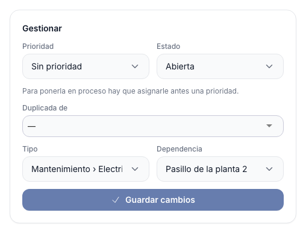

Para cerrarla con un comentario, en un solo paso, el responsable puede escribir la **observación** y
elegir el **estado** en el mismo formulario:

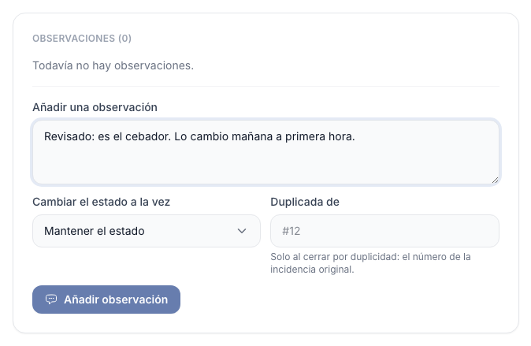

**Asignar la incidencia a una persona.** El campo opcional **Asignada a** (solo para responsables y
dirección) permite elegir, en un desplegable con buscador, a **cualquier docente del curso** (y, cuando
el centro los tenga, al personal no docente asociado). La persona asignada recibe un aviso, **ve la
incidencia** aunque no la haya registrado ni sea responsable, y puede **añadir observaciones y cambiar
su prioridad y su estado** (también cerrarla o reabrirla), pero no el tipo, la dependencia ni la
asignación, ni eliminarla. Las incidencias asignadas a cada persona salen en el filtro **Las asignadas
a mí** del listado, en la campana (**Incidencias asignadas a ti**) y en el recordatorio de las vencidas.

## Informe de una incidencia {#informe-de-una-incidencia}

El botón **Informe PDF** de la ficha genera un documento con **todos los datos** de la incidencia:
tipo, estado, prioridad, quién la registró y cuándo, a quién está asignada, la dependencia o la
reserva, los plazos y el cierre; su **descripción**; la lista de **adjuntos** (con la miniatura de las
imágenes); todas las **observaciones**, con su autor y su fecha y hora; y el **historial** de cambios.
Lo puede generar quien puede ver la incidencia. Se abre en una pestaña nueva (con `?descargar=1`
en la dirección se descarga) y se personaliza como los demás informes: encabezado, margen, pie y plantilla
PDF de fondo, en Ajustes › Personalización de informes y Plantillas de informes (ver
[Personalización de informes](13-administrar-la-plataforma.md#personalizacion-de-informes)).

## El listado

La sección abre el **listado**: paginado, con búsqueda, filtros y orden. De entrada solo salen las
incidencias **abiertas** (abiertas y en proceso); el filtro de estado permite ver las cerradas o
todas.

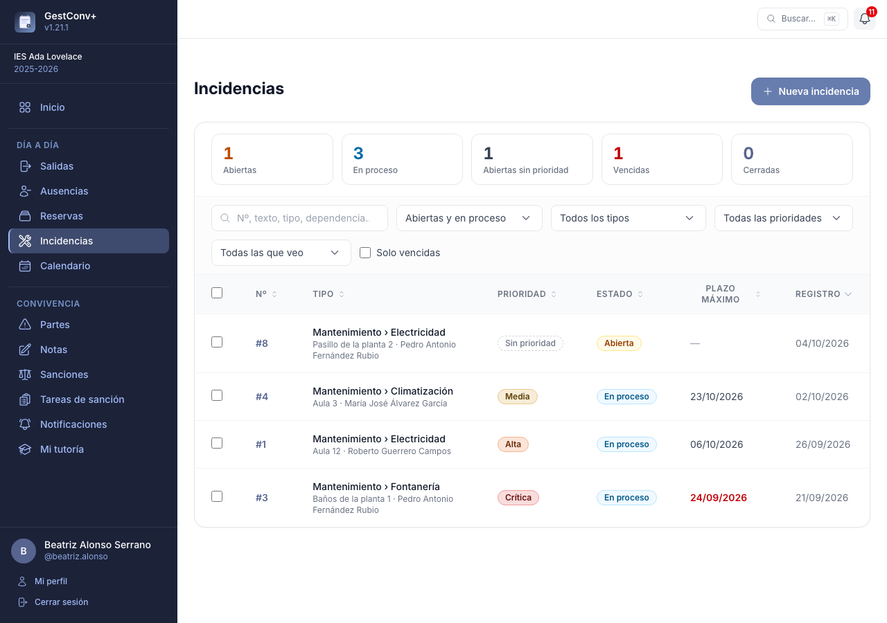

- **Qué se ve.** Quien solo informa ve **las que ha registrado**. Un responsable ve también las de
  los tipos que gestiona (y los de debajo) y la dirección, todas.
- **Cifras.** Arriba, unas tarjetas que son también atajos: un responsable ve las **abiertas**, las
  **en proceso**, las **abiertas sin prioridad**, las **vencidas** y las **cerradas**; quien solo
  informa, sus incidencias abiertas, en proceso y cerradas.
- **Filtros.** Estado, tipo (incluye los que cuelgan de él), prioridad (o «sin prioridad»), ámbito
  (*las que he registrado* / *las que gestiono*) y **solo vencidas**. El buscador mira el número
  (**#12**), el texto, el tipo, la dependencia y la persona. Los filtros **se recuerdan** la próxima
  vez que se abre el listado.
- **Orden.** Pulsa la cabecera de número, tipo, prioridad, estado, plazo o registro.

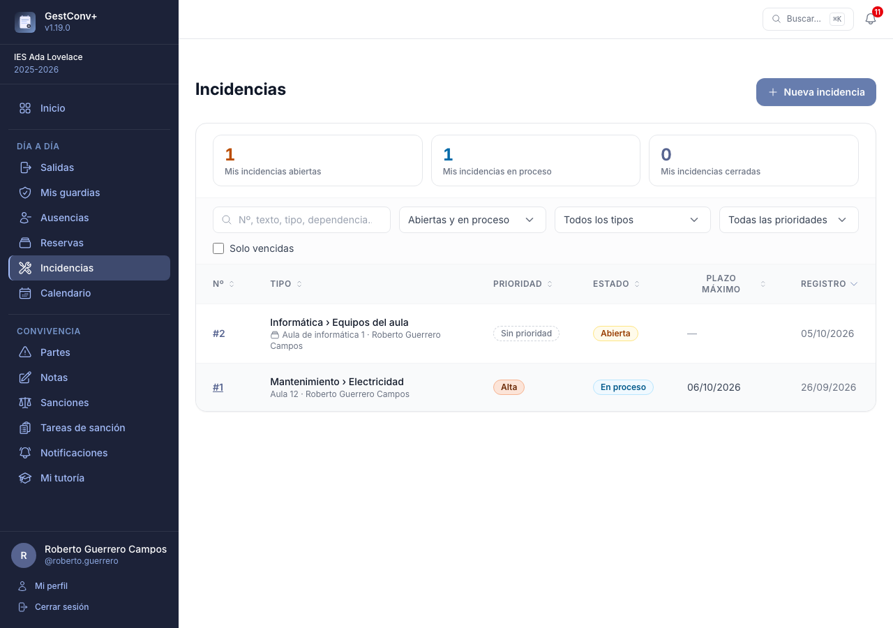

**Cambio en bloque.** Los responsables marcan varias incidencias y pulsan **Poner en proceso**,
**Cerrar: solucionada**, **Cerrar: no procede** o **Reabrir**. Las que no se pueden cambiar (por
ejemplo, poner en proceso una sin prioridad) se dejan como están y se cuentan en el aviso. La
**dirección** ve además un botón rojo **Eliminar**, que borra las marcadas con sus observaciones,
adjuntos e historial tras pedir confirmación (no se puede deshacer).

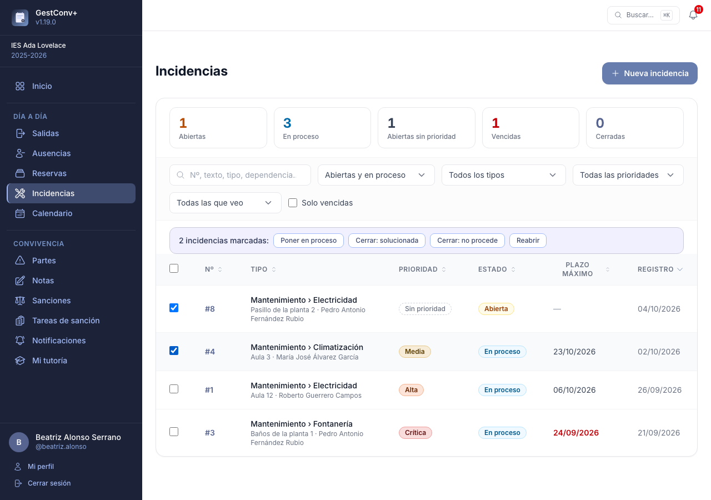

Para la dirección, la cabecera del listado tiene el botón **Tipos y prioridades**, que lleva a la
[configuración del módulo](#incidencias-del-centro).

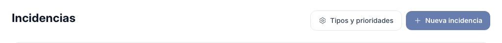

## Avisos {#avisos-de-incidencias}

Cada novedad se avisa por correo a las personas **afectadas**, salvo a quien la hace:

| Aviso | A quién llega |
|---|---|
| Nueva incidencia | A los responsables del tipo. Si el tipo no tiene ninguno en su rama, a la dirección. |
| Incidencia asignada | A la persona a quien se asigna. Quien la registró, los responsables y la persona asignada antes reciben el aviso de cambio de datos. |
| Cambio de estado | A quien la registró y a los responsables. |
| Prioridad asignada | A quien la registró y a los responsables. |
| Nueva observación | A quien la registró y a los responsables, con el texto. |
| Cambios en los datos | A quien la registró y a los responsables (tipo, dependencia o descripción). |
| Incidencias vencidas | Recordatorio **diario** (solo días lectivos) a cada responsable, con todas sus incidencias abiertas que han pasado el plazo máximo. |

Cada persona puede dejar de recibir cada tipo de aviso en sus ajustes, y el centro o la plataforma
pueden fijarlo para todos (ver
[Avisos que se reciben](13-administrar-la-plataforma.md#avisos-que-se-reciben)). Quien prefiere el
**resumen diario** recibe estos avisos, y el recordatorio de las vencidas, como líneas de ese correo.

También se ven sin salir de la aplicación:

- La **campana** avisa a los responsables de las incidencias **por atender** (nuevas, sin
  gestionar) y **vencidas**, y a quien las registró, de las **novedades de la última semana**.

  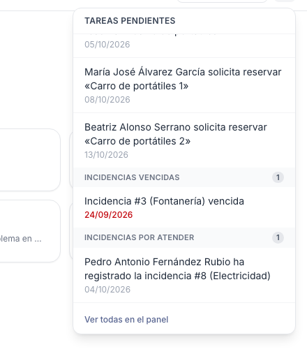

- El **panel de inicio** ofrece **Nueva incidencia** y, con el número, las incidencias abiertas o
  vencidas.

  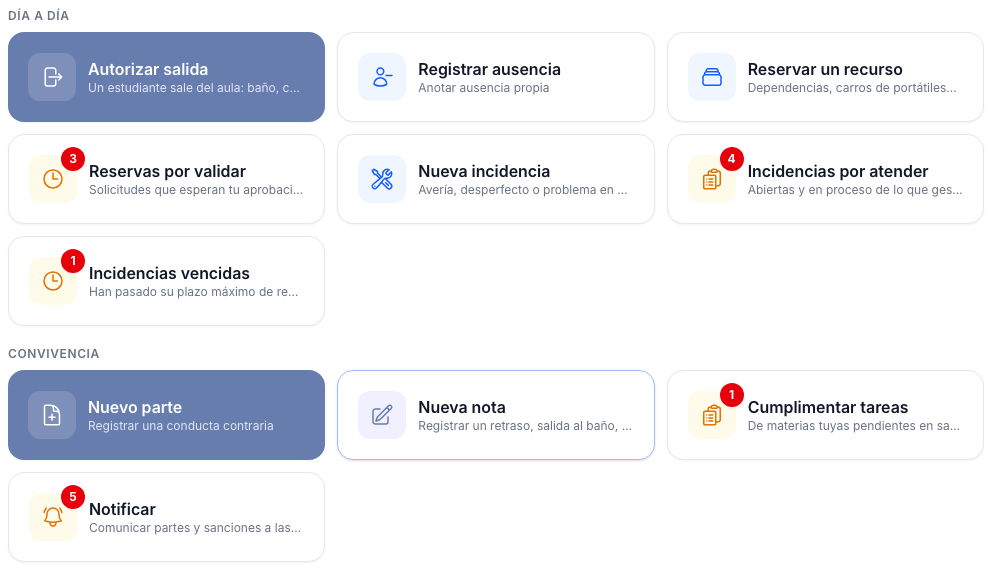

- El **buscador global** encuentra las incidencias propias o gestionadas por número, texto, tipo o
  dependencia.

  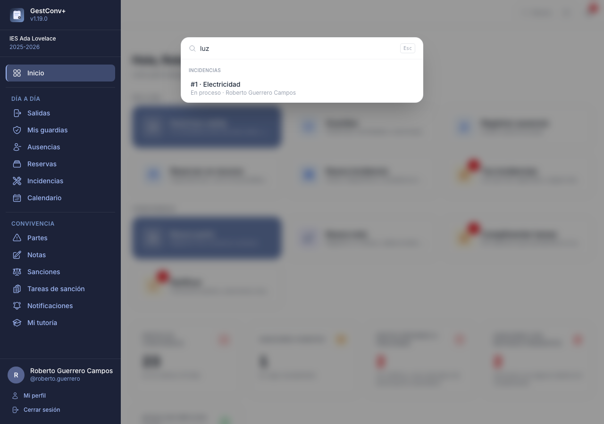

## Informe de incidencias {#informe-de-incidencias}

**Informes › Incidencias**, para quienes administran el centro, ayuda a ver **cuáles son los
problemas más frecuentes y los más difíciles de arreglar**. Analiza las incidencias **registradas**
en un rango de fechas del curso visualizado:

- **Resumen**: registradas, cerradas (con su porcentaje), abiertas, **abiertas y vencidas**,
  **tiempo medio** y **mediana** de cierre, tiempo medio hasta la **primera gestión** (la primera
  prioridad, estado o asignación) y porcentaje de cerradas **dentro del plazo máximo**.
- **Cómo se han cerrado**: solucionadas, *no procede* y cerradas por duplicidad, con su porcentaje
  y su tiempo de cierre.
- **Cumplimiento de plazos**: de las incidencias cerradas con plazo, cuántas se cerraron a tiempo
  respecto al **plazo máximo** y al **recomendado** de su prioridad, y cuántas abiertas ya lo han
  superado.
- **Qué problemas pesan más**: los tipos con más incidencias, los que más tardan en cerrarse y los
  que más se salen de plazo.
- **Por prioridad** y **por tipo** (agrupado por tipo raíz, con subtotales), con las mismas
  cifras en cada fila.
- **Dependencias con más incidencias** y **evolución por mes** de registro, con lo que ha pasado
  con las registradas cada mes.

Los tiempos cuentan desde el registro y solo de las incidencias cerradas. Se exporta a **PDF**
(vertical, con encabezado y plantilla personalizables, ver
[Personalización de informes](13-administrar-la-plataforma.md#personalizacion-de-informes)) y a
**hoja de cálculo**, con una fila por tipo. El informe desaparece si el módulo de Incidencias está
desactivado.

## Configurar los tipos y las prioridades {#incidencias-del-centro}

**Centro educativo › Incidencias** (administración del centro) configura cómo se registran y se atienden las
[incidencias](#incidencias) del centro: los **tipos**, con sus responsables, y las
**prioridades**. Además de desde el panel del centro, se llega con el botón **Tipos y prioridades** del
listado de incidencias. Esta tarjeta solo aparece si el módulo de **Incidencias** está activado.

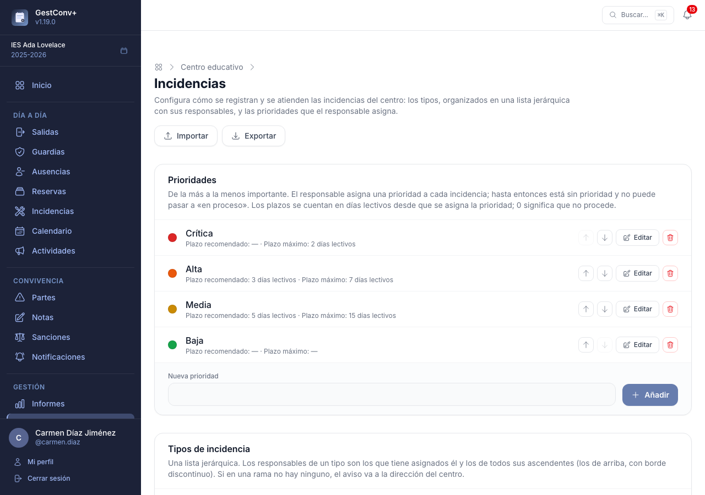

**Prioridades.** Una lista ordenada **de la más a la menos importante** (se reordena con las
flechas). El centro empieza con *Crítica*, *Alta*, *Media* y *Baja*, con un degradado de rojo a verde.
Cada una tiene un **nombre**, un **color** y dos plazos en **días lectivos** contados desde que se
asigna la prioridad: el **recomendado** y el **máximo**. Con **0** esa prioridad no tiene plazo
(por defecto, el recomendado es 0, y el máximo, 1 día para *Crítica*, 7 para *Alta* y 0 para las
demás). Cambiar los plazos no mueve las fechas de las incidencias que ya tienen la prioridad. Una
prioridad que alguna incidencia usa no se puede eliminar. Sin prioridades, los responsables no pueden
poner las incidencias en proceso.

**Tipos.** Una lista **jerárquica** (por ejemplo, *Mantenimiento › Electricidad*, *Informática › Red y
wifi*). Cada tipo tiene:

- **Nombre** y **Cuelga de**: el tipo del que depende en la lista (o el nivel superior).
- **Responsables**: uno o varios docentes del curso o personas del [personal no docente](12-administrar-el-centro.md#personal-no-docente) del centro, elegidos en un buscador. Reciben el aviso de las
  incidencias de ese tipo y de **todos los que cuelgan de él**, y las gestionan. Los **responsables de
  un tipo son los suyos más los de todos sus ascendentes**: quien gestiona *Mantenimiento* gestiona
  también *Electricidad*. Si en una rama no hay ningún responsable, el aviso va a la dirección del
  centro.
- **Estado**: un tipo **inactivo** no se ofrece al registrar incidencias nuevas, pero las que ya lo
  usan se conservan. Un tipo con incidencias, o con otros tipos debajo, no se puede eliminar:
  márcalo como inactivo.

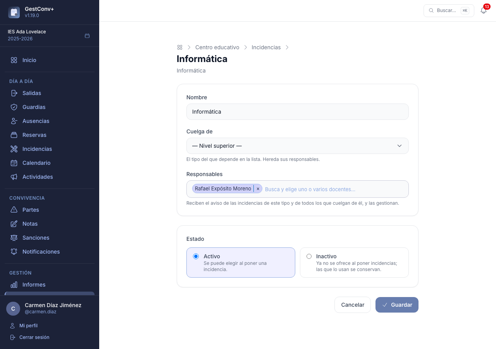

**Exportar e importar.** Los botones **Exportar** e **Importar** de la cabecera copian los tipos y las
prioridades entre centros o cursos en un fichero JSON, con los responsables incluidos (cada uno con su
**usuario IdEA** y su nombre). Al importar se abre una **vista previa** en la que se elige qué tipos y
qué prioridades traer, si se importan los responsables y si lo que ya existe se **ignora** o se
**sustituye**; cada elemento indica si es *Nuevo* o *Ya existe* (los tipos se emparejan por su ruta y
las prioridades por su nombre). Los responsables se buscan entre los docentes del curso activo y los
que no estén se omiten, con un aviso. Nunca se borra nada.

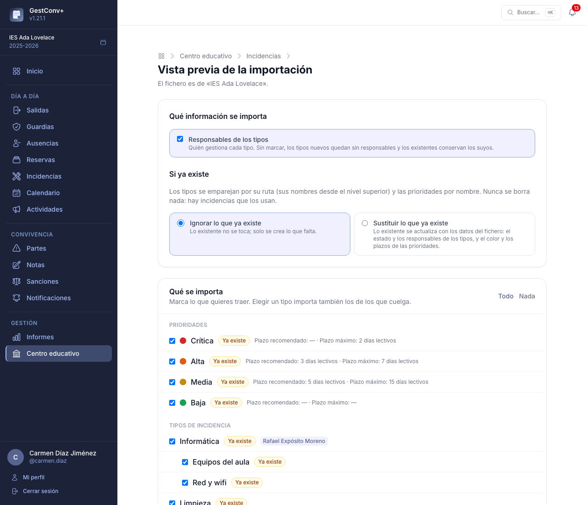

Los avisos por correo de las incidencias (a quién llegan y cómo se desactivan) se explican en
[Avisos de incidencias](#avisos-de-incidencias).

