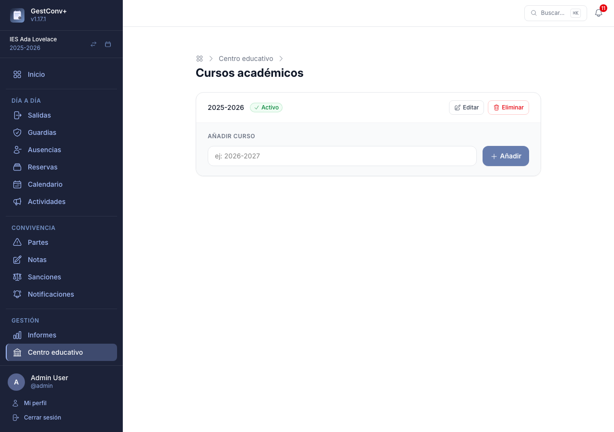
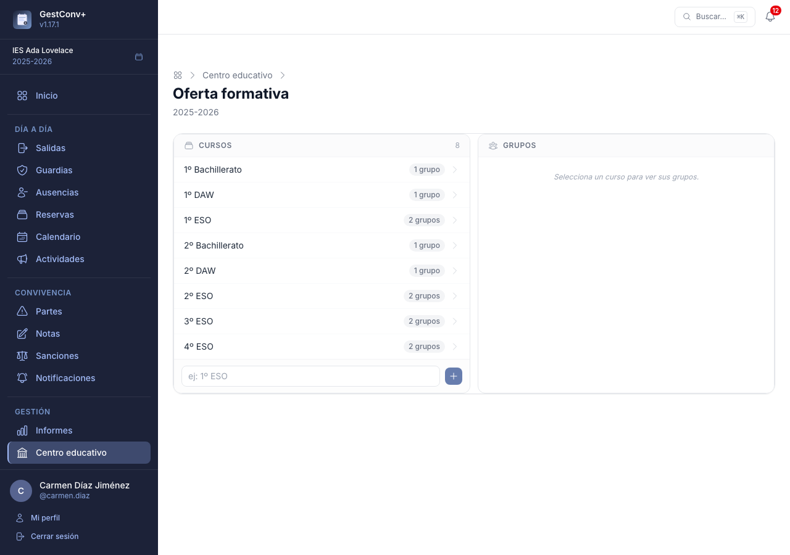
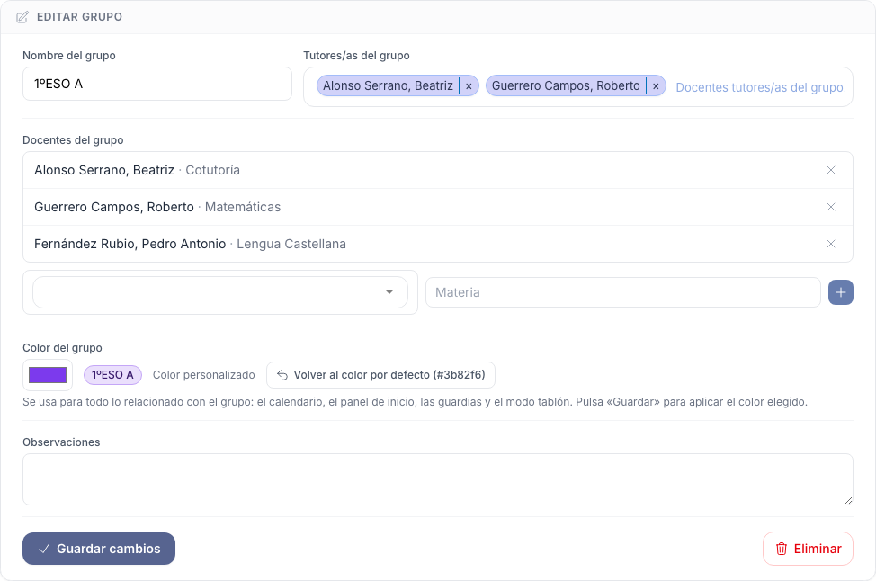
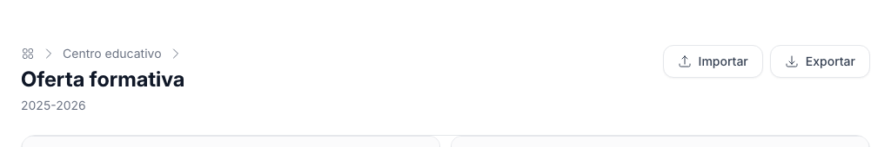
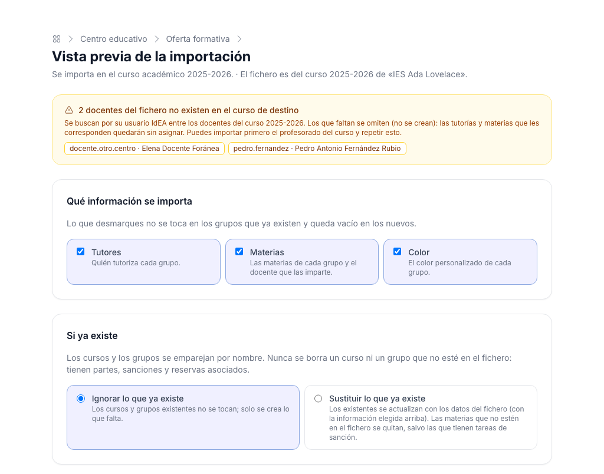
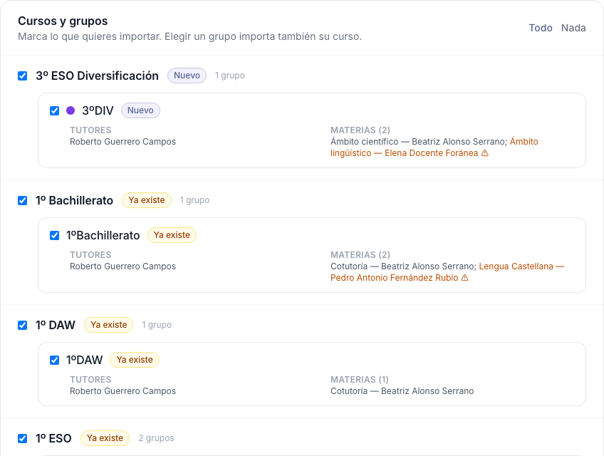
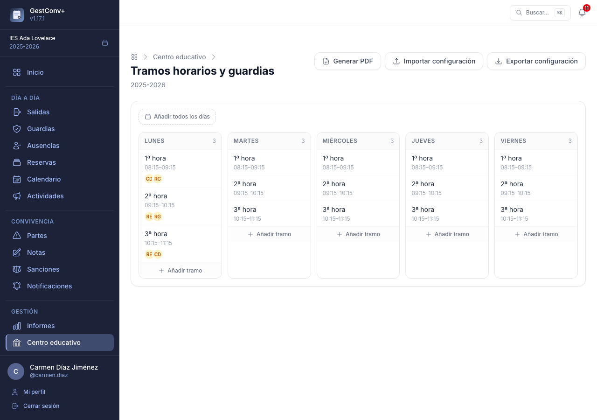
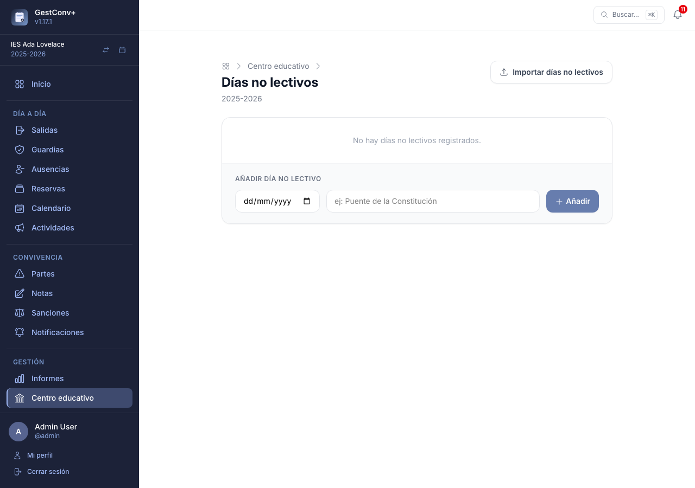
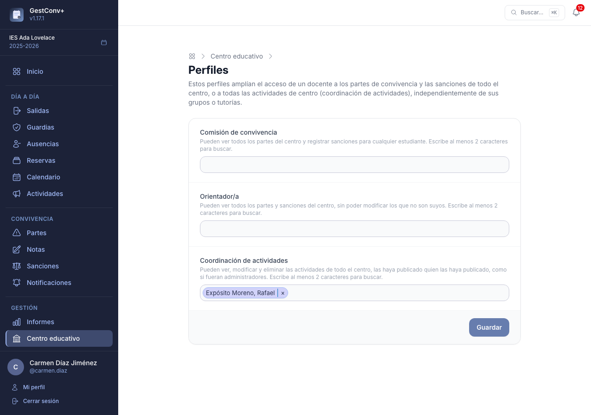
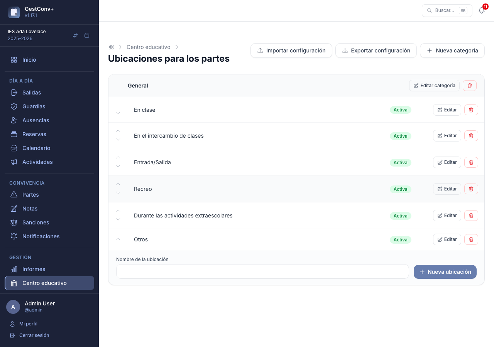

# Administrar el centro educativo {#administrar-el-centro-educativo}

Este capítulo es para quienes administran el centro — normalmente, el **equipo directivo**. La
puesta en marcha de cada curso (profesorado, alumnado, grupos y tutorías) se explica en
[Preparar el curso académico](02-preparar-el-curso-academico.md); aquí se cubre la administración
común a todo el centro: el panel, los cursos, la oferta formativa, los tramos horarios, los días no
lectivos, los perfiles, el personal no docente, el catálogo de ubicaciones y los ajustes. La
configuración propia de cada módulo está en su capítulo, en el apartado de configuración:
[convivencia](06-convivencia-administracion.md), [salidas](07-salidas.md#motivos-de-salida-del-aula),
[reservas](09-reservas.md#recursos-compartidos), [incidencias](10-incidencias.md#incidencias-del-centro)
y [actividades](11-calendario-actividades-y-tablon.md#tipos-de-actividad).

## El panel del centro educativo

La sección **Centro educativo** del menú lateral es el panel de configuración del centro,
reservado a los administradores. Sus tarjetas dan acceso a los cursos académicos, los docentes,
el personal no docente, la oferta formativa, los estudiantes, los tramos horarios, los días no
lectivos, los catálogos del centro, las incidencias (tipos y prioridades), los perfiles especiales,
los ajustes y el registro de avisos por correo. Las que configuran un módulo concreto se explican
en el capítulo de ese módulo.

Las tarjetas de **Docentes** y **Estudiantes** —altas e importaciones desde Séneca— se explican
paso a paso en [Preparar el curso académico](02-preparar-el-curso-academico.md); el resto, a
continuación.

### Cursos académicos

La tarjeta **Cursos académicos** gestiona los cursos del centro: crearlos, renombrarlos,
eliminarlos y establecer cuál es el activo.

- **Añadir** — un formulario con el nombre del curso (por ejemplo, `2026-2027`) lo crea de
  inmediato.
- **Establecer activo** — cambia el curso activo del centro; a partir de ese momento, los partes,
  sanciones y demás datos nuevos se asocian a él. El curso anterior queda disponible como
  histórico (ver
  [Cambio de curso académico](03-usar-la-aplicacion.md#cambio-de-curso-academico-administradores)).
- **Editar** — permite corregir el nombre de un curso.
- **Eliminar** — solo disponible en cursos que no sean el activo.

A diferencia del resto de tarjetas del panel, esta no requiere un curso académico activo para
poder usarse: es precisamente la que permite crear el primero.

### Oferta formativa

La tarjeta **Oferta formativa** abre un editor de dos columnas para el curso académico activo: la
izquierda muestra los cursos del año y la derecha, los grupos del curso seleccionado. Al
seleccionar un curso o un grupo aparece su formulario de edición debajo; los cambios se aplican
al instante, sin recargar la página.

- **Cursos** — cada entrada del año activo (por ejemplo, «1º ESO», «2º Bachillerato»). Desde su
  formulario se puede cambiar el nombre y añadir observaciones.
- **Grupos** — unidades de un curso (por ejemplo, 1ºA, 1ºB). Cada grupo pertenece a un único
  curso, y su formulario permite asignar tutores/as y docentes, y elegir su **color** (ver
  más abajo).
- **Aviso de grupos sin tutoría** — sobre las columnas, un cuadro ámbar indica cuántos grupos del
  curso activo no tienen tutor/a. Se despliega con **Ver los grupos**, lista los grupos agrupados
  por curso y cada uno es un enlace que abre directamente su panel de detalle (también se puede
  compartir esa dirección). Desaparece solo cuando todos los grupos tienen tutoría.

#### Color de un grupo

Cada grupo tiene un color que se aplica a todo lo relacionado con él: las barras del
[calendario](11-calendario-actividades-y-tablon.md), los listados del panel de inicio, las guardias y el modo
tablón, así como el nombre del grupo en los listados de partes, sanciones, notas y salidas.

- Sin hacer nada, cada grupo usa un **color por defecto** que la aplicación calcula a partir del
  propio grupo, de modo que siempre es el mismo y los distintos grupos se distinguen entre sí. El
  formulario del grupo muestra ese color y su código (por ejemplo, `#3b82f6`).
- Para **personalizarlo**, marca la casilla **Color personalizado**: aparece el selector de color,
  que parte del color calculado para que lo modifiques. Elige el que quieras y pulsa **Guardar**.
  Un punto de color junto al nombre del grupo en la columna de grupos muestra el que tiene.
- Para **volver al color por defecto**, desmarca la casilla y pulsa **Guardar**: se elimina el color
  personalizado y el grupo recupera el calculado.

Si el centro no tiene un curso académico activo, la sección muestra un aviso y no permite
gestionar la oferta formativa. El paso a paso completo está en
[Preparar el curso académico](02-preparar-el-curso-academico.md#la-oferta-formativa-a-mano).

#### Exportar e importar la oferta {#exportar-e-importar-la-oferta}

Los botones **Exportar** e **Importar** de la cabecera permiten llevar la oferta de un curso académico a otro
(por ejemplo, del curso que acaba al nuevo) o de un centro a otro, sin volver a montarla a mano.

- **Exportar** descarga un fichero JSON con la oferta del curso que se está viendo, también si es un curso
  pasado: los cursos, y en cada uno sus grupos con su **color**, sus **tutores** y sus **materias** (con el
  docente que imparte cada una). No incluye el alumnado, que tiene su propia
  [importación](02-preparar-el-curso-academico.md).
- Los **docentes** van identificados por su **usuario IdEA** (y su nombre, solo como referencia), no por un
  identificador interno: por eso el fichero sirve entre cursos académicos y entre despliegues distintos. Al
  importar, cada usuario se busca entre los docentes del **curso de destino**; los que no existan allí no se
  crean (importa antes el profesorado del curso) y se omiten, con un aviso que los lista.
- **Importar** escribe siempre en el **curso activo**, así que el botón no aparece mientras se mira otro curso.
  Se hace en tres pasos: elegir el fichero, revisar la **vista previa** y confirmar.

En la **vista previa** se ve qué contiene el fichero, curso por curso y grupo por grupo, con una etiqueta que
indica si cada uno es **Nuevo** o **Ya existe** en el curso de destino (se emparejan por nombre, sin distinguir
mayúsculas), y los docentes que faltan marcados con ⚠. Si hay docentes del fichero que no existen en el curso de
destino, un aviso en la parte superior los lista.

Ahí se elige:

- **Qué cursos y grupos** importar: todos vienen marcados. Marcar un curso marca sus grupos y marcar un grupo
  marca también su curso.

  

- **Qué información**: **tutores**, **materias** y **color**. Lo que se desmarque no se toca en los grupos que
  ya existen y queda vacío en los nuevos.
- **Qué hacer con lo que ya existe**: **ignorarlo** (por defecto: no se toca y solo se crea lo que falta) o
  **sustituirlo** (se actualiza con los datos del fichero y la información elegida; las materias que no estén
  en el fichero se quitan).

Ningún modo **borra** cursos ni grupos que no estén en el fichero: tienen partes, sanciones, salidas y reservas
asociados. Al sustituir las materias, las asignaciones que tienen **tareas de sanción** se conservan (el aviso
final indica cuántas), igual que al quitarlas a mano desde el editor. La importación queda anotada en el
[registro de actividad](13-administrar-la-plataforma.md#registro-de-actividad).

### Tramos horarios

La tarjeta **Tramos horarios** define los tramos en los que se organiza la jornada (1ª hora,
recreo, 2ª hora…) y quién está de guardia en cada uno, dentro del curso académico activo. El
editor muestra un tablero de cinco columnas, una por día lectivo de lunes a viernes.

- **Añadir tramo** — al pie de cada columna, crea un tramo solo para ese día: nombre, hora de
  inicio y hora de fin.
- **Añadir todos los días** — el botón situado sobre el tablero crea el mismo tramo (mismo
  nombre y horario) en los cinco días a la vez, para no repetir el alta cinco veces cuando el
  horario es igual toda la semana.
- Al seleccionar un tramo se abre su formulario de edición, con el campo **Docentes de
  guardia**: un buscador con autocompletado que admite varios docentes a la vez. Eliminar un
  tramo borra también su asignación de guardias, y pide confirmación porque no se puede deshacer.
- El tablero muestra, bajo el nombre y el horario de cada tramo, un grupo de avatares con las
  iniciales de los docentes de guardia (nombre completo al pasar el ratón por encima). A partir
  de seis docentes en un mismo tramo, los siguientes se resumen en una burbuja **+N** en vez de
  seguir añadiendo avatares.

Al igual que los catálogos del centro, los tramos horarios se pueden **exportar** e **importar en
JSON** para copiar la configuración entre centros, con la opción de vaciar los tramos existentes
antes de importar.

El botón **Generar PDF** descarga un informe apaisado de una sola tabla: una fila por cada
combinación de hora de inicio y fin que exista en la semana, con una columna por día de lunes a
viernes y el nombre completo de cada docente de guardia en una línea distinta dentro de su celda.
El encabezado admite el mismo tipo de personalización que el resto de informes (ver
[Personalización de informes](13-administrar-la-plataforma.md#personalizacion-de-informes)).

### Días no lectivos

La tarjeta **Días no lectivos** lleva el calendario de festivos, puentes y demás jornadas sin
clase del curso académico activo: cada entrada tiene una fecha y una descripción opcional (por
ejemplo, «Puente de la Constitución»).

- **Añadir día no lectivo** — al pie del listado, un formulario con la fecha y una descripción
  opcional lo crea de inmediato. No se admite repetir una fecha ya registrada en el mismo curso.
- **Editar** y **Eliminar** — junto a cada entrada; eliminar pide confirmación.
- **Importar días no lectivos** — la pantalla de importación ofrece dos vías:
  - *Desde CSV de Séneca* (opción recomendada): exporta desde
    **Centro › Organización del centro › Calendario y Jornada › Calendario escolar › Días festivos**
    y sube el CSV directamente. Solo se importan los días marcados con «Sí» en la columna
    *Afecta al personal docente*; el resto se contabilizan como descartados y no se crean.
  - *Desde iCal*: sube el fichero `.ics` descargado desde la
    [Secretaría Virtual de la Consejería de Educación](https://www.juntadeandalucia.es/educacion/secretariavirtual/consulta/calendario-escolar/).

  En ambos casos, las fechas que ya existan en el curso no se duplican, así que el mismo fichero
  se puede volver a importar sin riesgo (por ejemplo, tras una actualización del calendario oficial).

Esta iteración solo gestiona el catálogo de días no lectivos: todavía no se usa para excluir esas
fechas de otras pantallas (tramos horarios, ausencias, calendario de sanciones).

### Perfiles

La tarjeta **Perfiles** asigna los roles especiales a docentes concretos del centro:

- **Comisión de convivencia** — ven todos los partes del centro y pueden registrar sanciones para
  cualquier estudiante, con los mismos permisos que un administrador de centro sobre partes y
  sanciones.
- **Orientador/a** — ven todos los partes y sanciones del centro, pero no pueden crear, editar ni
  eliminar los que no han registrado ellos mismos.
- **Coordinación de actividades** — ven, modifican y eliminan todas las
  [actividades de centro](11-calendario-actividades-y-tablon.md#actividades-de-centro), las haya publicado quien
  las haya publicado, como si fueran administradores; y pueden publicar aunque el ajuste solo lo
  permita a la dirección. Este perfil solo se ofrece si las Actividades están activadas.

Los perfiles se asignan mediante buscadores de docentes con autocompletado, restringidos al
curso académico activo. Ninguno concede acceso al resto del panel del centro (oferta
formativa, estudiantes, catálogos…): solo amplían la visibilidad y los permisos sobre partes y
sanciones, o sobre las actividades (ver [Permisos de un vistazo](15-permisos-de-un-vistazo.md)).

### Personal no docente {#personal-no-docente}

La tarjeta **Personal no docente** gestiona las cuentas de quienes trabajan en el centro sin dar
clase (conserjería, administración, mantenimiento…) y necesitan registrar o atender incidencias.

- **Qué pueden hacer.** Solo acceden al módulo de [Incidencias](10-incidencias.md#incidencias):
  registran las suyas, ven las que han registrado o tienen asignadas, y pueden ser **responsables de
  tipos de incidencia** y **asignadas a** una incidencia. No ven ningún otro módulo (estudiantes,
  partes, sanciones, calendario…) ni aparecen en los listados ni en los buscadores de docentes.
- **Sin curso académico.** Pertenecen al centro, no a un curso: siguen en él al cambiar de curso.
  Tampoco autentican en Séneca: tienen usuario y contraseña propios de GestConv+.
- **Módulo desactivado.** Si el módulo de Incidencias está desactivado en el centro, su cuenta no puede
  entrar en él aunque esté autenticada: en la pantalla de selección de centro aparece bloqueado, con
  un mensaje que explica el motivo. Podrán entrar cuando se vuelva a activar.
- **Incorporar.** Escribe el **identificador o el correo electrónico** (coincidencia exacta) de una
  cuenta existente de personal no docente —por ejemplo, la de alguien que ya trabaja en otro
  centro— y pulsa **Añadir**. Las cuentas de docentes y de administración global no se pueden
  incorporar como personal no docente.
- **Registrar una cuenta nueva.** Si no existe, la pantalla ofrece registrarla con nombre, apellidos,
  usuario y correo electrónico (obligatorio), y elegir cómo recibirá su acceso:
  - *Establecer una contraseña ahora*: la persona deberá cambiarla en su primer acceso.
  - *Enviar un enlace de invitación*: recibe un correo, válido durante 7 días, para establecer ella
    misma su contraseña. Desde el listado se puede **reenviar la invitación** cuando caduca.
- **Editar.** Se pueden modificar nombre, correo, usuario, contraseña y estado (activo/inactivo) en
  cualquier momento. La cuenta es global: si la persona pertenece a más de un centro, los cambios
  se aplican en todos.
- **Quitar del centro.** La persona deja de pertenecer al centro y de ser responsable de sus tipos
  de incidencia; las incidencias que registró se conservan. La cuenta no se elimina.

## Catálogos del centro

Al crear el centro se configuran automáticamente varios catálogos con valores por defecto,
pensados para empezar a trabajar sin más preparación. Conviene revisarlos al menos una vez y
adaptarlos al plan de convivencia del centro. Todos comparten la misma mecánica: cada
elemento se puede **activar o desactivar** (solo los activos aparecen en los formularios), se
reordena con las flechas, y se puede editar o eliminar. Cada catálogo se explica en el capítulo
del módulo que lo usa:

- **Conductas contrarias a la convivencia**, **Medidas disciplinarias**, **Métodos de comunicación**
  y **Tipos de notas diarias**: [Convivencia: la administración](06-convivencia-administracion.md).
- **Motivos de salida del aula**: [Salidas del aula](07-salidas.md#motivos-de-salida-del-aula).
- **Recursos compartidos**: [Reservas de recursos](09-reservas.md#recursos-compartidos).
- **Tipos y prioridades de incidencias**: [Incidencias](10-incidencias.md#incidencias-del-centro).
- **Tipos de actividad**: [Calendario, actividades y tablón](11-calendario-actividades-y-tablon.md#tipos-de-actividad).
- **Ubicaciones**, compartidas por varios módulos: a continuación.

### Ubicaciones

En **Centro educativo › Ubicaciones del centro** se configura el catálogo de lugares del centro,
organizado en categorías. Se usa en tres sitios:

- El campo obligatorio **Dónde sucedió** al registrar un parte (ver
  [Registrar un nuevo parte](04-convivencia-profesorado.md#registrar-un-nuevo-parte)).
- La **dependencia** (opcional) de una [incidencia](10-incidencias.md#incidencias).
- Como sugerencias del **lugar de realización** de una
  [actividad](11-calendario-actividades-y-tablon.md#actividades-de-centro), que es un texto libre: se puede elegir
  una ubicación del catálogo o escribir cualquier otro lugar.

**Dónde se ofrecen.** Cada **categoría** tiene un selector de dos opciones, **Solo en los partes** o
**En todos los sitios**. Las ubicaciones de una categoría «solo en los partes» aparecen únicamente en
el campo **Dónde sucedió** de un parte, y no en las incidencias ni en las actividades. Se elige al
crear o editar la categoría, y las que son solo para partes llevan la etiqueta **Solo partes** en el
listado. Una categoría nueva es, por defecto, para todos los sitios; la categoría **General** que
trae cada centro —con las ubicaciones propias de un parte: *En clase*, *Recreo*…— viene **solo para
partes**. Si cambias una categoría que ya usan incidencias, estas conservan su dependencia, aunque
ya no se ofrezca a otras. El ámbito va incluido al exportar e importar el catálogo.

Una ubicación desactivada deja de ofrecerse en los formularios nuevos, pero se conserva en lo ya
registrado. El catálogo por
defecto incluye las ubicaciones más habituales: *En clase*, *En el intercambio de clases*,
*Entrada/Salida*, *Recreo*, *Durante las actividades extraescolares* y *Otros*.

### Copiar catálogos entre centros {#copiar-catalogos-entre-centros}

Los siete catálogos, y también el de recursos compartidos, incluyen botones **Exportar configuración** e **Importar configuración**
para copiar la configuración de un centro a otro: la exportación descarga un fichero con los elementos y sus
categorías, y la importación lo vuelve a cargar, creando lo que no exista y actualizando el resto
por nombre (sin distinguir mayúsculas). Al importar se puede marcar la opción de **vaciar el
catálogo existente** antes de incorporar el fichero; esta acción no se puede deshacer (los
elementos ya usados —métodos de comunicación en alguna comunicación, tipos de nota en alguna
nota, motivos de salida en alguna salida— se conservan aunque se marque).

## Ajustes del centro

La tarjeta **Ajustes** del panel abre los ajustes con ámbito de centro: valores que se aplican a
todo el profesorado del centro por encima del valor global del servidor. Los más relevantes para
el día a día:

- **Quién notifica los partes** y **quién notifica las sanciones** — el docente que los registró,
  el tutor/a del grupo o ambos (valor por defecto). Determinan quién puede registrar las
  comunicaciones con las familias (ver
  [Quién puede notificar](04-convivencia-profesorado.md#quien-puede-notificar)).
- **Días para la prescripción automática de partes** y **aviso de prescripción próxima de
  partes** — controlan las dos tareas diarias descritas [más
  abajo](06-convivencia-administracion.md#prescripcion-automatica-de-partes-sin-notificar).
- **Días para la prescripción automática de sanciones** y **aviso de prescripción próxima de
  sanciones** — lo mismo para las sanciones, que por defecto **no prescriben** (ver [Prescripción
  de sanciones sin notificar](06-convivencia-administracion.md#prescripcion-de-sanciones-sin-notificar)).
- **Avisos por correo** — qué eventos de partes y sanciones generan un correo y a quién (ver
  [Avisos de partes y sanciones](06-convivencia-administracion.md#avisos-de-partes-y-sanciones)).
- **Modo tablón** — duraciones de la alternancia de semanas y tema de colores (ver
  [Ajustes del modo tablón](11-calendario-actividades-y-tablon.md#ajustes-del-modo-tablon)).
- **Personalización de informes** — encabezados, pies y marca de agua de los PDF (ver
  [Personalización de informes](13-administrar-la-plataforma.md#personalizacion-de-informes)).
- **Plantillas de informes** — un PDF propio como fondo de cada página de los informes, general
  o por tipo de informe (ver
  [Plantillas de informes](13-administrar-la-plataforma.md#plantillas-de-informes)).
- **Secciones de la aplicación** — activar o desactivar Salidas, Ausencias, Notas, tareas de
  sanción, Actividades, Reservas, Incidencias y Utilidades en este centro (ver
  [Secciones de la aplicación](13-administrar-la-plataforma.md#secciones-de-la-aplicacion)).

La referencia completa de todos los ajustes, con sus rangos y valores por defecto, está en
[Ajustes disponibles](13-administrar-la-plataforma.md#ajustes-disponibles); la mecánica de
niveles (global, centro, docente) y el bloqueo con candado se explican en
[Sistema de ajustes](13-administrar-la-plataforma.md#sistema-de-ajustes).

