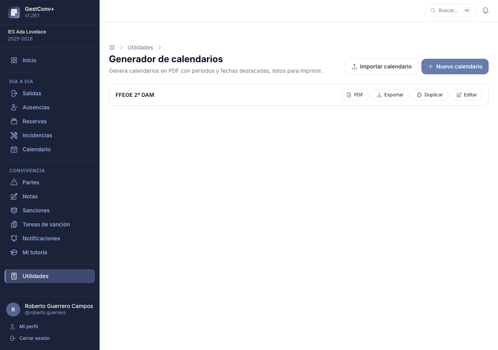
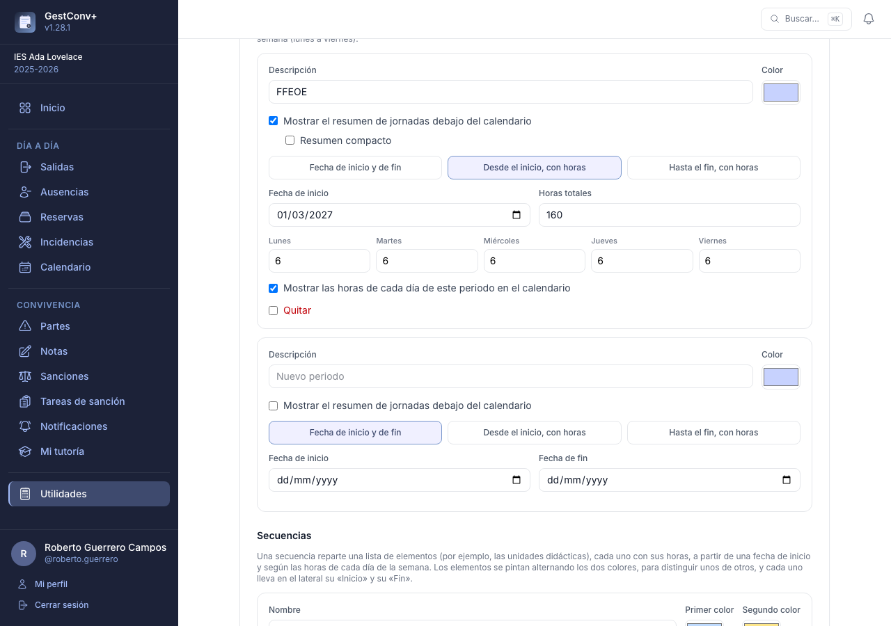
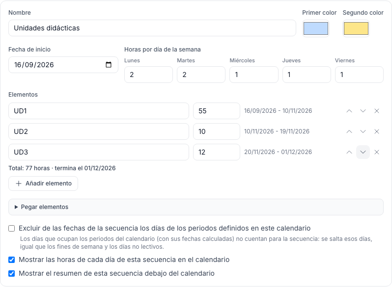
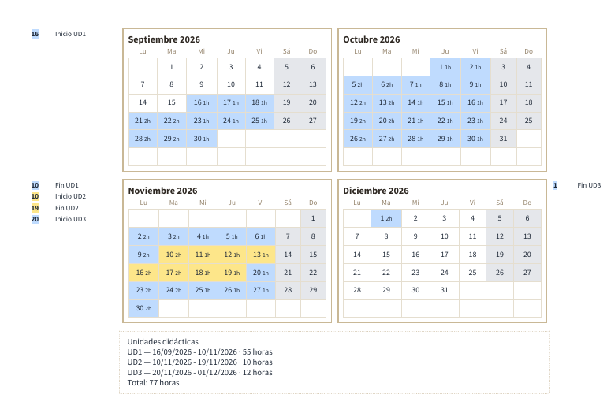
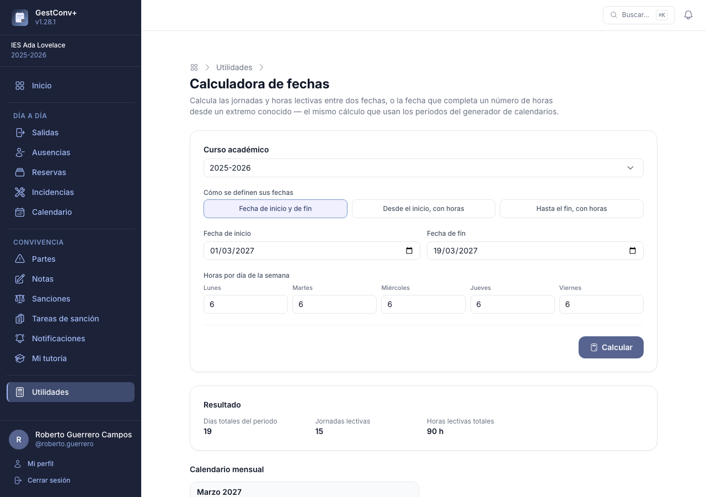

# Utilidades

La sección **Utilidades** reúne herramientas personales del profesorado que no dependen de ningún
otro módulo: nada de lo que hay aquí afecta a los partes, las sanciones ni a ningún otro dato del
centro, ni lo ve nadie más. Cualquier docente con un centro activo puede usarlas, sin necesidad de
ningún perfil especial. El personal no docente, que solo tiene acceso a
[Incidencias](10-incidencias.md), no las ve.

Se abre desde la entrada **Utilidades** del menú lateral, que muestra una tarjeta por herramienta.
La sección se puede desactivar, para toda la plataforma o para un centro, con el ajuste
**Utilidades** de la categoría **Secciones de la aplicación** (ver
[Secciones de la aplicación](13-administrar-la-plataforma.md#secciones-de-la-aplicacion)): desactivada,
desaparece del menú y sus direcciones dejan de funcionar, pero los calendarios ya guardados se
conservan.

## Generador de calendarios

Genera calendarios propios en PDF, con **periodos**, **secuencias** y **fechas destacadas** — pensado,
por ejemplo, para llevar el seguimiento de un periodo de prácticas, de un proyecto o de cualquier
otro periodo con un patrón de horas semanal, o para **temporalizar** las unidades didácticas de un
módulo. No tiene relación con el
[calendario del centro](11-calendario-actividades-y-tablon.md): es completamente personal, cada
calendario lo ve y lo edita únicamente quien lo ha creado.



### Crear y editar un calendario

Un calendario tiene:

- un **título** y, si se quiere, una **descripción** con texto enriquecido (negrita, listas,
  enlaces y alineación de párrafos), que aparece justo debajo del encabezado;
- el **curso académico** al que pertenece;
- una **fecha de inicio y de fin**, opcionales: si se dejan en blanco, se calculan solas a partir de
  sus periodos y fechas individuales;
- el **color** de los días no lectivos y el de los fines de semana (con un valor por defecto para
  cada uno). En la cuadrícula del mes, el color de cada día se decide por prioridad, de menor a
  mayor: **periodos**, **días no lectivos y fines de semana**, y **fechas individuales**. Un día no
  lectivo conserva su color aunque caiga dentro de un periodo, y una fecha individual manda sobre
  todo lo demás;
- el **formato de página** (vertical o apaisado) y el **tamaño de la letra** (entre el 50 % y el
  200 % del tamaño por defecto de ese formato);
- si se muestran o no el **encabezado** y el **pie de página** — ocultarlos deja más espacio para
  el propio calendario.

Los días no lectivos son los que el centro ha declarado en
[Días no lectivos](12-administrar-el-centro.md#dias-no-lectivos) (festivos y vacaciones), además de
los fines de semana.

### Fechas individuales

Días sueltos que se quieren destacar, cada uno con su propio color y descripción (p. ej. una
entrega o una convocatoria). Si dos entradas comparten la misma fecha, se les aplica el mismo color
de fondo automáticamente al guardar, pero cada descripción se sigue mostrando por separado en el
margen del mes.

### Periodos

Un periodo resalta un rango de días con un color propio, de tres formas posibles:

- **Fecha de inicio y de fin**: un rango de fechas fijo.
- **Desde el inicio, con horas**: se indica la fecha de inicio, un total de horas y las horas que
  corresponden a cada día de la semana (lunes a viernes); el calendario calcula solo la fecha de
  fin, repartiendo esas horas día a día y saltando fines de semana y días no lectivos del curso.
- **Hasta el fin, con horas**: igual que el anterior, pero calculando hacia atrás la fecha de
  inicio a partir de la fecha de fin.

En los dos tipos con horas, la casilla **Mostrar las horas de cada día de este periodo en el
calendario** decide, periodo a periodo, si cada día lleva escritas sus horas o solo el color. No
aparece en los periodos de fecha de inicio y de fin, que no tienen horas.

Un periodo con horas puede mostrar, además, un **resumen de jornadas** justo encima del calendario
(cuántas jornadas y de cuántas horas cada una, y al final la **suma total de horas** del periodo).
Los periodos del resumen aparecen **ordenados por su fecha de comienzo**, sea cual sea el orden en
que se hayan dado de alta. Si marcas **Resumen compacto**, opción que solo aparece cuando el
resumen está activado, ese periodo ocupa una sola línea con su **rango de fechas y el total de
horas**, sin el desglose de jornadas, por ejemplo: «UD2 — 11/11/2026 - 18/11/2026 · 10 horas».



### Secuencias

Una secuencia sirve para **temporalizar**: reparte una lista de elementos (por ejemplo, las unidades
didácticas de un módulo), cada uno con sus horas, uno detrás de otro a partir de una fecha de inicio.
Se define con:

- un **nombre** (por ejemplo, «Unidades didácticas») y una **fecha de inicio**;
- **dos colores**, que se alternan de un elemento al siguiente (el primero, el tercero… con el primer
  color; el segundo, el cuarto… con el segundo) para distinguir a simple vista dónde acaba uno y
  empieza otro;
- las **horas de cada día de la semana** (lunes a viernes), igual que en los periodos con horas. El
  calendario salta los fines de semana y los días no lectivos del curso;
- la lista de **elementos**, cada uno con su descripción y sus horas (se admiten decimales, como 7,5).



En el ejemplo, la secuencia empieza el 16/09/2026 y el centro dedica 2 horas el lunes, 2 el martes y 1
el miércoles, el jueves y el viernes (7 a la semana). Con 55, 10 y 12 horas para UD1, UD2 y UD3, el
calendario pinta los días que ocupa cada una y, en el margen del mes, indica **Inicio UD1**,
**Fin UD1**, **Inicio UD2**… con el color de cada elemento. Cuando un elemento acaba a mitad de día,
el siguiente empieza ese mismo día con las horas que sobran (aquí, el 10/11/2026 es el último día de
UD1 y el primero de UD2): ese día se pinta del color del elemento que ocupa **más horas** (si
empatan, el que empieza), y si la secuencia muestra las horas de cada día, aparece el total del día.

Cada secuencia tiene su **propio cuadro de resumen** encima del calendario, aparte del de los
periodos, con una línea por elemento y el total de horas:



```text
Unidades didácticas
UD1 — 16/09/2026 - 10/11/2026 · 55 horas
UD2 — 10/11/2026 - 19/11/2026 · 10 horas
UD3 — 20/11/2026 - 01/12/2026 · 12 horas
Total: 77 horas
```

Si en el mismo calendario hay periodos (una evaluación, unas prácticas, un examen…) y la secuencia
no debe ocupar esos días, marca **Excluir de las fechas de la secuencia los días de los periodos
definidos en este calendario**: la secuencia los salta, igual que los fines de semana y los días no
lectivos, y sus fechas y su fin se recalculan solos (también los de los periodos con horas, cuyos
días se calculan a partir de ellas). Los periodos conservan su propio color en esos días. Las fechas
en directo del formulario tienen en cuenta los periodos tal como están escritos, aunque todavía no
se hayan guardado.

Otras dos casillas controlan cada secuencia: **Mostrar las horas de cada día de esta secuencia en el
calendario** y **Mostrar el resumen de esta secuencia debajo del calendario**.

Para rellenar la lista con comodidad:

- **Añadir elemento** añade una fila; los botones de cada fila la **suben**, la **bajan** o la
  **quitan**. El orden de la lista es el orden en que se reparten las horas.
- Al lado de cada elemento aparecen, **en directo**, las fechas que le tocarían (por ejemplo,
  «16/09/2026 - 10/11/2026»), y debajo de la lista, el total de horas y el día en que termina la
  secuencia. Se recalculan al cambiar la fecha de inicio, las horas de cada día o las horas de un
  elemento, y al reordenar la lista; es el mismo cálculo que usa el PDF. Si la secuencia no tiene
  todavía fecha de inicio u horas por día de la semana, no se muestra nada.
- **Pegar elementos** admite varias líneas con la descripción y las horas separadas por «;»
  (`UD1; 55`). También sirve copiar dos columnas de una hoja de cálculo. Se añaden a la lista al
  guardar.

Las secuencias se duplican, se exportan y se importan junto con el resto del calendario.

### Generar y compartir el PDF

El botón **PDF** de cada calendario lo descarga en su formato actual; desde el formulario de
edición, **Guardar cambios y generar PDF** hace las dos cosas de una vez.

Si el centro tiene configurada una plantilla propia para el generador de calendarios (**Ajustes del
centro → Plantillas de informes**, una para el formato vertical y otra para el apaisado), se usa
como fondo de cada página; si no, se usa la plantilla general del centro para esa orientación (ver
[Ajustes del centro](12-administrar-el-centro.md#ajustes-del-centro)).

### Duplicar, exportar e importar

- **Duplicar** crea una copia completa del calendario (con sus fechas, periodos y secuencias), con «(copia)»
  añadido al título — útil para reutilizar uno de un curso anterior como punto de partida.
- **Exportar** descarga el calendario como un fichero **JSON** que no incluye el centro ni el curso
  académico, para poder llevarlo a otro curso o compartirlo con otro docente. Los ficheros
  exportados con versiones anteriores, que no tenían secuencias, se siguen pudiendo importar.
- **Importar calendario** crea un calendario nuevo a partir de uno de esos ficheros, en el curso
  académico que se elija al importarlo.

## Calculadora de fechas

Resuelve directamente, sin crear ni guardar ningún calendario, la misma cuenta que hace un periodo
con horas del generador de calendarios:

- **Fecha de inicio y de fin**: cuántas jornadas y horas lectivas hay entre dos fechas dadas, con un
  patrón de horas semanal.
- **Desde el inicio, con horas**: qué fecha de fin corresponde a un total de horas, empezando en una
  fecha conocida.
- **Hasta el fin, con horas**: qué fecha de inicio corresponde a un total de horas, terminando en
  una fecha conocida.

En los tres casos se indican el **curso académico** (para saber qué días no lectivos aplican) y las
**horas de cada día de la semana** (lunes a viernes). El resultado muestra la fecha calculada (si
aplica), los días totales del periodo, las jornadas lectivas y las horas lectivas totales, y se
puede descargar en **Excel** con el detalle de cada jornada.


