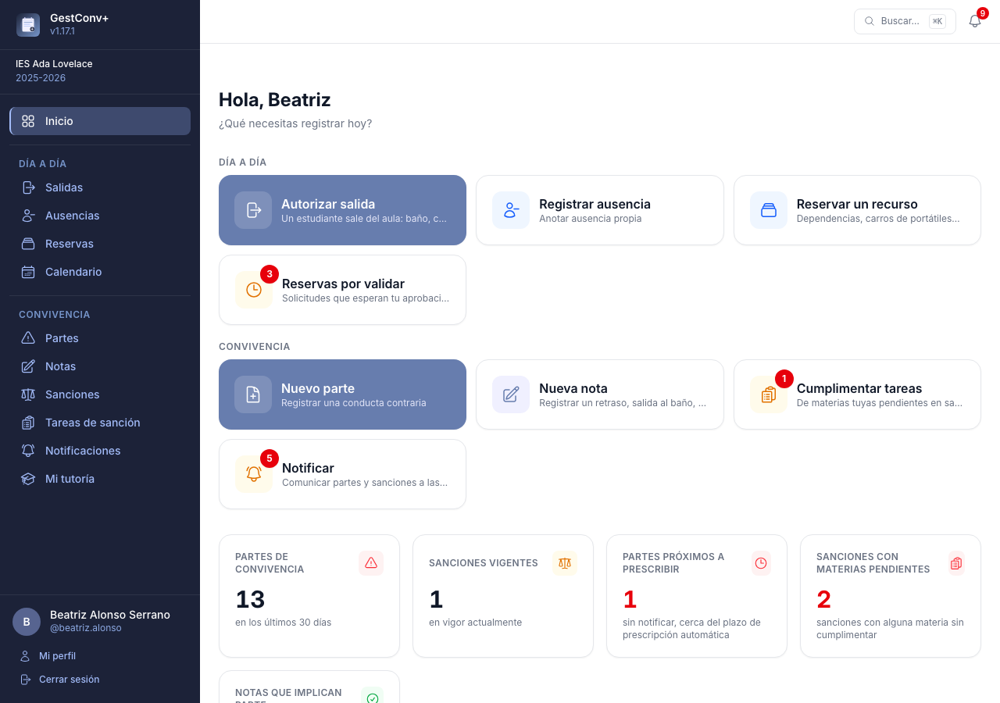

# Introducción

**GestConv+** es una aplicación web para gestionar la convivencia en centros de Educación
Secundaria Obligatoria, Bachillerato y Formación Profesional. Centraliza el registro de partes de
convivencia, la tramitación de sanciones, la comunicación con las familias y el seguimiento del
historial de cada estudiante.

## El ciclo de la convivencia

Todo el trabajo en GestConv+ gira en torno a un mismo ciclo:

1. **Un docente registra un parte** cuando se produce un incidente.
2. **Se informa a la familia** del parte y se deja constancia de esa comunicación.
3. **La comisión de convivencia registra la sanción**, si procede, a partir de uno o varios
   partes ya comunicados a la familia; la sanción también se comunica.
4. **La sanción aparece en el calendario y en el tablón** del centro durante sus fechas de
   vigencia, para que todo el claustro la tenga presente.

La regla más importante del ciclo: **sin comunicación a la familia no hay sanción posible**, y un
parte que pasa demasiado tiempo sin comunicarse acaba prescribiendo.

## Quién es quién

- **Docente** — registra partes de convivencia y comunica los suyos a las familias.
- **Tutor/a de grupo** — además, ve los partes y sanciones de su grupo y puede comunicarlos.
- **Comisión de convivencia** — ve todos los partes del centro y registra las sanciones.
- **Orientador/a** — consulta todos los partes y sanciones del centro, sin poder editarlos.
- **Coordinación de actividades** — gestiona todas las actividades de centro (calendario y tablón)
  como si fuera administradora.
- **Responsable de una categoría de recursos** — gestiona las reservas de los recursos compartidos
  (aulas, carros de portátiles…) de su categoría y, si se le pide, las valida.
- **Administración del centro** — configura el centro y tiene acceso completo a sus datos. Este
  papel corresponde, normalmente, al **equipo directivo**.
- **Administración de la plataforma** — mantiene el servidor y puede gestionar todos los centros
  alojados en él.

El detalle completo de lo que puede hacer cada perfil está en
[Permisos de un vistazo](15-permisos-de-un-vistazo.md).

## Acceso a la aplicación

Solo el profesorado registrado puede acceder, con usuario y contraseña propios o mediante
autenticación externa (iSéneca). Un mismo servidor puede alojar **varios centros educativos** con
datos completamente separados; quien pertenece a más de un centro elige con cuál trabajar al
entrar y puede cambiar de centro en cualquier momento desde el menú lateral.

## Cómo usar este manual

No hace falta leerlo de principio a fin; cada persona puede ir directamente a lo que necesita:

- **¿Acabas de empezar a usar la aplicación?** Empieza por [Usar la aplicación](03-usar-la-aplicacion.md):
  el menú, la pantalla de inicio, la búsqueda y el uso desde el móvil.
- **¿Eres docente o tutor/a?** Para los partes, las notas y la comunicación con las familias, ve a
  [Convivencia: el trabajo del profesorado](04-convivencia-profesorado.md). Después, el capítulo del
  módulo que uses: [Salidas del aula](07-salidas.md),
  [Ausencias y guardias](08-ausencias-y-guardias.md), [Reservas de recursos](09-reservas.md),
  [Incidencias](10-incidencias.md) o [Calendario, actividades y tablón](11-calendario-actividades-y-tablon.md).
- **¿Formas parte de la comisión de convivencia?** Tu capítulo es
  [Convivencia: la comisión y las sanciones](05-convivencia-comision.md).
- **¿Formas parte del equipo directivo?** Empieza por
  [Preparar el curso académico](02-preparar-el-curso-academico.md) y consulta
  [Administrar el centro educativo](12-administrar-el-centro.md) y, para configurar cada módulo, el
  apartado de configuración de su capítulo (por ejemplo,
  [Convivencia: la administración](06-convivencia-administracion.md)).
- **¿Vas a instalar la aplicación o mantener el servidor?** Los capítulos
  [Instalación y puesta en marcha](01-instalacion-y-puesta-en-marcha.md) y
  [Administrar la plataforma](13-administrar-la-plataforma.md) son los únicos con contenido
  técnico. Si tu centro ya tiene GestConv+ en marcha, puedes saltártelos por completo. Los anexos
  de despliegue detallan cada forma de instalar: [Plesk](18-despliegue-en-plesk.md),
  [Ubuntu Server paso a paso](19-ubuntu-instalacion-manual.md),
  [despliegue continuo](20-despliegue-continuo.md) y
  [Cloudflare Tunnel](21-cloudflare-tunnel.md).

## Sobre el proyecto

GestConv+ es software libre, publicado bajo licencia [AGPL-3.0](http://www.gnu.org/licenses/agpl.html)
y desarrollado con [Symfony](https://symfony.com). El código fuente, las incidencias y las nuevas
versiones se publican en
**[github.com/reasol-edu/gestconv-plus](https://github.com/reasol-edu/gestconv-plus)**.

Forma parte del proyecto de innovación educativa REASOL (PIN-219/23 y PIN-354/24), financiado
por la Consejería de Desarrollo Educativo y Formación Profesional de la Junta de Andalucía.
